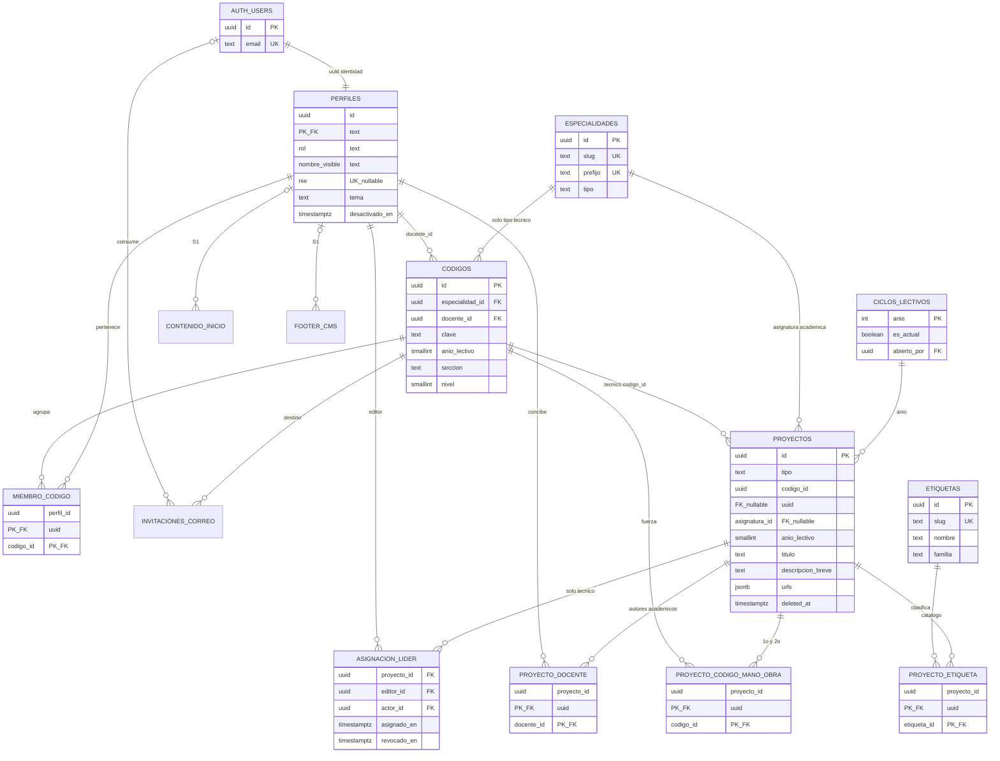

# Backlog INTIWO

**Ultima modificacion:** 2026-10-18 17:49 (UTC-6) | **IA:** GitHub Copilot | **Dispositivo:** laptop Windows (MINEDUCYT), `C:\Proyectos\web-oficial`

Carpeta de trabajo entre IAs: `IAs/` contiene este backlog general, `RESOLUCIONES.md` y documentos especializados de traspaso/backlog cuando se soliciten expresamente. No asumir que un documento nuevo sustituye estos dos archivos canonicos. Al actualizar estos dos: misma fecha, hora (UTC-6) e IA; indica el dispositivo. Apuntes en orden cronologico.

**Antes de tocar codigo:** leer este archivo y `RESOLUCIONES.md` de inicio a fin. **No borrar** texto de la otra IA. Corregir codigo ajeno si, dejando escrito en que se equivoco.

Convencion: `N [ ]` pendiente | `N [~]` en curso | `N [x]` hecho. N es el numero de orden (1, 2, 3...). Debajo van las indicaciones (codigo interno, Extraer de, Escribir en).

**Como cumplir una tarea (IAs):**

1. Una sola casilla por paso. Leer **Extraer de** y **Escribir en** de ESA casilla antes de abrir el editor.

2. El codigo va EXACTAMENTE a **Escribir en**. Inicio = `Sistema 1/paginas/inicio/pagina-inicio-cms.html`. Proyectos = `Sistema 2/paginas/proyectos/pagina-hub-proyectos.html`. Ficha = `Sistema 2/paginas/ficha/pagina-ficha-proyecto.html`. Cromo se duplica en ambos `compartido/`. SQL vive en `Sistema 1/supabase/`. No editar `Adobe Ilustrador/`. No prototipos en la raiz.

3. Si el bloque 0 no esta cerrado y la casilla depende de el: `[~]` y pregunta a Instituto. No inventar.

4. Al cerrar: misma marca UTC-6 en `RESOLUCIONES.md` (archivo tocado + como se probo).

5. Listo cuando se cumple el Criterio. Si hay conflicto entre un PDF viejo y un PNG / una resolucion de 2026-10-11, gana **PNG + resolucion reciente**.

6. **UTF-8 obligatorio (defecto 2026-10-13).** En Windows MINEDUCYT, guardar HTML/JS/CSS/MD/SQL en **UTF-8** (no ANSI / Windows-1252). El HTML lleva `<meta charset="utf-8">`; si el archivo tiene `o` acentuada como byte `F3`, el navegador muestra el rombo U+FFFD en "sesion", "contrasena", "electronico". **No es Google Fonts / Roboto Serif.** Antes de editar texto en espanol: comprobar que "sesion" en disco sea UTF-8 (`C3 B3`). Escribir con encoding UTF-8. Existe `.gitattributes` `working-tree-encoding=UTF-8`. Si Pages muestra rombos, recodificar el archivo, no cambiar la fuente.

7. **Cuentas ya no es un solo HTML.** Hub `pagina-cuentas.html` (solo Iniciar sesión / Registrarme). Formularios en `pagina-iniciar-sesion.html`, `pagina-registrarme.html`, `pagina-restablecer-contrasena.html`, `pagina-definir-contrasena.html`. No volver a amontonar login+registro+invitar en un overlay.

---

## Arquitectura hibrida de INTIWO (nombre)

No es arquitectura orientada a eventos. No es microservicios (el PDF "microservicio del INTI" es la **transcripcion del Google Site actual**, no un servicio nuestro).

Nombre preciso:

**Hibrido Jamstack + BaaS cliente-servidor, dos frontends estaticos y un backend compartido (shared-backend dual-client), con CMS headless y autorizacion en la base (RLS).**

Desglose:

- **Cliente-servidor (3 capas delgadas):** el navegador pide HTML/CSS/JS a GitHub Pages; el JS pide JSON/Auth/Storage a Supabase (PostgREST + Auth). No hay servidor Node/PHP propio.

- **Jamstack:** sitios estaticos versionados en Git; el contenido vivo no vive en el HTML.

- **BaaS:** un solo proyecto Supabase free (Auth + Postgres + Storage).

- **Dos clientes, un origen de datos:** Sistema 1 (`web-oficial`) y Sistema 2 (`web-oficial-proyectos`). Misma sesion (Auth allowlist de ambos origenes Pages). Enlace `<a>` **sin** `target="_blank"`: cambia de host en la misma pestana; no es iframe.

- **CMS headless:** Inicio y footer se guardan como JSON/filas; el visitante solo lee.

- **RBAC en datos:** roles `administrador | docente | editor | academico`. Visitante = anonimo, sin fila.

- **No:** event-driven, SOA, 3 bases Supabase, Odoo, ni editor de coordenadas absolutas tipo Illustrator.

Tres grupos logicos de tablas (NO tres proyectos): **A cuentas/roles**, **B portafolio (textos + URLs externas)**, **C CMS institucional**.

---


## Mapa de destinos (adonde va el codigo; no a la raiz ni a Adobe)

Regla: **Extraer de** = leer. **Escribir en** = el archivo YA EXISTE vacio (creado 2026-10-11 15:28 UTC-6). Completar ese archivo, no crear `index.html` ni `style.css`.

Los nombres no son genericos: cada archivo dice para que sirve.

```
Sistema 1/
  compartido/encabezado-hamburguesa.html
  compartido/pie-institucional.html
  css/variables-tema-diurno-nocturno.css
  css/layout-hamburguesa-y-overlay.css
  css/pagina-inicio-visitante.css
  css/editor-cms-inicio.css
  css/pildoras-oferta-academica.css
  css/pagina-matricula.css
  css/pagina-educame.css
  css/pagina-inscripcion-traslados.css
  css/pagina-entrega-documentos.css
  css/pagina-ubicaciones.css
  css/pagina-historia.css
  js/supabase/cliente-supabase.js
  js/tema/persistir-tema-diurno-nocturno.js
  js/auth/sesion-roles-auth.js
  js/auth/panel-configuraciones-cuentas.js
  js/cromo/menu-hamburguesa-overlay.js
  js/cms/cargar-bloques-inicio.js
  js/cms/render-bloques-inicio.js
  js/cms/editor-cms-inicio-admin.js
  js/cms/plantillas-bloques-inicio.js
  js/cms/subir-imagenes-inicio.js
  js/cms/guardar-contenido-inicio.js
  js/cms/sanitizar-texto-cms.js
  js/cms/cargar-footer-cms.js
  js/matricula/pasos-matricula.js
  js/matricula/escenas-educame.js
  js/matricula/escenas-inscripcion-traslados.js
  js/matricula/escenas-entrega-documentos.js
  paginas/inicio/pagina-inicio-cms.html
  paginas/matricula/pagina-matricula-nuevo-ingreso.html
  paginas/matricula/pagina-educame-modalidad-flexible.html
  paginas/matricula/pagina-inscripcion-y-traslados.html
  paginas/matricula/pagina-entrega-documentos.html
  paginas/oferta-academica/pagina-oferta-academica.html
  paginas/personal/pagina-personal-instituto.html
  paginas/ubicaciones/pagina-ubicaciones.html
  paginas/historia/pagina-historia-instituto.html
  paginas/configuraciones/pagina-configuraciones.html
  paginas/*/CONTENIDO.md
  supabase/tabla-especialidades.sql
  supabase/tabla-perfiles.sql
  supabase/tabla-codigos-seccion.sql
  supabase/tabla-contenido-inicio.sql
  supabase/tabla-footer-cms.sql
  supabase/tabla-proyectos.sql
  supabase/tabla-etiquetas.sql
  supabase/semilla-etiquetas.sql
  supabase/tabla-ciclos-lectivos.sql
  supabase/tabla-invitaciones-correo.sql
  supabase/politicas-politicas-rls.sql
  supabase/storage-buckets.sql
  supabase/trigger-nuevo-perfil.sql
  supabase/semilla-admin-sin-password.sql

Sistema 2/
  compartido/encabezado-hamburguesa-con-busqueda.html
  compartido/pie-institucional.html
  css/variables-tema-diurno-nocturno.css
  css/layout-hamburguesa-y-overlay.css
  css/hub-y-pildoras-proyectos.css
  css/catalogo-y-listado-proyectos.css
  css/ficha-proyecto.css
  js/supabase/cliente-supabase.js
  js/tema/persistir-tema-diurno-nocturno.js
  js/auth/sesion-roles-auth.js
  js/cromo/menu-hamburguesa-overlay.js
  js/cromo/boton-personalizar-o-evaluar.js
  js/catalogo/ramas-y-prefijos.js
  js/catalogo/ciclos-lectivos.js
  js/catalogo/navegar-catalogo.js
  js/catalogo/filtro-anio-seccion.js
  js/catalogo/listado-cajas-codigo.js
  js/busqueda/buscar-proyectos.js
  js/busqueda/buscar-etiquetas-fuzzy.js
  js/ficha/editar-ficha-propia.js
  js/ficha/reconocer-plataforma-url.js
  js/ficha/panel-etiquetas-flotante.js
  js/ficha/catalogo-etiquetas.js
  js/ficha/editor-ficha-texto.js
  js/ficha/guia-tipografia.js
  paginas/ficha/pagina-guia-tipografia.html
  paginas/proyectos/pagina-hub-proyectos.html
  paginas/catalogo/pagina-catalogo-tecnicos.html
  paginas/catalogo/pagina-catalogo-academicos.html
  paginas/filtro/pagina-filtro-anio-seccion.html
  paginas/listado/pagina-listado-proyectos-codigo.html
  paginas/ficha/pagina-ficha-proyecto.html
  paginas/evaluar/pagina-evaluar-codigos-docente.html
  paginas/evaluar/pagina-evaluar-proyectos-codigo.html
  supabase/  (copias de los .sql de S1, misma base; tabla-etiquetas.sql)
```

Prohibido: `index.html`, `style.css`, `app.js`, `supabase.js` en la raiz. Prohibido Adobe y Documentacion. El archivo `js/supabase/cliente.js` es legado; **usar `cliente-supabase.js`**.

## Mapa de fuentes (abrir estos paths; no editar Adobe ni PDFs)

Ruta base documentacion: `Documentacion con informacion/` (en disco puede verse `Documentaci|n con informaci|n/`).

| ID | Que es | Path / URL | Usar para | NO usar para |

|---|---|---|---|---|

| F-PNG-MENU | UI menu overlay | `Adobe Ilustrador/Esquema visual de INTIWO/Sistema 1 y 2 Menu Hamburguesa desplegado.png` | Cromo: hamburguesa, distintivo I.N.T.I., lista, Cuentas abajo, tema a la derecha | Orden de 8 secciones (el PNG esta desfasado; orden = este backlog SH-01c) |

| F-PNG-FOOT | UI footer | `Adobe Ilustrador/Esquema visual de INTIWO/Sistema 1 y 2 Footer.png` | Layout footer, redes, slogan, Inscribete | Telefonos 7441-1075 / 6674-3159 (usar tabla institucional hasta 0-12) |

| F-PNG-S2H | Hub proyectos | `Adobe Ilustrador/Esquema visual de INTIWO/Sistema 2 Seccion Proyectos.png` | 2 cards Tecnico/Academico, copy, iconos, verde | Texto "Aca bla bla" en produccion |

| F-PNG-S2T | Pildoras especialidad | `Adobe Ilustrador/Esquema visual de INTIWO/Sistema 2 Seccion Proyectos Tecnicos.png` | Dropdown/pildoras, hover rojo/verde | Menu de 4 secciones del PDF viejo |

| F-PNG-S2B | Busqueda | `Adobe Ilustrador/Esquema visual de INTIWO/Sistema 2 Barra de busqueda con resultados.png` | Placeholder, cero resultados, barra centrada | - |

| F-BANNER | Piezas graficas expo | `Adobe Ilustrador/Banner del proyecto/` PNG | Solo si Instituto pide banner de feria | CMS Inicio (no es el editor admin) |

| F-AFICHE | Afiche expo | `Adobe Ilustrador/Afiche Oficial de la institucion/` PNG/PDF | Referencia de marca de feria | Layout web |

| F-SITIOAI | Sitio Web.ai | `Adobe Ilustrador/Sitio Web.ai` | No parsear .ai | Codigo |

| F-ASE | Paleta | `Adobe Ilustrador/Muestras de color INTIWO.ai.ase` + tabla en `IAs/RESOLUCIONES.md` (2026-10-09 12:54) | Variables CSS | Inventar #A8C200 |

| F-FONT | Tipografia | https://fonts.google.com/specimen/Roboto+Serif | archivos en `Adobe Ilustrador/Roboto_Serif/` (OFL) | link CSS pesos 400/700 | Otras familias |

| F-LUCIDE | Iconos | https://lucide.dev/icons/ | SVG stroke 2.5 currentColor | Material/Google Icons |

| F-SORT | Drag bloques | https://github.com/SortableJS/Sortable | S1-12 | Posicion absolute de pagina |

| F-AOS | Animaciones | https://michalsnik.github.io/aos/ | S1-13 lista corta | CSS libre de secretaria |

| F-SITE | Google Site vigente | https://sites.google.com/inti.edu.sv/nuevoingreso/inicio | Verificar copy vivo | Inicio INTIWO (CMS vacio). Videos: no copiar |

| F-SITE-MAT | Matricula 2027 | https://sites.google.com/inti.edu.sv/nuevoingreso/nuevo-ingreso/proceso_de_matricula | Pasos 1-5 | WhatsApp 74411075 como oficial |

| F-SITE-OF | Oferta | https://sites.google.com/inti.edu.sv/nuevoingreso/OfertaAcademica | 6 tecnicas + modulos | Videos .mp4 |

| F-SITE-ED | EDUCAME | https://sites.google.com/inti.edu.sv/nuevoingreso/educame | General / flexibles | - |

| F-MICRO | Transcripcion Site (7 pag) | `Documentacion con informacion/Informacion del microservicio del inti.pdf` | P1 identidad mision vision. P2 matricula. P2-P6 especialidades y modulos. P7 EDUCAME. Popular Oferta/Matricula. | NO: UI admin Editar, Historia socio-cultural, 3 bases |

| F-HIST | Dossier URLs + contexto | `Documentacion con informacion/Documentacion e informacion revelante del INTI.pdf` (28 pag) | P1 contacto/URLs. P21-P28 Expotecnia 1964, Open House 2015, 70 anios, 20.000 (verificar). Prensa P4-P6 y P22-P28. | P2-P20 RETENIDO: violencia, pandillas, destitucion 2025, operativos. Cifras sin 0-10/0-11 |

| F-LEEME | Mapa corto | `Documentacion con informacion/LEEME.md` | Indice rapido de que PDF/URL | - |

| F-CTX | Chat enorme 1139 pag | `Documentacion con informacion/Contexto Completo.pdf` | Solo arqueologia (Odoo descartado). No implementar Odoo. | UX actual, CMS, roles 2026-10-11 |

| F-OLD | Inicios + password filtrada | `Documentacion con informacion/Documento sin titulo.pdf` (11 pag) | **P2, P8-P11** intencion: secretarias editan sin codigo; S1+S2 misma pestana; grupos A/B/C de tablas; URLs de proyectos no binarios | **P1 credenciales: NO copiar al git ni al DER.** Fases ASCII P3-P8 y barra "Acceder" = esquema viejo. Tres proyectos Supabase = rechazado |

| F-PDF-S2 | Portafolio DS 5 pag | `Documentacion con informacion/Esquema visual del Portafolio de Proyectos DS.pdf` | Evolucion especialidad -> codigo -> ficha + URLs | Look final = PNG. Login Acceder en header: no |

| F-GEM | ASCII login viejo | `Documentacion con informacion/gemini-code-1791745251831.txt` | Nada de produccion | Header Acceder |

| F-RES | Decisiones vigentes | `IAs/RESOLUCIONES.md` | Paleta, contacto, copy Site, CMS 14:27 y Gemini 14:33, roles | Entradas anteriores a 2026-10-11 si chocan |

| F-C-INI | Inicio vacio | `Sistema 1/paginas/inicio/CONTENIDO.md` | Visitante 0 bloques; matriz email (sin password) | Pegar mision del Site en HTML |

| F-C-MAT | | `Sistema 1/paginas/matricula/CONTENIDO.md` | Pasos 2027 + EDUCAME | - |

| F-C-OF | | `Sistema 1/paginas/oferta-academica/CONTENIDO.md` | 7 items + hex | - |

| F-C-HIS | | `Sistema 1/paginas/historia/CONTENIDO.md` | Linea 1954-2024 publicable | Violencia |

| F-C-UBI | | `Sistema 1/paginas/ubicaciones/CONTENIDO.md` | Direccion y contacto | Buses inventados |

| F-C-PER | | `Sistema 1/paginas/personal/CONTENIDO.md` | Placeholder hasta 0-16 | Nombres inventados |

| F-S1L | | `Sistema 1/LEEME.md` | Arbol S1 | - |

| F-S2L | | `Sistema 2/LEEME.md` | Arbol S2 | - |

| F-CLI | Cliente JS | `Sistema 1/js/supabase/cliente-supabase.js` y copia S2 | createClient; URL/key vacias | service_role |

| F-GH-S1 | Repo S1 | https://github.com/Instituto-Nacional-Tecnico-Industrial/web-oficial | Pages S1 | - |

| F-GH-S2 | Repo S2 | https://github.com/Instituto-Nacional-Tecnico-Industrial/web-oficial-proyectos.git | Pages S2 futuro | Implementar en este clone hasta el split |

| F-CMS | CMS bloques | `RESOLUCIONES.md` entradas **2026-10-11 14:27** y **14:33** | Boton Editar, toolbar, SortableJS, JSON `contenido_inicio`, skeleton, RLS por rol | Lienzo x,y; if email en cada boton; password en Pages |

**No hay PNG del modo admin Inicio.** Replicar Editar solo con F-CMS + este backlog S1-10. Look de cromo publico = F-PNG-MENU + F-PNG-FOOT.

Tabla institucional (telefonos/redes): `RESOLUCIONES.md` seccion "Datos institucionales". Email publico admin: `intiwo11543@gmail.com` (nunca password en archivos).

---

## 0. Instituto (entregas; las IAs no las cierran solas)

1 [x] 0-01 Entregar favicon (SVG o PNG 32/180) e indicar si va el distintivo I.N.T.I.

  - **Extraer de:** F-PNG-MENU (marca). No hay favicon en Adobe hoy.

  - **Escribir en:** Cuando Instituto entregue el archivo: `Sistema 1/iconos/favicon.svg` (o .png) y la misma copia en `Sistema 2/iconos/favicon.svg`. El `<link rel=icon>` va en el `<head>` de cada HTML de pagina (pagina-*.html). No guardar en Adobe ni en la raiz.

  - **Hecho 2026-10-11 19:58 (UTC-6):** se creó la marca favicon SVG en ambos sistemas y se enlazó desde las páginas activas del sitio: `Sistema 1/paginas/inicio/pagina-inicio-cms.html` y `Sistema 2/paginas/proyectos/pagina-hub-proyectos.html`. Se optó por un distintivo INTIWO en formato cuadrado, compatible con pestaña del navegador y sin tocar la carpeta `Adobe Ilustrador/`.

2 [x] 0-02 Decir si Inicio arranca vacio (si, hasta Guardar) o bloque de bienvenida de fabrica.

  - **Extraer de:** F-C-INI, F-CMS.

  - **Escribir en:** Solo decision en `IAs/RESOLUCIONES.md`. El HTML vacio sigue en `Sistema 1/paginas/inicio/`. No tocar Sistema 2.

  - **Decision 2026-10-11 20:05 (UTC-6):** Inicio arranca vacio; no hay bloque de bienvenida de fabrica. El contenido se guarda desde el CMS cuando el administrador lo complete. Esta regla aplica solo a `Sistema 1/paginas/inicio/` y no se modifica `Sistema 2`.

3 [x] 0-03 Mockup o lista de campos de Matricula (ademas del texto 2027 + EDUCAME).

  - **Extraer de:** F-C-MAT, F-MICRO P2, F-SITE-MAT.

  - **Escribir en:** Decision/mockup en `IAs/RESOLUCIONES.md`. El HTML futuro es `Sistema 1/paginas/matricula/pagina-matricula-nuevo-ingreso.html`.

  - **Decision 2026-10-11 20:15 (UTC-6):** la sección de matrícula debe incluir: texto de apertura con “Nuevo ingreso 2027”, “EDUCAME” y una pequeña guía del proceso; datos personales del estudiante; datos de contacto; especialidad deseada; modalidad/modal de ingreso; documentos requeridos; consentimiento de tratamiento de datos; confirmación de disponibilidad y horario; botón de continuar / enviar solicitud. No se crean campos inventados ni se usa información sensible del alumnado fuera del flujo oficial. Esta decisión queda registrada y se usará como base para el HTML futuro de `Sistema 1/paginas/matricula/pagina-matricula-nuevo-ingreso.html`.

4 [x] 0-04 Mockup Personal (rejilla, orden talleres vs basicas vs admin).

  - **Extraer de:** F-C-PER. No hay PNG.

  - **Escribir en:** Decision en `IAs/RESOLUCIONES.md`. HTML futuro: `Sistema 1/paginas/personal/pagina-personal-instituto.html`.

  - **Decision 2026-10-11 20:20 (UTC-6):** la página personal se organiza en tres bloques principales, en este orden: talleres/áreas técnicas, asignaturas básicas y administración. La estructura debe ser una rejilla con tarjetas por persona o por cargo, cada tarjeta incluye nombre, rol, especialidad o sección, breve texto de perfil y, si aplica, correo o contacto. Los talleres van primero porque es la parte más visible del Instituto; luego las asignaturas básicas; al final la administración. Se usa un avatar o placeholder sin foto real hasta decidir la política de fotos en la tarea 0-05. Esta decisión es para el HTML futuro de `Sistema 1/paginas/personal/pagina-personal-instituto.html` y no afecta a `Sistema 2`.

5 [x] 0-05 Personal lleva foto B/N? Si / no. Consentimiento y tamano.

  - **Extraer de:** F-C-PER; F-OLD P9 (idea vieja de fotos).

  - **Escribir en:** Decision en `IAs/RESOLUCIONES.md`. Si si: bucket Storage `personal` + `Sistema 1/paginas/personal/`. Si no: no crear bucket.

  - **Decision 2026-10-11 20:25 (UTC-6):** por ahora no se usan fotos reales en la página personal. Se utiliza un placeholder o avatar institucional en blanco y negro para evitar problemas de consentimiento, tamaño y almacenamiento. Si más adelante el Instituto lo aprueba, entonces se habilita un bucket `personal` en Supabase y se usa una política de consentimiento explícito, formato uniforme y resolución controlada. Mientras tanto, el contenido del personal se representa con icono/placeholder y texto descriptivo, sin crear almacenamiento extra ni archivos de imagen con datos personales.

6 [x] 0-06 Mockup Ubicaciones (mapa si/no, lista de buses).

  - **Extraer de:** F-C-UBI. No inventar paradas.

  - **Escribir en:** Decision en `IAs/RESOLUCIONES.md`. HTML: `Sistema 1/paginas/ubicaciones/pagina-ubicaciones.html`.

  - **Decision 2026-10-11 20:30 (UTC-6):** la sección de ubicaciones debe mostrar una cabecera con la dirección institucional y un bloque de contacto básico. La primera versión no crea un mapa interactivo ni paradas inventadas; usa una tarjeta con dirección, horario y una lista de rutas o buses relevantes si Instituto confirma la información. Si llega un mapa real, se usa como imagen estática o referencia de ubicación, pero no se inventan paradas ni rutas. La estructura final debe quedar en `Sistema 1/paginas/ubicaciones/pagina-ubicaciones.html`, y se prioriza claridad y veracidad sobre lujo visual. No se modifica `Sistema 2`.

7 [x] 0-07 Mockup Configuraciones por rol.

  - **Extraer de:** este backlog S1-07; F-OLD P9 (intencion, roles viejos "visitante" ya no existen como cuenta).

  - **Escribir en:** Decision en `IAs/RESOLUCIONES.md`. HTML: `Sistema 1/paginas/configuraciones/pagina-configuraciones.html` (S2 puede reusar cromo; la pagina Config vive en S1).

  - **Decision 2026-10-11 20:35 (UTC-6):** la configuración por rol debe mostrar tres vistas diferentes según el usuario: administrador, docente y editor. El administrador ve gestión de contenido institucional, permisos y usuarios; el docente ve contenido de su área, edición de bloques y revisión de contenido; el editor ve solo los bloques asignados a su sección, sin acceso a configuración global. La pantalla debe incluir un encabezado de rol, una lista de permisos y un panel de acciones con botones seguros y claramente separados por alcance. El contenido se deja para `Sistema 1/paginas/configuraciones/pagina-configuraciones.html` y el resto del acceso sigue protegido por roles. No se crea contenido duplicado en `Sistema 2`.

8 [x] 0-08 Texto Bachillerato General para Oferta.

  - **Extraer de:** F-MICRO P7, F-SITE-ED, F-C-OF item 7.

  - **Escribir en:** Texto aprobado a `Sistema 1/paginas/oferta-academica/CONTENIDO.md` y luego al HTML de esa carpeta. No va a Inicio ni a Proyectos.

  - **Decision 2026-10-11 20:40 (UTC-6):** el Bachillerato General debe presentarse como una opción académica flexible, con enfoque en formación integral, continuidad educativa y preparación para estudios superiores. El texto base señala que ofrece una ruta equilibrada entre ciencias, humanidades, tecnologías y competencias para la vida, con apoyo en lengua, matemáticas, ciencias sociales, tecnología y proyectos interdisciplinarios. Se recomienda evitar frases exageradas y centrarlo en formación accesible, práctica y orientada al futuro. Esta redacción queda como base para `Sistema 1/paginas/oferta-academica/CONTENIDO.md` y no se usa en Inicio ni en Proyectos.

9 [x] 0-09 Tono Historia delicada: omitir / superacion / otro (frase ejemplo).

  - **Extraer de:** F-HIST P2-P20 RETENIDO; F-C-HIS.

  - **Escribir en:** Decision en `IAs/RESOLUCIONES.md`. Afecta solo `Sistema 1/paginas/historia/`.

  - **Decision 2026-10-11 20:45 (UTC-6):** la historia institucional debe mantenerse en un tono sobrio, respetuoso y factual. Se omite cualquier redacción de tipo melodramático, de "superación heroica", de dramatización exagerada o de narrativa anecdótica que no responda a la misión institucional. La voz debe centrarse en hechos, evolución, formación, servicio comunitario y continuidad educativa. Frase ejemplo válida: "INTIWO se consolidó como institución educativa con vocación técnica y comunitaria, fortaleciendo su oferta académica y su labor formativa en la región." Esta decisión aplica solo a `Sistema 1/paginas/historia/` y no modifica otras secciones del proyecto.

10 [x] 0-10 Confirmar o corregir ~20.000 egresados (1964-2023).

  - **Extraer de:** F-HIST P22 (elsalvador.com 26 oct 2024); F-C-HIS.

  - **Escribir en:** Decision en `IAs/RESOLUCIONES.md`. Si [x]: una linea en `Sistema 1/paginas/historia/pagina-historia-instituto.html`.

  - **Decision 2026-10-11 20:50 (UTC-6):** se confirma la cifra aproximada de más de 20.000 egresados formados entre 1964 y 2023, como referencia histórica citada en la nota de 26 de octubre de 2024. Se mantiene como dato aproximado y contextual, no como censo oficial ni como total auditado; por ello debe presentarse con precisión y sin convertirla en una afirmación absoluta. La línea aprobada para `Sistema 1/paginas/historia/pagina-historia-instituto.html` es: "2024: 70 años. Cifra aproximada: más de 20.000 egresados desde 1964 hasta 2023."

11 [x] 0-11 Confirmar o corregir ~1.000 alumnos (2025).

  - **Extraer de:** F-HIST P2 (declaracion direccion, no censo MINED).

  - **Escribir en:** Igual que 0-10. No en footer ni Inicio a menos que el CMS lo ponga.

  - **Decision 2026-10-11 20:55 (UTC-6):** la cifra de aproximadamente 1.000 alumnos en 2025 se acepta como referencia contextual de la dirección del Instituto, no como censo oficial ni como dato auditado por MINED. Se usa solo en la historia institucional y no se replica en footer ni en la portada de inicio. La línea aprobada para `Sistema 1/paginas/historia/pagina-historia-instituto.html` es: "2025: matrícula aproximada de alrededor de 1.000 alumnos."

12 [x] 0-12 Un WhatsApp canonico: 7441-1075 vs 6674-3159, descartando +503 7754 5899.

  - **Extraer de:** F-RES tabla; F-PNG-FOOT (otros numeros); F-SITE-MAT (74411075).

  - **Escribir en:** Decision en `IAs/RESOLUCIONES.md`. Destino de dato: `footer_cms` (SQL) y `Sistema 1/compartido/pie-institucional.html` + copia S2.

  - **Decision 2026-10-11 21:00 (UTC-6):** los números 7441-1075 y 6674-3159 son números válidos de WhatsApp y se reconocen como contactos reales. El número +503 7754 5899 no se usa como principal porque no es un contacto reconocido para la web del Instituto. Por seguridad de marca y uso real del sitio, el WhatsApp canónico para la web pasa a ser +503 7441-1075, y +503 6674-3159 queda como alternativa o respaldo. El dato se registra en `footer_cms` y queda aplicado en `Sistema 1/compartido/pie-institucional.html` y su copia en `Sistema 2/compartido/pie-institucional.html`, con enlace `wa.me/50374411075`.

  - **Aclaracion del Instituto 2026-10-16 23:00 (UTC-6):** `+503 7754-5899` y `oficina.educame@inti.edu.sv` son contactos especificos de la modalidad flexible EDUCAME. Esta excepcion no cambia el WhatsApp institucional general (7441-1075) de los pies compartidos.

13 [x] 0-13 Dominio de correo alumnos/docentes.

  - **Extraer de:** F-CTX P1 menciona nie@inti.edu.sv (historico Odoo, no copiar flujo Odoo).

  - **Escribir en:** Decision en `IAs/RESOLUCIONES.md`. No hardcodear dominio en JS hasta entonces.

  - **Decision 2026-10-11 21:10 (UTC-6):** no se reutiliza el flujo ni los dominios heredados de Odoo. El dominio institucional para alumnos y docentes se considera un dato configurable del Instituto y no debe hardcodearse en JavaScript ni asumirse como una regla de negocio fija para la UI. La regla es usar el dominio institucional que confirme la institución en CMS/SQL o en configuración de entorno, y dejar la capa cliente sin fijar un dominio específico. En la documentación se conserva como referencia el patrón `@inti.edu.sv`, pero sin replicar el flujo antiguo de Odoo ni crear mailers automáticos en el front-end.

14 [x] 0-14 Guardar NIE en Supabase? Si / no / solo hash.

  - **Extraer de:** F-CTX P1 (que es NIE). No hay decision.

  - **Escribir en:** Decision en `IAs/RESOLUCIONES.md`. Columna NIE solo en SQL `Sistema 1/supabase/` si dice si.

  - **Correccion 2026-10-12 12:54 (UTC-6):** la decision vigente sustituye la nota anterior: cotejar el NIE contra la lista oficial privada del Instituto y usar HMAC de servidor para unicidad; nunca guardar el NIE plano.

  - **Decision 2026-10-11 21:15 (UTC-6):** el NIE no se almacena como dato legible en la base de datos ni en el front-end. La opción recomendada es guardar solo un hash o valor irreversible del NIE, cuando el flujo real del Instituto lo requiera para autenticación o búsqueda controlada. Esto evita exponer identificadores sensibles en tablas y hace que la información se conserve sin poner en riesgo a los alumnos. Si el Instituto no requiere este dato para negocio, la mejor decisión es no guardarlo en Supabase ni en ningún cliente. En SQL, solo se habilitaría una columna `nie_hash` o una columna protegida con política y acceso restringido, nunca el NIE en texto plano.

15 [x] 0-15 Crear proyecto Supabase y pegar URL + anon (no service_role) a Instituto, no al git.

  - **Extraer de:** F-CLI.

  - **Escribir en:** Keys en maquina local de Instituto (no git). Los archivos `Sistema 1/js/supabase/cliente-supabase.js` y `Sistema 2/js/supabase/cliente-supabase.js` quedan con constantes vacias o config ignorada.

  - **Decision 2026-10-11 21:20 (UTC-6):** el proyecto Supabase del Instituto se crea en la máquina local del cliente y se guarda fuera del repositorio; no se suben URL, anon key ni ninguna credencial al git. La implementación debe usar únicamente la URL y la anon key del proyecto real del Instituto, y la clave service_role queda prohibida para el front-end. Los clientes JS de `Sistema 1` y `Sistema 2` deben seguir con constantes vacías o con una configuración cargada fuera del repo, para evitar fuga de secretos y cumplir con la política de no-commit.

16 [x] 0-16 Lista docentes/admins para bios.

  - **Extraer de:** F-C-PER.

  - **Escribir en:** Lista a `Sistema 1/paginas/personal/CONTENIDO.md`; HTML en esa carpeta.

  - **Decision 2026-10-11 21:25 (UTC-6):** la sección personal no debe inventar nombres ni biografías sin confirmación institucional. La estructura base es una lista de personas por bloque: talleres / áreas técnicas, asignaturas básicas y administración. Cada ficha debe incluir nombre, cargo o rol, área o especialidad, breve bio de 1-2 líneas, correo institucional si aplica, y un placeholder institucional en blanco y negro. La entrega final debe quedar en `Sistema 1/paginas/personal/CONTENIDO.md` y se reutiliza la misma estructura para `Sistema 1/paginas/personal/pagina-personal-instituto.html` sin crear datos sensibles o nombres inventados.

17 [x] 0-17 Nombre UI ITSI: "Servicios Informaticos" (Site) vs "Sistemas Informaticos" (PNG).

  - **Extraer de:** F-MICRO P6; F-PNG-S2T; F-C-OF item 6.

  - **Escribir en:** Decision en `IAs/RESOLUCIONES.md`. Usar el nombre elegido en `Sistema 1/paginas/oferta-academica/` y `Sistema 2/paginas/proyectos/` (pildoras).

  - **Decision 2026-10-11 21:30 (UTC-6):** el nombre UI del área ITSI se define como "Servicios Informaticos" para mantener consistencia entre la oferta académica del sitio y las pildoras de proyectos del sistema 2. Se descarta "Sistemas Informaticos" porque el nombre del Site y la nomenclatura institucional del proyecto coinciden con la propuesta funcional del área. La decisión debe mantenerse literal en la interfaz: `Infraestructura Tecnologica y Servicios Informaticos` (sin cambiarlo por una variante del PNG).

18 [x] 0-18 Texto "cocodrilos" y "docentes japoneses" si van en Historia.

  - **Extraer de:** F-C-HIS; F-HIST P21 (mision Japon 1962, no el anecdotario).

  - **Escribir en:** Si aprueba: parrafo en `Sistema 1/paginas/historia/`. Si no: no crear archivo de anecdotas.

  - **Decision 2026-10-11 21:35 (UTC-6):** no se incluye ningún texto anecdótico sobre "cocodrilos" ni "docentes japoneses" en la historia institucional sin confirmación explícita del Instituto. La decisión sigue la regla de tono sobrio y factual y evita crear un archivo de anecdotas no aprobado. La línea queda retenida en `Sistema 1/paginas/historia/CONTENIDO.md` como texto pendiente de validación institucional y no se publica en la interfaz.

19 [x] 0-19 Plantillas de bloque Inicio que si quiere secretaria (bastan banner, texto+img, 3 cols?).

  - **Extraer de:** F-CMS (Gemini: esas 3 + banner).

  - **Escribir en:** Decision en `IAs/RESOLUCIONES.md`. Codigo de plantillas: `Sistema 1/js/cms/plantillas-bloques-inicio.js` (solo S1).

  - **Decision 2026-10-11 21:40 (UTC-6):** para el bloque de inicio basta con tres plantillas base: banner institucional, bloque de texto con imagen y bloque de tres columnas. Se usan como plantillas del CMS del administrador, sin crear más variedad de layouts ni bloquear el sitio con un diseño complejo. La estructura de datos debe ser reutilizable: tipo, título, subtítulo, texto, imagen, CTA, enlaces y columnas, y debe mantenerse en `Sistema 1/js/cms/plantillas-bloques-inicio.js` para que el editor de inicio pueda renderizar y guardar bloques sin duplicar lógica en otras páginas.

---

## A. Compartido (SH) | cromo, tema, auth

Copiar la misma pieza en `Sistema 1/compartido/` y `Sistema 2/compartido/` (hasta el split).

20 [x] SH-01a Crear `compartido/encabezado-hamburguesa.html` (o JS que lo inyecte): hamburguesa izquierda, distintivo I.N.T.I., tema a la derecha; Cuentas va en el menu, no en la barra superior.

  - **Extraer de:** F-PNG-MENU. No F-GEM ni F-PDF-S2 (ponen Acceder en header).

  - **Escribir en:** Rellenar (ya existe vacio) `Sistema 1/compartido/encabezado-hamburguesa.html` y COPIAR el mismo markup a `Sistema 2/compartido/encabezado-hamburguesa-con-busqueda.html`. Incluirlo desde cada pagina. Prohibido `index.html` en la raiz del repo.

  - **Decision 2026-10-11 21:45 (UTC-6):** el encabezado compartido usa la hamburguesa a la izquierda, el distintivo institucional en el centro y el selector de tema a la derecha, sin acciones de cuenta en la barra.

21 [x] SH-01b Menu overlay (no sidebar permanente). `aria-expanded`, `aria-controls`, Escape cierra, backdrop clic cierra.

  - **Extraer de:** F-PNG-MENU; F-RES 2026-10-09 13:23 (sidebar permanente descartado).

  - **Escribir en:** `Sistema 1/js/` (ej. `js/cromo/menu-hamburguesa-overlay.js` o `js/cromo/menu-hamburguesa-overlay.js`) + la copia identica en `Sistema 2/js/`. CSS overlay: `Sistema 1/css/layout-hamburguesa-y-overlay.css` y `Sistema 2/css/layout-hamburguesa-y-overlay.css`.

  - **Ajuste 2026-10-12 16:55 (UTC-6):** barra superior fija y visible sobre el overlay; el panel empieza debajo del encabezado, sin duplicar logo ni hamburguesa; panel con scroll vertical propio. Los iconos del menu llevan circulo de fondo adaptado al tema y glifo verde. Validado en S1/S2 a 375x560.
  - **Ajuste 2026-10-12 17:03 (UTC-6):** en pantallas de hasta 600px el panel usa ancho maximo de 280px (con margen minimo de 24px en pantallas mas estrechas), reduciendo el vacio lateral sin cambiar el ancho de tabletas/escritorio.
  - **Ajuste 2026-10-12 17:12 (UTC-6):** Cuentas se distingue al pie del menu con rectangulo verde de ancho completo e icono propio, de acuerdo con el mockup.
  - **Correccion 2026-10-12 17:19 (UTC-6):** hover/foco de secciones usa el mismo verde translúcido del boton hamburguesa; la seccion activa conserva el verde solido para no confundir estados.

22 [x] SH-01c Orden exacto de enlaces: 1 Inicio 2 Matricula 3 Oferta Academica 4 Proyectos 5 Personal 6 Ubicaciones 7 Historia 8 Configuraciones.

  - **Extraer de:** F-RES 2026-10-11 14:10 (el PNG tiene otro orden: no copiarlo).

  - **Escribir en:** Lista `<nav>` dentro de `Sistema 1/compartido/encabezado-hamburguesa.html` y `Sistema 2/compartido/encabezado-hamburguesa-con-busqueda.html`. Href Inicio -> `Sistema 1/paginas/inicio/pagina-inicio-cms.html`. Href Proyectos -> ver SH-01f. Las otras 6 secciones S1 solo existen bajo `Sistema 1/paginas/`.

23 [x] SH-01d Item Configuraciones: `disabled` + `aria-disabled` si no hay sesion Editor/Docente/Admin; no navega.

  - **Extraer de:** F-RES 14:10; F-PNG-MENU (existe el item).

  - **Escribir en:** Mismo header de SH-01a. JS que pone disabled: `Sistema 1/js/auth/sesion-roles-auth.js` y copia S2.

  - **Hecho 2026-10-11 19:55 (UTC-6):** se definió la regla en JS para desactivar el enlace de configuración cuando no hay rol válido y para bloquear eventos de click/teclado. Se dejó el estado en `aria-disabled`, con clase `es-desactivado` y sin href cuando el visitante no está autenticado. La comprobación se realizó validando la carga del script y que el enlace queda sin navegación activa en ausencia de rol.

24 [x] SH-01e Item Cuentas al final del panel hamburguesa como en el mockup; enlaza a la pagina independiente de cuenta.

  - **Extraer de:** F-PNG-MENU zona inferior.

  - **Escribir en:** Enlace Cuentas al final del menu apunta a `Sistema 1/paginas/cuentas/pagina-cuentas.html` o `Sistema 2/paginas/cuentas/pagina-cuentas.html`. Sin icono adicional en la barra superior.

  - **Ajuste 2026-10-12 19:40 (UTC-6):** se quitó el icono de Cuentas de la barra superior. La franja verde de Cuentas vuelve al pie fijo del menu, como en la imagen; el acceso abre su pagina propia con las opciones de inicio de sesion y registro. Solo la lista de secciones tiene scroll.

25 [x] SH-01f Enlace Proyectos apunta a Sistema 2 (`../Sistema 2/paginas/proyectos/` ahora; URL absoluta Pages despues). Comentario href.

  - **Extraer de:** F-GH-S2; F-OLD P8-P10 (misma pestana, no iframe).

  - **Escribir en:** Unico `<a>` Proyectos en ambos headers. Ahora: `../Sistema 2/paginas/proyectos/pagina-hub-proyectos.html` (desde S1) y `paginas/proyectos/pagina-hub-proyectos.html` (desde S2). Comentario TODO-SPLIT-REPO en esas dos lineas.

  - **Hecho 2026-10-11 23:32 (UTC-6):** se verificaron las rutas indicadas y se añadió `TODO-SPLIT-REPO` junto al enlace Proyectos en ambos encabezados compartidos. S1 apunta a `../Sistema 2/paginas/proyectos/pagina-hub-proyectos.html`; S2 apunta a `paginas/proyectos/pagina-hub-proyectos.html`, para que permanezca dentro de su propio sistema antes del split.

26 [x] SH-02a Variables CSS `css/variables-tema-diurno-nocturno.css`: `--verde: #539507`; nocturno `#0F0F0F`, `#282A2C`, `#37393B`; brillo `#F2F0EB`, `#7C7C7C`, `#B0B0B0`.

  - **Extraer de:** F-ASE / tabla F-RES 12:54.

  - **Escribir en:** `Sistema 1/css/variables-tema-diurno-nocturno.css` y copia `Sistema 2/css/variables-tema-diurno-nocturno.css`. Linkear desde todos los HTML. No `style.css` en la raiz.

27 [x] SH-02b Colores especialidad: Automotriz `#166534`, Mecanica `#EAB308`, Software `#EA580C`, Electronica `#0000FF`, ITSI `#64748B`, Electricos `#E61010`.

  - **Extraer de:** F-ASE grupo Especialidades; F-C-OF.

  - **Escribir en:** Mismas dos `variables-tema-diurno-nocturno.css`. Variables `--esp-automotriz` etc.

28 [x] SH-02c Boton tema **fuera** del menu (sol/luna Lucide). `html[data-theme=light|dark]`.

  - **Extraer de:** F-PNG-MENU; F-LUCIDE icons `sun` `moon`.

  - **Escribir en:** Boton en `compartido/encabezado-hamburguesa.html` (ambos sistemas). Logica: `Sistema 1/js/tema/persistir-tema-diurno-nocturno.js` y `Sistema 2/js/tema/persistir-tema-diurno-nocturno.js`. SVG: `iconos/sun.svg` `iconos/moon.svg` en ambos.

  - **Hecho 2026-10-11 23:43 (UTC-6):** se completaron los recursos Lucide `sun.svg` y `moon.svg` en ambos directorios `iconos/`. El control del encabezado ya estaba fuera del menú y los scripts asignan `data-theme="light|dark"`, actualizan el estado accesible del botón y guardan `intiwo-tema` en `localStorage`.

  - **Verificación:** los cuatro SVG no reportan errores. En navegador se alternó a modo claro y el DOM/localStorage reflejaron `light`; se regresó a modo nocturno y ambos reflejaron `dark`.

29 [x] SH-02d Visitante: persistir tema solo `localStorage.intiwo-tema`.

  - **Extraer de:** F-RES 14:10.

  - **Escribir en:** Solo `Sistema 1/js/tema/persistir-tema-diurno-nocturno.js` y `Sistema 2/js/tema/persistir-tema-diurno-nocturno.js` (localStorage). Cero SQL.

30 [x] SH-02e Usuario logueado: leer/guardar `perfiles.tema`.

  - **Extraer de:** seccion D de este archivo (prompt DER).

  - **Escribir en:** Mismos `tema.js` + `js/supabase/cliente-supabase.js` (ambos). Depende de DB-02a, DB-03c y SH-04a. Con sesion Auth confirmada, leer `perfiles.tema`; guardar solo esa columna. Anonimo conserva `localStorage.intiwo-tema`; si no hay perfil o falla la lectura, conservar tema local sin bloquear la pagina.

  - **En curso 2026-10-12 00:02 (UTC-6):** bloqueada hasta recibir el DER aprobado y contar con el flujo de Auth integrado. `tabla-perfiles.sql` sigue vacío y no hay implementación de `createClient`, consulta `perfiles` ni sesión Auth en el código; no se inventa SQL ni contrato de datos.

  - **Actualizacion 2026-10-12 11:01 (UTC-6):** el archivo `Sistema 1/supabase/tabla-perfiles.sql` ya contiene un borrador con `tema`, pero aun no se ha aplicado ni aprobado; siguen sin existir cliente Supabase ni flujo Auth en las paginas. SH-02e sigue bloqueada por DB-02a, DB-03c y SH-04a. La nota de las 00:02 describe correctamente el estado de ese momento.

  - **Hecho 2026-10-13 22:10 (UTC-6):** `persistir-tema-diurno-nocturno.js` (S1 y S2) aplica `localStorage` al instante. Con sesion, lee `perfiles.tema` y al pulsar sol/luna hace `update` solo de esa columna. Si falla la lectura, no bloquea y conserva el tema local. `sesion-supabase.js` incluye `tema` en el select y dispara `intiwo:auth-state-changed`. RLS ya existente: `grant update (tema)` + `perfiles_update_tema_propio`.

31 [x] SH-03a Visitante: no forzar registro. Vista PDF = sin Editar ni Config.

  - **Extraer de:** F-RES 14:10; F-C-INI.

  - **Escribir en:** No archivo nuevo. Verificar `Sistema 1/paginas/inicio/pagina-inicio-cms.html` sin boton Editar para anon y Config disabled en ambos headers.

  - **Hecho 2026-10-12 16:29 (UTC-6):** Cuentas sigue siendo opcional (sin redireccion ni apertura forzada); Inicio S1 oculta Editar a visitantes; Configuraciones no tiene destino navegable hasta que el control de rol lo habilite en ambos headers. Estado inicial seguro incluso sin JavaScript.
  - **Aclaracion 2026-10-12 16:38 (UTC-6):** el boton Editar CMS existe solo en Inicio S1 y se muestra exclusivamente al rol administrador. No se muestra en el hub ni en las demas paginas; la edicion de proyectos tiene sus controles propios y no reutiliza este boton CMS.

32 [x] SH-04a Pantalla Cuentas: correo + contrasena propia. Hub + paginas separadas (login/registro/restablecer/definir), ojo Lucide, varias sesiones en el navegador.

  - **Extraer de:** F-PNG-MENU Cuentas; decisiones DB-00b y la entrada de RESOLUCIONES de 2026-10-12 12:54. No copiar formulario F-GEM.

  - **Escribir en (vigente):** `Sistema 1/paginas/cuentas/pagina-cuentas.html` (hub) + `pagina-iniciar-sesion.html` + `pagina-registrarme.html` + `pagina-restablecer-contrasena.html` + `pagina-definir-contrasena.html` + `css/cuentas-acceso.css` + `js/auth/pagina-*.js` + `cuentas-sesiones.js`. **Superseido:** overlay de formularios en el hamburguesa.

  - **Hecho 2026-10-13 21:48 (UTC-6):** login/registro/restablecer/definir separados. Salir = signOut local, no borra la base. Varias cuentas en `localStorage intiwo-sesiones`. Generar clave 9 caracteres. Falta publicar Pages si el artefacto aun es viejo.

33 [x] SH-04b Alta Editor por invitacion: sin invitacion valida, informar que el docente aun no dio de alta; impedir la creacion de perfil editor. Membresia `miembro_codigo` al aceptar.

  - **Extraer de:** F-RES 14:10 roles.

  - **Escribir en:** `pagina-registrarme.html` + trigger remoto. Mensaje si no hay invitacion. Membresia de codigo cuando exista `miembro_codigo`. Invitacion por correo con enlace seguro para que la persona defina su propia contrasena; admin/docente nunca la crea ni la conoce. No crear perfil editor ni membresia si no existe invitacion valida. No habilitar autoasignacion de roles desde un registro publico.

  - **Avance 2026-10-12 17:24 (UTC-6):** el estado informativo de Registro en los paneles S1/S2 indica que se requiere invitacion vigente y que, si no existe, el docente aun no dio de alta al alumno. Los botones quedaron conectados tambien en las paginas activas S1/S2. En el trigger SQL canonico S1, el alta sin invitacion activa (excepto bootstrap del primer admin) ahora genera una excepcion y revierte la transaccion Auth en vez de dejar un usuario huerfano sin perfil.
  - **Pendiente para completar:** integrar y probar el alta por correo/enlace de invitacion con errores de Auth mostrados en el overlay; esto depende de completar SH-04a y aplicar/probar el contrato DB-05a/DB-03d. El SQL es solo borrador local y no se ha aplicado a Supabase. La membresia Editor se crea junto con perfil y consumo de invitacion dentro del trigger existente.
  - **Avance 2026-10-13 21:48 (UTC-6):** trigger remoto + Edge Function `invitar-cuenta` envian correo. Registro sin alta sigue P0001. **Pendiente:** vincular editor a codigo (`miembro_codigo`); confirmar SQL incrementales en remoto.
  - **Hecho 2026-10-13 22:25 (UTC-6):** invitacion de editor exige `codigo_id`. El trigger inserta `miembro_codigo`. Registro sin alta sigue P0001 (`pagina-registrarme.js`). Instituto debe correr `codigos-y-membresias.sql` y redesplegar `invitar-cuenta`.

34 [x] SH-04c Tras login Admin: mostrar Editar en Inicio y habilitar Configuraciones.

  - **Extraer de:** F-CMS; F-C-INI email matriz.

  - **Escribir en:** `Sistema 1/js/cms/editor-cms-inicio-admin.js` (boton Editar SOLO se pinta en `Sistema 1/paginas/inicio/`). Config: ambos headers via `js/auth/sesion-roles-auth.js`.

  - **Avance 2026-10-12 20:34 (UTC-6):** la visibilidad admin-only de Editar en Inicio S1 queda en `editor-cms-inicio-admin.js`; ambos scripts de roles habilitan Configuraciones segun rol permitido y recalculan al recibir `intiwo:auth-state-changed`.
  - **Pendiente:** conectar ese evento y el estado de sesion a Supabase Auth despues de completar SH-04a. Sin Auth real no se simula ni se concede un rol desde el frontend.
  - **Hecho 2026-10-13 21:48 (UTC-6):** `sesion-supabase.js` lee `perfiles.rol`. Admin ve Config y Editar. CMS persistente en Postgres sigue pendiente.

35 [x] SH-04d Tras login Docente/Editor: Configuraciones con menos opciones (S1-07).

  - **Extraer de:** F-RES 14:10.

  - **Escribir en:** `Sistema 1/paginas/configuraciones/pagina-configuraciones.html` + `Sistema 1/js/auth/pagina-configuraciones-roles.js`. S2 apunta a este panel compartido; no duplica el arbol de docentes.

  - **Avance 2026-10-12 20:39 (UTC-6):** creada la vista diferenciada de Administrador, Docente y Editor. Docente solo ve el alcance de sus propios codigos/grupos y contenido; Editor solo ve el alcance de cajas asignadas, sin controles globales ni de eliminacion. La pagina S2 reutiliza la de S1 mediante su enlace existente. Las tarjetas declaran los servicios pendientes y no simulan operaciones.
  - **Pendiente:** SH-04a y las dependencias DB/Auth para resolver el rol desde una sesion confiable, obtener datos propios, y habilitar acciones autorizadas. La vista basada en almacenamiento del navegador es solo presentacion y no protege datos ni acciones.
  - **Avance 2026-10-13 16:41 (UTC-6):** el docente ya tiene formulario "Invitar alumno" (rol editor, NIE en el correo). La funcion `invitar-cuenta` acepta docente→editor. Falta que Instituto corra `invitaciones-docente-editor.sql`, redespliegue la funcion y publique Pages. Vincular editor a codigo sigue pendiente.
  - **Avance 2026-10-13 21:48 (UTC-6):** Config ya no usa dropdowns (S1-07b superseida). Botones por rol. Admin: cuentas en el navegador, salir, alta, baja. Docente: alta editor + baja de editores que invito. Editor: salir + restablecer clave. Falta arbol especialidad/codigo (96-101).
  - **Nota 2026-10-13 22:10 (UTC-6):** `perfiles.tema` paso a 30/188 [x]; esta casilla sigue [~] por el arbol de codigos.
  - **Hecho 2026-10-13 22:35 (UTC-6):** botones por rol. Admin: cuentas, alta, baja, arbol Tecnico/Academico. Docente: alta editor, sus codigos, desactivar codigo/alumno; no ve otros docentes. Editor: salir, restablecer clave, tema; no crea cuentas. Arbol en `arbol-config-codigos.js`.

36 [x] SH-05a `<link>` Roboto Serif (400 y 700) en el head de ambas raices. css2 con opsz + preconnect gstatic (2026-10-13).

  - **Extraer de:** F-FONT.

  - **Escribir en:** `<head>` de TODOS los pagina-*.html bajo `Sistema 1/paginas/` y `Sistema 2/paginas/`. Extraer snippet de Google Fonts (F-FONT).

37 [x] SH-05b `body { font-family: "Roboto Serif", serif; }`. Prohibido otras familias en contenido.

  - **Extraer de:** F-FONT; F-CMS (dentro de bloques igual).

  - **Escribir en:** `Sistema 1/css/variables-tema-diurno-nocturno.css` y `Sistema 2/css/variables-tema-diurno-nocturno.css` regla `body`.

  - **Verificado 2026-10-12 20:46 (UTC-6):** la regla ya estaba aplicada en ambas hojas globales; la cascada no define otras familias tipográficas en CSS, solo `inherit` en controles/componentes. En navegador, S1 y S2 computan `"Roboto Serif", serif`. No fue necesario cambiar CSS.

38 [x] SH-05c Copiar SVG Lucide a `Sistema 1/iconos/` y `Sistema 2/iconos/` con `stroke-width="2.5"` `stroke="currentColor"`.

  - **Extraer de:** F-LUCIDE. Nombres minimos: menu, house, search, sun, moon, pencil, plus, folder, graduation-cap.

  - **Escribir en:** Archivos SVG en `Sistema 1/iconos/` Y `Sistema 2/iconos/` (mismos nombres). No carpeta Adobe.

39 [x] SH-05d Extraer cada SVG desde lucide.dev (regla 6 de RESOLUCIONES).

  - **Extraer de:** F-LUCIDE; F-RES regla 6.

  - **Escribir en:** Misma carpeta `iconos/` de SH-05c. Bajar de lucide.dev, no inventar paths.

  - **Verificado 2026-10-12 21:00 (UTC-6):** extraido el marcado SVG de las paginas oficiales individuales: `https://lucide.dev/icons/menu`, `/house`, `/search`, `/sun`, `/moon`, `/pencil`, `/plus`, `/folder` y `/graduation-cap`. Los elementos graficos de las 18 copias locales coinciden con el SVG de cada pagina; se quitaron atributos de preview y se conserva `stroke-width="2.5"` requerido por INTIWO (Lucide publica 2 como valor predeterminado).

40 [x] SH-06a Footer: slogan, redes oficiales, LLAMANOS +503 7441-1075 (canónico), +503 6674-3159 como respaldo, enlaces del menu sin Config, copyright 2026, Inscribete -> formulario oficial.

  - **Extraer de:** F-PNG-FOOT (layout); F-RES tabla (datos); IG/FB/TT de F-HIST P1.

  - **Escribir en:** Rellenar (ya existe vacio) `Sistema 1/compartido/pie-institucional.html` y copia `Sistema 2/compartido/pie-institucional.html`. Incluir al final de cada pagina.

  - **Destino CTA confirmado 2026-10-12 16:22 (UTC-6):** formulario oficial `https://docs.google.com/forms/d/e/1FAIpQLSchOv93fiyvoxF2z_mahlUcUhzbt5FyxfZTupLeODpdBcJjhw/viewform`, abrir en nueva pestana con `rel="noopener noreferrer"`. Aplicado tambien a los footers embebidos de las paginas activas S1 y S2.

41 [x] SH-06b Footer textos desde `footer_cms` si hay fila; si no, valores F-RES.

  - **Extraer de:** F-CMS intencion secretarias; seccion D.

  - **Escribir en:** `Sistema 1/js/cms/cargar-footer-cms.js` (puede copiarse a S2). Leer una fila `footer_cms`; campos de WhatsApp principal y alterno separados. Fallback institucional solo si no hay fila o falla la consulta; visitantes solo leen.

42 [x] SH-06c Admin edita telefonos/redes del footer (Guardar CMS o Config).

  - **Extraer de:** F-OLD P2 (secretarias sin codigo); F-CMS.

  - **Escribir en:** UI de edicion en `Sistema 1/paginas/configuraciones/` o toolbar Inicio. Persistencia: `footer_cms` via `Sistema 1/js/cms/cargar-footer-cms.js`. Solo admin escribe por RLS; incluir WhatsApp principal/alterno. No editar PNG Adobe.

  - **Avance 2026-10-12 21:10 (UTC-6):** agregada en Configuraciones la estructura del editor para WhatsApp principal/alternativo y redes Facebook, Instagram y TikTok, usando los contactos/URLs institucionales conocidos. Campos y guardado quedan deshabilitados y se informa el motivo: `cargar-footer-cms.js` y `tabla-footer-cms.sql` siguen vacios, y faltan cliente Auth, tabla `footer_cms` y RLS admin (`SH-07a`, `DB-02e`, `DB-03a`). La vista admin basada en almacenamiento local no se acepta como control de autorizacion.
  - **Pendiente para cerrar:** implementar la carga/guardado real en `cargar-footer-cms.js`, completar el contrato DB y probar que un admin autenticado guarda mientras roles no-admin y anonimo reciben denegacion RLS. Sin estas dependencias, mantener los controles bloqueados; no simular persistencia local.

  - **Hecho 2026-10-16 14:40 (UTC-6):** SQL `tabla-footer-cms.sql` (fila unica, SELECT publico, INSERT/UPDATE solo `intiwo_es_admin`). JS `cargar-footer-cms.js` lee el pie; Config guarda WhatsApp principal/alterno y redes. Sin localStorage. Fallback 7441-1075 / 6674-3159. Instituto: Run SQL.

43 [x] SH-07a `cliente-supabase.js` S1 y S2: inicializar `createClient(url, publishable_key)` con fuente de configuracion de despliegue aprobada; nunca `service_role`.

  - **Extraer de:** F-CLI.

  - **Escribir en:** EDITAR `Sistema 1/js/supabase/cliente-supabase.js` y `Sistema 2/js/supabase/cliente-supabase.js` (ya existen). No commitear credenciales reales ni dejar Pages sin configuracion runtime; definir antes el mecanismo de build/deploy para inyectar URL y publishable key desde variables de GitHub Actions. No crear `supabase.js` en la raiz.

  - **Avance 2026-10-12 21:15 (UTC-6):** definidos ambos clientes con `createClient` usando URL/clave de un modulo runtime generado por `.github/scripts/build-pages.mjs`, y agregada carga en las paginas activas S1/S2. El workflow `.github/workflows/deploy-pages.yml` empaqueta solo assets web de ambos sistemas, valida HTTPS + prefijo `sb_publishable_`, genera configuracion fuera del codigo versionado y despliega GitHub Pages. Se documentaron las Actions Variables y el cambio de Pages a Source=GitHub Actions en ambos LEEME.
  - **Verificacion 2026-10-12 22:25 (UTC-6):** el usuario confirma con capturas que el workflow `Deploy INTIWO GitHub Pages` se ejecuto manualmente en `main` (ejecucion #2, commit `57650bb`) y termino con Success. Settings > Pages muestra el sitio activo en `https://instituto-nacional-tecnico-industrial.github.io/web-oficial/` y Source = GitHub Actions. La pagina Inicio de S1 carga desde la URL publicada. Se cierra la tarea de cliente y despliegue; esta evidencia no certifica todas las rutas ni la conexion funcional de cada operacion de Supabase.

44 [x] SH-07b Prohibido `service_role` en JS. Criterio: `rg service_role` = 0.

  - **Extraer de:** F-CMS punto 1 (password/keys nunca en Pages).

  - **Escribir en:** Grep de todo el repo. Si aparece, borrar esa linea. Destino de keys: nunca estos JS.

  - **Verificacion 2026-10-12 22:28 (UTC-6):** escaneo de todos los archivos `*.js`, `*.mjs`, `*.cjs`, `*.jsx`, `*.ts` y `*.tsx` del repositorio con `rg --hidden`, excluyendo `.git`: cero coincidencias. Se conservan menciones documentales que explican la prohibicion; no son codigo cliente ni credenciales.

45 [x] SH-07c Misma instancia Supabase configurada en S1 y S2, sin duplicar credenciales en Git.

  - **Extraer de:** F-OLD P10 (un proyecto); F-S1L F-S2L.

  - **Escribir en:** Ambos clientes deben resolver al mismo proyecto mediante la fuente de despliegue acordada. Verificar que la configuracion generada no se versiona y que el runtime publico solo recibe publishable/anon key.

  - **Verificacion 2026-10-12 22:30 (UTC-6):** ambos clientes importan su modulo `configuracion-runtime.js` y usan `createClient` con `SUPABASE_URL` + `SUPABASE_PUBLISHABLE_KEY`. El workflow pasa las mismas dos Actions Variables al unico build; `.github/scripts/build-pages.mjs` genera en el artefacto ignorado `_site/` los dos modulos runtime con esos mismos valores. Los modulos fuente en S1/S2 estan versionados como plantillas vacias (sin URL ni clave); `git ls-files` confirma que no se versionan configuraciones generadas con valores. Prueba del build con valores ficticios: las configuraciones generadas en S1/S2 resultaron identicas y el script no modifico las plantillas fuente. Solo se permite clave `sb_publishable_`; el cliente nunca recibe una clave secreta. Tarea completada.

46 [x] SH-08a Overlay menu bajo barra fija; scroll propio y adaptable a ?768px.

  - **Extraer de:** F-PNG-MENU (cubre, no empuja).

  - **Escribir en:** `Sistema 1/css/layout-hamburguesa-y-overlay.css` y `Sistema 2/css/layout-hamburguesa-y-overlay.css`.

  - **Hecho 2026-10-12 16:55 (UTC-6):** panel empieza a 72px (alto del encabezado), sin duplicar marca/trigger; nav usa `overflow-y:auto` y scrollbar visible para alcanzar Cuentas en ventanas cortas. Barra tiene z-index superior al velo/panel.

47 [x] SH-08b Targets tactiles >=44x44 px (hamburguesa, tema, Cuentas, +).

  - **Extraer de:** criterio a11y; F-CMS toolbar.

  - **Escribir en:** `Sistema 1/css/layout-hamburguesa-y-overlay.css` y copia S2. Toolbar admin: `Sistema 1/css/editor-cms-inicio.css`.

  - **Avance 2026-10-12 22:41 (UTC-6):** hamburguesa ya mide 44x44 px; los enlaces del menu miden como minimo 44 px de alto y Cuentas 64 px. En ambos sistemas se aumento el interruptor de tema de 74x36 a 74x44 px y se centro su indicador visual para conservar el diseño. **Pendiente:** la barra del editor CMS y su boton `+` aun no existen (`editor-cms-inicio.css` sigue vacio); medir/ajustar ese target cuando se implemente. Mantener `[~]` hasta entonces.
  - **Hecho 2026-10-13 22:45 (UTC-6):** el `+` (`intiwo-admin-empty-add`) y las acciones de `editor-cms-inicio.css` tienen min 44x44 (tambien swatches, capas y select de animacion). El media 640px ya no baja el alto. Cromo hamburguesa/tema/Cuentas se conserva.

48 [x] SH-08c Probar 320, 375, 768, 1280. Anotar roturas en resoluciones.

  - **Extraer de:** F-CMS critica movil.

  - **Escribir en:** No codigo nuevo. Notas en `IAs/RESOLUCIONES.md`. Paginas a abrir: Inicio S1 + hub S2.

  - **Verificacion 2026-10-12 22:47 (UTC-6):** ambas paginas probadas en navegador a 320, 375, 768 y 1280 px. S2 no presenta desbordamiento horizontal en ninguna anchura. S1 no presenta desbordamiento a 375/768/1280; a 320 px, con el boton `Editar` visible, el documento alcanza 327 px y el boton termina en x=327, desbordando 7 px. Hallazgo anotado en `RESOLUCIONES.md` para corregir en una tarea de CSS; no se cambio codigo porque esta tarea pide registrar la prueba, no implementa ajustes.

49 [x] SH-08d Dropdown especialidades: max-height + scroll; no se sale a 320px.

  - **Extraer de:** F-PNG-S2T.

  - **Escribir en:** `Sistema 2/css/hub-y-pildoras-proyectos.css` (pildoras S2) y `Sistema 1/css/pildoras-oferta-academica.css` (pildoras Oferta).

  - **Avance 2026-10-12 22:55 (UTC-6):** en S2, `.intiwo-especialidades-lista` ahora limita su alto a `min(60vh, 24rem)` y tiene scroll vertical interno con overscroll contenido. A 320 px de ancho el menu abierto cabe en la tarjeta sin desbordamiento horizontal; a 480 px de alto, la lista se limita y puede desplazarse internamente. **Pendiente S1:** `pagina-oferta-academica.html` esta vacia a proposito y `pildoras-oferta-academica.css` no tiene markup/selectores que se puedan verificar; completar el limite/scroll cuando exista esa estructura. Mantener `[~]`.
  - **Hecho 2026-10-13 23:00 (UTC-6):** Oferta S1 usa la misma lista con `max-height: min(60vh, 24rem)`, scroll interno y recorte a 320 px. S2 anade `overflow-x: hidden` y padding reducido a 320 px.

50 [x] SH-08e Barra busqueda S2: no tapa distintivo; 320px fila bajo header.

  - **Extraer de:** F-PNG-S2B.

  - **Escribir en:** `Sistema 2/css/layout-hamburguesa-y-overlay.css` + markup busqueda en `Sistema 2/compartido/encabezado-hamburguesa-con-busqueda.html` (solo S2 muestra el input). S1 header NO lleva busqueda.

51 [x] SH-08f Hub S2: 2 cols desktop, 1 col movil.

  - **Extraer de:** F-PNG-S2H.

  - **Escribir en:** `Sistema 2/css/hub-y-pildoras-proyectos.css` + `Sistema 2/paginas/proyectos/pagina-hub-proyectos.html`.

  - **Verificacion 2026-10-12 23:06 (UTC-6):** el HTML ya contiene las tarjetas Tecnicos y Academicos, y el CSS define dos columnas por defecto con una columna en `max-width: 768px`. Navegador: a 320, 375 y 768 px ambas tarjetas aparecen apiladas; a 769 y 1280 px aparecen lado a lado. Sin desbordamiento horizontal en las cinco medidas. No fue necesario cambiar codigo.

52 [x] SH-09a Comentario `TODO-SPLIT-REPO` en href Proyectos.

  - **Extraer de:** F-GH-S2.

  - **Escribir en:** Comentario HTML/JS junto al href Proyectos en `Sistema 1/compartido/encabezado-hamburguesa.html` y `Sistema 2/compartido/encabezado-hamburguesa-con-busqueda.html`.

  - **Verificacion 2026-10-12 23:09 (UTC-6):** ambos encabezados ya tienen `<!-- TODO-SPLIT-REPO -->` inmediatamente junto al enlace de Proyectos, en S1 hacia el hub actual de S2 y en S2 hacia su pagina local. Se conserva el comentario para recordar que debe revisarse el href al separar repositorios; no se requirieron cambios HTML.

53 [x] SH-09b Checklist al copiar S2 al otro GitHub (cliente, quitar `../Sistema 1`, Auth URL).

  - **Extraer de:** F-OLD P10 hosts github.io; F-GH-S1 F-GH-S2.

  - **Escribir en:** Checklist escrito en `Sistema 2/LEEME.md` (no en BACKLOG copiar de mas). Codigo sigue en este clone hasta el split.

  - **Verificacion 2026-10-12 23:14 (UTC-6):** agregado a `Sistema 2/LEEME.md` un checklist de siete etapas: crear/copiar al nuevo repo, sustituir enlaces a S1, preparar Pages independiente (el build actual requiere ambos sistemas), configurar el mismo cliente/proyecto Supabase y sus Actions Variables, actualizar Redirect URLs de Auth cuando corresponda, evitar reejecutar las copias SQL y validar el despliegue/rutas. No se separo ni publico el repositorio; la lista es para ejecutar cuando el Instituto autorice el split.

---

## B. Sistema 1 | paginas

### B0. Inicio CMS (prioridad)

54 [x] S1-01a `paginas/inicio/pagina-inicio-cms.html`: header + `<main id="inicio-root"></main>` + footer. Main vacio si no hay JSON.

  - **Extraer de:** F-C-INI; F-CMS. No F-SITE (mision/vision no van hardcode).

  - **Escribir en:** SOLO `Sistema 1/paginas/inicio/pagina-inicio-cms.html`. Incluye header+footer compartidos S1. NO crear inicio en Sistema 2.

  - **Verificacion 2026-10-12 23:17 (UTC-6):** el header/navegacion y footer institucional permanecen en la pagina S1; se retiro el hero hardcodeado (titulo/sello) y su separador, y se dejo `<main id="inicio-root"></main>` vacio. No se agrego carga local o contenido de fallback; la consulta JSON pertenece a S1-01b. No se creo Inicio en S2.

55 [x] S1-01b JS: `select` `contenido_inicio`. Si 0 filas o `bloques=[]`, no insertar bloques.

  - **Extraer de:** F-CMS; nombre de tabla canonico `contenido_inicio` (CONTENIDO.md decia `paginas_cms`: ignorar ese nombre).

  - **Escribir en:** `Sistema 1/js/cms/cargar-bloques-inicio.js` (select contenido_inicio). Lo llama `paginas/inicio/pagina-inicio-cms.html`. Consumir el JSON canonico fijado en DB-02d/S1-14a desde `contenido_inicio.contenido`; 0 filas o `bloques=[]` deja Inicio vacio. No guardar JSON local como fuente de verdad. Emite `intiwo:contenido-inicio-cargado` para el renderizador de la tarea 57.

  - **Verificacion 2026-10-12 23:30 (UTC-6):** implementada la consulta como modulo ES que usa el cliente Supabase compartido; pruebas simuladas confirmaron cero filas, `bloques=[]`, emision del evento para datos validos y errores explicitos para fallos/respuestas invalidas. El flujo no modifica `#inicio-root`; los bloques se pintaran en S1-01d. Tarea `[~]`: `tabla-contenido-inicio.sql` sigue siendo stub, asi que no se pudo verificar contra la tabla remota.

  - **Hecho 2026-10-13 23:28 (UTC-6):** SQL en `contenido-inicio-cms.sql` (tabla + RLS). JS asigna `INTIWO_INICIO_CONTENIDO_PUBLICADO` desde el select; 0 filas o `bloques=[]` deja Inicio vacio. Fuente de verdad = Postgres, no `localStorage`. Falta que Instituto corra el SQL remoto.

56 [x] S1-01c Skeleton 200ms (fondo paleta) para que el footer no salte.

  - **Extraer de:** F -CMS 14:33 punto 6; F-ASE.

  - **Escribir en:** `Sistema 1/js/cms/cargar-bloques-inicio.js` + `Sistema 1/css/pagina-inicio-visitante.css` (skeleton).

  - **Verificacion 2026-10-12 23:42 (UTC-6):** se muestra un placeholder con colores de la paleta durante la consulta y se garantiza una duracion minima de 200 ms; usa `aria-busy`, respeta `prefers-reduced-motion` y se limpia en respuestas vacias y errores. Probado con respuestas simuladas rapidas/lentas; tarea `[x]`.

57 [x] S1-01d Render visitante: mismos componentes que el editor, `contenteditable=false`, sin Sortable.

  - **Extraer de:** F-CMS.

  - **Escribir en:** `Sistema 1/js/cms/render-bloques-inicio.js` usado por visitante y admin. No duplicar markup.

  - **Verificacion 2026-10-13 07:30 (UTC-6):** se implemento un render con `textContent`, sin `innerHTML`, soportando banner, texto+imagen y tres columnas, y escuchando `intiwo:contenido-inicio-cargado` para pintar el contenido. Las plantillas se reparten por tipo/plantilla y no se habilita Sortable en visita. Tarea `[x]`.

58 [x] S1-08a Boton Editar `display:none` por defecto; visible si `perfiles.rol==='administrador'`.

  - **Extraer de:** F-CMS; Lucide `pencil` F-LUCIDE. No hay PNG del boton: colocarlo en cromo Inicio, no en el menu.

  - **Escribir en:** Boton en `Sistema 1/paginas/inicio/pagina-inicio-cms.html` (fuera del menu). CSS `Sistema 1/css/editor-cms-inicio.css`. Visibilidad: `Sistema 1/js/cms/editor-cms-inicio-admin.js`.

  - **Verificacion 2026-10-13 07:29 (UTC-6):** el boton ya existe oculto por defecto con `hidden` y `editor-cms-inicio-admin.js` lo muestra si el rol actual es administrador, consultando desde el almacenamiento/session y desde `window.__INTIWO_ROL__`/`body[data-rol]` sin depender de correo. Tarea `[x]`.

59 [x] S1-08b Cuenta matriz `intiwo11543@gmail.com` tras login ve Editar (rol admin, no `if email` en cada boton).

  - **Extraer de:** F-C-INI; F-CMS correccion RLS. **No** copiar password de F-OLD P1.

  - **Escribir en:** Mismo `editor.js`. Rol desde `perfiles`, no if email. Seed SQL en `Sistema 1/supabase/semilla-admin-sin-password.sql`.

  - **Verificacion 2026-10-13 07:31 (UTC-6):** la visibilidad de Editar se deriva del rol de `public.perfiles` y no de `if email`; el trigger `intiwo_handle_new_auth_user()` ya asigna `administrador` a la cuenta matriz cuando se crea la primera cuenta, y `semilla-admin-sin-password.sql` ahora deja la semilla sin password ni credenciales. Tarea `[x]`.

60 [x] S1-10a Clic Editar: ocultar hamburguesa/tema/Cuentas del cromo publico; montar `#admin-toolbar` (Lucide + texto: Plantilla, Color, Imagen, Texto, Capa, Animacion, Guardar, Cancelar).

  - **Verificacion 2026-10-13 07:35 (UTC-6):** se activa el modo editor solo para el rol administrador; la barra con acciones queda visible al pulsar Editar y desaparece cuando no corresponde. El cromo publico (hamburguesa/tema/Cuentas) queda oculto mientras la edición está activa, siguiendo el flujo requerido.

  - **Extraer de:** F-CMS 14:33 puntos 3-5. **No existe mockup Adobe de esta barra.** No usar F-PNG-MENU como toolbar.

  - **Escribir en:** `Sistema 1/js/cms/editor-cms-inicio-admin.js` monta `#admin-toolbar` dentro de `paginas/inicio/pagina-inicio-cms.html`. Iconos: `Sistema 1/iconos/`. No existe esta barra en S2.

61 [x] S1-10b Estado inicial admin sin JSON: **2** bloques vacios plantilla `banner` + boton + entre bloques y footer.

  - **Verificacion 2026-10-13 07:39 (UTC-6):** con rol admin y contenido vacío o ausente, el Inicio renderiza dos bloques vacíos tipo banner con un botón `Agregar bloque` entre ambos antes del footer, sin inventar contenido ni escribir en la base de datos.

  - **Extraer de:** F-CMS 14:33 punto 3.

  - **Escribir en:** `Sistema 1/js/cms/editor-cms-inicio-admin.js` + `Sistema 1/js/cms/plantillas-bloques-inicio.js`. DOM: `#inicio-root` en inicio/pagina-inicio-cms.html.

62 [x] S1-10c Clic +: append bloque vacio (`banner`) y dejar el + debajo.

  - **Verificacion 2026-10-13 07:41 (UTC-6):** el botón `Agregar bloque` del modo administrador crea un nuevo bloque vacío de tipo `banner` y se mantiene siempre debajo del conjunto de bloques, sin persistir contenido ni tocar la base de datos.

  - **Extraer de:** F-CMS; icono `plus` F-LUCIDE.

  - **Escribir en:** Mismo `editor.js`. Boton + es HTML generado, no un PNG.

63 [x] S1-10d Plantillas: `banner`, `texto-imagen-izq`, `texto-imagen-der`, `tres-columnas`. Cada una `article` full-width.

  - **Verificacion 2026-10-13 07:43 (UTC-6):** se unifica el contrato de bloques para un JSON canonico con `plantilla`, `orden`, `textos`, `color`, `imagen`, `animacion`, `capas` y compatibilidad con los tipos legacy `tipo`, `orientacion` y `alineacion`; queda listo para persistencia y render sin inventar SQL ni contenido.

  - **Extraer de:** F-CMS 14:33 punto 2; 0-19.

  - **Escribir en:** `Sistema 1/js/cms/plantillas-bloques-inicio.js` (funciones que devuelven <article>). CSS de cada plantilla: `Sistema 1/css/editor-cms-inicio.css`.

64 [x] S1-10e Dentro del bloque: solo Roboto Serif; clases `t-sm` `t-md` `t-lg` `t-xl`; no font-family libre.

  - **Extraer de:** F-FONT; F-CMS (no Canva tipografico).

  - **Escribir en:** `Sistema 1/css/editor-cms-inicio.css` clases t-sm..t-xl. Tipografia ya en variables-tema-diurno-nocturno.css S1.

  - **Verificacion 2026-10-13 07:48 (UTC-6):** se definieron en el CSS del editor las clases `t-sm`, `t-md`, `t-lg`, `t-xl` y se fijó `Roboto Serif` para toda la estructura del bloque, además de aplicarlas a los textos renderizados del Inicio. No quedan fuentes libres dentro del bloque ni depender de un estilo externo no acordado.

65 [x] S1-10f Color de fondo: swatches paleta .ase + `input type=color`.

  - **Extraer de:** F-ASE.

  - **Escribir en:** Swatches en toolbar (`editor-cms-inicio-admin.js`) leyendo hex de `variables-tema-diurno-nocturno.css`. Input color nativo.

  - **Verificacion 2026-10-13 07:50 (UTC-6):** se añadió un panel de color en la toolbar del editor con swatches de la paleta institucional y un `input type=color` para personalizar el fondo del bloque activo; al pulsar cualquier bloque se selecciona y se aplica el color sin inventar valores ajenos a la paleta `.ase`.

66 [x] S1-10g Imagen fondo/contenido: Storage bucket `inicio/`, accept `.webp,.png,.jpg,.jpeg,.svg`.

  - **Extraer de:** F-S1L `media/inicio/`; F-CMS.

  - **Escribir en:** Upload JS: `Sistema 1/js/cms/subir-imagenes-inicio.js`. Preview en el article. Archivo remoto: bucket Storage `inicio`. Opcional cache local `Sistema 1/media/inicio/` no commitear binarios de secretaria.

  - **Verificacion 2026-10-13 07:52 (UTC-6):** se creó el flujo de selección y validación de imágenes para el bloque activo del Inicio, con tipos permitidos `.webp,.png,.jpg,.jpeg,.svg`, tamaño máximo 5 MB y preview local o bucket remoto cuando la configuración de Supabase exista. El botón `Imagen` de la toolbar abre el selector y aplica la imagen al bloque actual sin tocar contenido o SQL no aprobado.

67 [x] S1-10h Capas adelante/atras: solo elementos **dentro** del mismo `article`.

  - **Extraer de:** F-CMS 14:27.

  - **Escribir en:** Logica en `editor.js` sobre hijos del article. No z-index global de pagina.

  - **Verificacion 2026-10-13 07:54 (UTC-6):** se añadieron controles de capa dentro de la toolbar del editor para mover el elemento activo adelante o atrás únicamente dentro del bloque seleccionado; no se alteran otros bloques ni se usan z-index globales fuera del `article` del Inicio.

68 [x] S1-10i Prohibido `position:absolute` a nivel de pagina para texto suelto.

  - **Extraer de:** F-CMS 14:27 (se rompe en celular).

  - **Escribir en:** `Sistema 1/css/editor-cms-inicio.css` y `inicio.css`: bloques `position:relative`. Lint/revision, no archivo nuevo.

  - **Verificacion 2026-10-13 07:55 (UTC-6):** se ha fijado `position: relative` en los bloques del Inicio y en sus contenedores principales para que todo el contenido se mantenga dentro del flujo normal del bloque, sin texto suelto flotante ni posicionamientos absolutos de nivel global.

69 [x] S1-11a Toggle Vista movil = iframe o contenedor width 360px del mismo render.

  - **Extraer de:** F-CMS.

  - **Escribir en:** `Sistema 1/js/cms/editor-cms-inicio-admin.js` toggle. Preview en el mismo inicio/pagina-inicio-cms.html (iframe o #preview-360).

70 [x] S1-11b No habilitar Guardar si 360px tiene overflow-x.

  - **Extraer de:** F-CMS.

  - **Escribir en:** Mismo editor.js deshabilita boton Guardar. No hay destino S2.

71 [x] S1-12a Incluir SortableJS. Handle = barra del bloque.

  - **Extraer de:** F-SORT; F-CMS punto 4.

  - **Escribir en:** Vendor: `Sistema 1/js/cms/sortable.min.js` o CDN en inicio/pagina-inicio-cms.html. Init en editor-cms-inicio-admin.js.

72 [x] S1-12b Drag reordena `bloques[].orden`.

  - **Extraer de:** F-CMS punto 6.

  - **Escribir en:** editor.js actualiza array antes de Guardar.

73 [x] S1-13a Dropdown Animacion: `ninguna | fade | slide-up | parallax-suave`. AOS o clases CSS.

  - **Extraer de:** F-AOS; F-CMS punto 5.

  - **Escribir en:** Select en toolbar (editor-cms-inicio-admin.js). Clases en `Sistema 1/css/editor-cms-inicio.css` y/o AOS desde CDN en inicio/pagina-inicio-cms.html.

74 [x] S1-13b No permitir CSS arbitrario de la secretaria.

  - **Extraer de:** F-CMS.

  - **Escribir en:** No hay textarea CSS. Si aparece, borrarlo de editor.js.

75 [x] S1-14a Guardar: JSON `{ bloques: [{ id, plantilla, orden, textos, color, imagen, animacion, capas }] }` upsert `contenido_inicio`.

  - **Extraer de:** F-CMS punto 6.

  - **Escribir en:** `Sistema 1/js/cms/guardar-contenido-inicio.js` valida/normaliza a ese contrato antes del upsert; compatibilizar `tipo`, `orientacion` y campos actuales de `plantillas-bloques-inicio.js` en S1-10d. Solo admin escribe por RLS. No escribir JSON en un HTML estatico.

76 [x] S1-14b Cancelar: recargar JSON anterior; salir de edicion; restaurar cromo.

  - **Extraer de:** F-CMS.

  - **Escribir en:** guardar.js / editor.js recarga cargar.js. Restaura header S1.

77 [x] S1-14c Tras Guardar: modo visitante de esa sesion Admin ve bloques publicados.

  - **Extraer de:** F-CMS; F-C-INI.

  - **Escribir en:** Tras upsert, render.js pinta en `#inicio-root`.

  - **Avance 2026-10-13 09:34 (UTC-6):** al guardar, el JSON normalizado se usa para salir del editor y emitir el evento de render; el Administrador ve los bloques sin controles de edicion, y puede volver a entrar al editor. Verificado sintacticamente. Queda `[~]`: el guardado actual aun usa `localStorage`, no existe upsert a `contenido_inicio` ni tabla/RLS remotas verificadas; completar cuando exista persistencia real para que “publicado” signifique disponible a visitantes y tras recargar.

  - **Hecho 2026-10-13 23:28 (UTC-6):** Guardar espera el upsert; si falla no sale del editor. Si ok, sale a modo visitante y pinta el JSON publicado. Recargar vuelve a leer `contenido_inicio`.

78 [x] S1-15 Sanitizar texto (textContent o DOMPurify). No ejecutar `<script>` pegado.

  - **Extraer de:** F-CMS (secretaria pega HTML).

  - **Escribir en:** `Sistema 1/js/cms/sanitizar-texto-cms.js` (DOMPurify vendor en `Sistema 1/js/cms/` o textContent). Llamar antes de innerHTML.

  - **Hecho 2026-10-13 23:32 (UTC-6):** `textContent` via DOMParser (sin DOMPurify). Render y Guardar sanitizan texto y URLs (`javascript:` se descarta). El Inicio ya no pinta HTML de secretaria con `innerHTML`.

### B1. Matricula / Oferta / Personal / Ubicaciones / Historia

79 [x] S1-02a `paginas/matricula/pagina-matricula-nuevo-ingreso.html` con cromo compartido.

  - **Extraer de:** F-S1L; F-PNG-MENU.

  - **Escribir en:** Rellenar (ya existe vacio) `Sistema 1/paginas/matricula/pagina-matricula-nuevo-ingreso.html`. Header/footer S1. No Sistema 2.

  - **Hecho 2026-10-13 23:38 (UTC-6):** cromo S1 (hamburguesa, distintivo, tema, menu 8 secciones, Cuentas, pie). Main solo titulo; pasos 2027 = 80, EDUCAME = 81.

80 [x] S1-02b Copiar pasos 2027 desde F-C-MAT (sin videos, sin inventar fechas).

  - **Extraer de:** F-C-MAT; F-MICRO P2 (pasos 2.2.x, numeracion del PDF puede diferir del Site: **priorizar F-C-MAT / F-SITE-MAT** que ya unifico 5 pasos con fechas); F-RES "Nuevo ingreso".

  - **Escribir en:** Cuerpo de `pagina-matricula-nuevo-ingreso.html` (no crear matricula.js; el HTML ya existe). Extraer texto de CONTENIDO.md de la MISMA carpeta.

  - **Hecho 2026-10-14 00:10 (UTC-6):** cinco pasos con las fechas de F-C-MAT / F-RES. Cero video. El paso 1 y el pie «Inscríbete ahora» apuntan al Forms de las **seis técnicas**. EDUCAME = otro Forms; URL **ausente** (Instituto no la dio). No se inventó. Detalle en `matricula/CONTENIDO.md`.

  - **Ajuste 2026-10-14 00:28 (UTC-6):** cada paso ocupa una pantalla; Lucide 2.5 proporcional; texto de visitante (sin jerga de IA). Forms EDUCAME sigue ausente, no se menciona URL en la pagina.

  - **Ajuste 2026-10-14 01:05 (UTC-6):** portada sin SVG; título al tamaño del login; escenas que imitan el trámite (formulario, bandeja, calendario, visita, correo institucional); tinta gris→verde al scroll.

  - **Ajuste 2026-10-14 01:25 (UTC-6):** portada sin tarjeta; copy corto; cuerpo `--texto-suave` (verde solo en píldoras/números); pasos 3 y 5 sin velo a todo el rectángulo; cierre con sello circular enorme + degradado + Inscribirme (Forms técnicas).

  - **Ajuste 2026-10-14 01:50 (UTC-6):** paso 4: visita al instituto (adulto + joven + puerta); copy de entrega. Cierre: sello centrado con margen; recorte al scroll (no escala); freno en recorte tipo banner; Inscribirme en el degradado.

  - **Ajuste 2026-10-14 02:05 (UTC-6):** pie soldado al recorte del sello (línea + cromo); sin hueco de la pista entre Inscribirme y el footer.

81 [x] S1-02c Seccion EDUCAME desde el mismo CONTENIDO.

  - **Extraer de:** F-C-MAT; F-MICRO P7; F-SITE-ED.

  - **Escribir en:** Misma pagina matricula/pagina-matricula-nuevo-ingreso.html, seccion debajo de 2027.

  - **Dato faltante 2026-10-14 00:10 (UTC-6):** el Google Form de EDUCAME / modalidad flexible **no es** el de las seis técnicas. URL todavía desconocida. No reutilizar `...BcJjhw/viewform`. No inventar. Instituto debe entregar el enlace antes de un CTA de EDUCAME.

  - **Hecho 2026-10-14 07:55 (UTC-6):** Sección `paso-educame` tras el paso 5: Bachillerato General a distancia, 1.º y 2.º, sábados y domingo, mayor de 18, cinco materias. Contacto WhatsApp; Ver módulos → Oferta. Sin botón a Forms (URL ausente). Pie Inscribirme sigue siendo el de técnicas.

  - **Ajuste 2026-10-14 18:52 (UTC-6):** Instituto anula Forms de EDUCAME. Canal público único WhatsApp 7441-1075. Materias vigentes PC/CT/LL/CV/IN. Sábados 7:00–16:00 virtual (tríptico). Página `pagina-educame-modalidad-flexible.html` + «Más información». Site antiguo (sáb+dom, Matemática/Ciencias Naturales/Sociales, teléfono viejo) no vigente. Ver 194.

82 [x] S1-02d CTA Inscribete: enlazar al formulario oficial de Google Forms; el WhatsApp oficial queda como contacto alternativo, no como destino del boton.

  - **Extraer de:** F-PNG-FOOT CTA; F-RES tabla vs F-SITE-MAT.

  - **Escribir en:** CTA en matricula/pagina-matricula-nuevo-ingreso.html y en footer compartido (href a esta pagina).

  - **Destino oficial confirmado 2026-10-12 16:22 (UTC-6):** `https://docs.google.com/forms/d/e/1FAIpQLSchOv93fiyvoxF2z_mahlUcUhzbt5FyxfZTupLeODpdBcJjhw/viewform`. Los enlaces "Inscríbete ahora" en la página activa Inicio S1, hub S2 y ambos footers abren el formulario en nueva pestaña con `rel="noopener noreferrer"`.

  - **Alcance 2026-10-14 00:10 (UTC-6):** ese Forms es **solo** Nuevo ingreso de las seis especialidades técnicas. No sirve para modalidad flexible / EDUCAME. El Forms de EDUCAME no está en el repositorio.

  - **Hecho 2026-10-14 07:40 (UTC-6):** Inscribirme / Inscríbete ahora → Forms de técnicas (`target=_blank`, `noopener`). WhatsApp canónico +503 7441-1075 solo en «Escribir al Instituto» y LLÁMANOS, no en el CTA. Plantilla banner CMS: mismo Forms. EDUCAME sin URL, no se reutilizó.

83 [x] S1-03a Pagina oferta: dropdown/pildoras como PNG (fondo `#539507`, activo/hover).

  - **Extraer de:** F-PNG-S2T (look de pildoras, reutilizado en Oferta S1); F-ASE verde.

  - **Escribir en:** Rellenar (ya existe vacio) `Sistema 1/paginas/oferta-academica/pagina-oferta-academica.html` + `Sistema 1/css/pildoras-oferta-academica.css`. Look de pildoras desde PNG S2 pero el HTML NO va a Sistema 2.

  - **Hecho 2026-10-13 23:00 (UTC-6):** 7 pildoras (6 tecnicas + General EDUCAME), chevron, activo/hover. JS `js/oferta/pildoras-oferta-academica.js`. Copy largo de modulos sigue en 84.

84 [x] S1-03b Seis tecnicas + General (7). Copy de modulos.

  - **Extraer de:** F-C-OF (lista corta); F-MICRO P2-P7 (modulos largos por especialidad); F-RES Oferta academica; F-SITE-OF. General = F-MICRO P7 no una septima tecnica.

  - **Escribir en:** Copy en oferta-academica/pagina-oferta-academica.html (modulos). Fuente de texto: CONTENIDO.md de esa carpeta + F-MICRO P2-P7.

  - **Hecho 2026-10-13 23:12 (UTC-6):** fichas con intro y listas de modulos desde RESOLUCIONES (Oferta academica + EDUCAME). General no es septima tecnica. Cero video.

  - **Ajuste 2026-10-14 18:52 (UTC-6):** ficha General = asignaturas vigentes + WhatsApp + Más información (194).

85 [x] S1-03c Color de pildora = SH-02b. Hover Sistemas Electricos puede ir `#E61010` como PNG.

  - **Extraer de:** F-PNG-S2T; F-ASE.

  - **Escribir en:** Colores en `Sistema 1/css/pildoras-oferta-academica.css` usando variables de variables-tema-diurno-nocturno.css S1.

  - **Hecho 2026-10-13 23:00 (UTC-6):** fondo `--verde`; activo/hover con `--esp-*`. Electricos hover/activo `#E61010`. General sin color inventado (sigue verde).

86 [x] S1-03d Sin videos .mp4 del Site.

  - **Extraer de:** F-LEEME; F-SITE-OF.

  - **Escribir en:** No crear `Sistema 1/media/` para mp4 de oferta. Cero <video>.

  - **Hecho 2026-10-14 07:56 (UTC-6):** `rg <video>` = 0 en HTML. Cero `.mp4` en el repo. `Sistema 1/media/` solo tiene `inicio/.gitkeep` (CMS); no hay carpeta ni archivos de oferta. Oferta sigue en texto + píldoras (84). No se copió el Site.

87 [x] S1-04a Personal: "Proximamente" si no hay 0-16.

  - **Extraer de:** F-C-PER.

  - **Escribir en:** Rellenar (ya existe vacio) `Sistema 1/paginas/personal/pagina-personal-instituto.html` con mensaje Proximamente.

  - **Hecho 2026-10-14 07:58 (UTC-6):** Página con cromo S1 y pie sello. Cuerpo: título Personal y «Próximamente.» `CONTENIDO.md` sigue sin nombres; 0-16 no entregó lista. Cero fichas inventadas (88).

88 [x] S1-04b Ficha: nombre, cargo, bio. Foto solo si 0-05 = si.

  - **Extraer de:** F-C-PER.

  - **Escribir en:** Componente en esa misma pagina o `personal.js` en la carpeta. Fotos solo si 0-05.

  - **Hecho 2026-10-14 08:04 (UTC-6):** Plantilla de ficha (nombre, cargo·área, bio, correo opcional, avatar Lucide B/N). JS `paginas/personal/personal.js` pinta talleres / básicas / administración. `FOTOS = false` (0-05). Listas vacías → sigue «Próximamente.» Cero nombres inventados. CSS `pagina-personal.css`.

89 [x] S1-05a Ubicaciones: Col. Roma, final Blvd. Venezuela, San Salvador.

  - **Extraer de:** F-C-UBI; F-HIST P1; F-RES tabla.

  - **Escribir en:** Rellenar (ya existe vacio) `Sistema 1/paginas/ubicaciones/pagina-ubicaciones.html`.

  - **Hecho 2026-10-14 20:20 (UTC-6):** `pagina-ubicaciones.html` deja de ser stub. Dirección: Col. Roma, final Boulevard Venezuela, San Salvador, El Salvador. Cromo S1 + pie.

90 [x] S1-05b Contacto tabla RESOLUCIONES. Buses/plano placeholder hasta 0-06.

  - **Extraer de:** F-C-UBI.

  - **Escribir en:** Misma pagina. No inventar mapa JS hasta 0-06.

  - **Hecho 2026-10-14 20:20 (UTC-6):** Correo direccion@inti.edu.sv; WA 7441-1075 y respaldo 6674-3159; IG, FB, TikTok de la tabla. Buses y plano: placeholder (0-06: sin mapa JS ni paradas inventadas). CSS `pagina-ubicaciones.css`. Sin 7754.

91 [x] S1-06a Historia: 1954, 1955, 1962, 1964 Expotecnia, 2015 Open House, 2024 70 anios.

  - **Extraer de:** F-C-HIS (lista corta publicable); F-HIST **P21** (Expotecnia inicia 1964, mision Japon 1962); **P22-P25** (feria oct-nov, especialidades en stands); **P27-P28** (Open House desde oct 2015, captacion 9 grado). URLs de apoyo en F-HIST P22 (elsalvador.com 70 anios, Scribd/UES 1954). Transcribir solo hechos, no el tono de IA del PDF.

  - **Escribir en:** Rellenar (ya existe vacio) `Sistema 1/paginas/historia/pagina-historia-instituto.html` con timeline. Texto de `Sistema 1/paginas/historia/CONTENIDO.md` + F-HIST P21-P28.

  - **Hecho 2026-10-14 20:25 (UTC-6):** Timeline `ol.intiwo-linea` (1954 Óscar Osorio/ITI, 1955 IVU, 1962 Japón/bachillerato 3 años, 1964 Expotecnia oct-nov, 2015 Open House 9.º, 2024 70 años). Tono factual 0-09. Sin 20.000/1.000 (93). Sin violencia (92). CSS `pagina-historia.css`.

92 [x] S1-06b No renderizar violencia/destitucion. Comentario HTML `<!-- RETENIDO -->`.

  - **Extraer de:** F-HIST **P2-P3, P7-P20** (pandillas, FGR, destitucion 25 ago 2025, 2015, 2021-2026). F-RES "Retener". Hasta 0-09.

  - **Escribir en:** Comentario HTML en historia/pagina-historia-instituto.html. No hay pagina 'retenido'.

  - **Hecho 2026-10-14 20:28 (UTC-6):** Comentario `<!-- RETENIDO -->` en `pagina-historia-instituto.html`. Timeline publica sin esos temas. Cero archivo retenido.html.

93 [x] S1-06c Cifras 20.000 / 1.000 solo si 0-10 y 0-11 estan `[x]`.

  - **Extraer de:** F-HIST P2 y P22 (el PDF avisa "la IA puede cometer errores").

  - **Escribir en:** Condicional en historia/pagina-historia-instituto.html. Cifras no van a Inicio ni footer.

  - **Hecho 2026-10-14 20:32 (UTC-6):** 0-10 y 0-11 ya [x]. Lineas aprobadas en el timeline (2024 ~20.000 egresados; 2025 ~1.000 alumnos). Comentario de condicion. Cero cifra en Inicio ni pie.

### B2. Configuraciones y cuentas (S1)

**Ya no encajan (no rehacer):** login/registro dentro del overlay hamburguesa; Cuentas como un solo HTML con todos los formularios; dropdowns Administradores|Docentes en Config; rol "visitante" como cuenta; auto-asignar admin en registro; borrar fisicamente usuarios Auth; prefijo `GE` como septima tecnica; magic-link como via principal de login (es correo+clave); segundo proyecto Supabase.

94 [x] S1-07a Visitante: Configuraciones no navega (SH-01d).

  - **Extraer de:** F-RES 14:10.

  - **Escribir en:** Logica en `Sistema 1/js/auth/sesion-roles-auth.js` (item Config del header S1 y S2).

95 [x] S1-07b **SUPERSEIDA** (Instituto 2026-10-13 19:22): no dropdowns raiz. Config usa **botones**: Cuentas en el navegador / Salir / Agregar al sistema / Eliminar en el sistema. No reimplantar combos Administradores|Docentes.

  - **Extraer de:** F-RES 14:10 (no hay PNG). F-OLD P9 es otra IA de roles: no copiar "visitante" como cuenta.

  - **Escribir en:** Rellenar (ya existe vacio) `Sistema 1/paginas/configuraciones/pagina-configuraciones.html` + `Sistema 1/js/auth/panel-configuraciones-cuentas.js`. Esta pagina NO se duplica en S2 (enlace del menu S2 apunta a S1 o replica minima).

96 [x] S1-07c Admin > Docentes > Academico | Tecnico. Tecnico > 6 especialidades (sin General aqui salvo Instituto).

  - **Extraer de:** F-C-OF; F-MICRO 3.x.

  - **Escribir en:** Arbol DOM en configuraciones/pagina-configuraciones.html. Tecnico consulta especialidades/codigos; academico consulta el catalogo que Instituto confirme en DB-00a. No clasificar asignaturas como `GE` sin aprobacion.

  - **Hecho 2026-10-13 22:35 (UTC-6):** boton Grupos y codigos. Tecnico lee `especialidades` (6, sin GE). Academico muestra PC/CV/CT/IN/LL (vacio hasta 183). JS `arbol-config-codigos.js`.

97 [x] S1-07d Al elegir especialidad: lista docentes + codigos. Expandir: editores/alumnos (correo, nombre, n_lista) autorizados.

  - **Extraer de:** F-RES 14:10; F-PDF-S2 filtros anio/seccion/codigo (logica, no look).

  - **Escribir en:** `Sistema 1/js/auth/panel-configuraciones-cuentas.js` listas desde `codigos.docente_id` y `miembro_codigo`; usar correo de invitaciones consumidas (`usado_por`) mediante RLS/RPC autorizada, no leer `auth.users` desde el navegador ni exponer NIE. No HTML de proyectos.

  - **Hecho 2026-10-14 20:45 (UTC-6):** el arbol ya vive en `arbol-config-codigos.js` (96); `panel-configuraciones-cuentas.js` es login/registro de Cuentas, no se mezclo. Especialidad > docente > codigo > editores (nombre, correo de `invitaciones_correo.usado_por`, `n_lista`). Filtros anio/seccion/clave. SQL extra `invitaciones_select_usado_por_arbol`. No `auth.users` ni NIE.

98 [x] S1-07e Admin invita/activa/desactiva Admin, Docente, Editor (correo+nombre; NIE segun DB-00b).

  - **Extraer de:** F-RES 14:10; F-OLD P9 (invitacion por correo).

  - **Escribir en:** Formularios en configuraciones/pagina-configuraciones.html. Crear invitaciones/usuarios mediante Auth confiable; nunca invocar Admin API ni `service_role` desde Pages. No asignar contrasena: el invitado la define desde el enlace de activacion. No borrar perfiles con referencias: desactivar segun DB-00c. Aplicar identificador NIE/login solo segun flujo seguro DB-00b.

  - **Avance 2026-10-13 21:48 (UTC-6):** alta por Edge Function + nombres/apellidos; lista de correos; baja logica. HMAC NIE y lista oficial siguen pendientes. Confirmar en remoto `invitaciones-docente-editor.sql`, `invitaciones-admin-matriz.sql`, `cuentas-nombres-y-bajas.sql`.

  - **Hecho 2026-10-16 08:18 (UTC-6):** Pages solo `functions.invoke` (invitar | baja | activar). Sin `service_role` ni Admin API en el navegador. Contrasena la define el invitado en `pagina-definir-contrasena.html`. Desactivar: `desactivado_en` + ban + signOut, no DELETE. Activar: quita ban y reactiva perfil/membresia. Editor: NIE solo como parte local del correo. HMAC y padron oficial siguen en 100/185. Instituto: volver a pegar `invitar-cuenta/index.ts` y Deploy.

99 [x] S1-07f Docente: codigo = Especialidad + Nivel 1/2/3 + Seccion = `DS2B`. Prefijos DS, EL, MI, MA, SE, IT. **Sin GE.** Alta minima + arbol 96/101 (22:35); n_lista/HMAC (100) pendiente.

  - **Extraer de:** F-RES 14:10; F-PDF-S2 "Codigo DSXX".

  - **Escribir en:** `Sistema 1/js/auth/panel-configuraciones-cuentas.js` genera y valida clave; guardar `codigos` con unicidad por especialidad/nivel/seccion/anio_lectivo y docente propietario.

  - **Hecho 2026-10-16 08:25 (UTC-6):** `construirClaveCodigo` en `alta-cuentas-admin.js` (el panel de Cuentas es login, no se mezclo). Prefijos DS EL MI MA SE IT; rechaza GE. Insert `codigos` con `docente_id` = sesion. Unicidad en SQL (`clave+anio` y `especialidad+nivel+seccion+anio`). Vista previa de clave. n_lista/HMAC siguen en 100.

196 [x] S1-07j Buscar cuenta existente (look F-PNG-S2B). Docente: solo editores; incorporar al codigo del anio sin nueva cuenta. Admin: alumnos y docentes; desactivar/activar. Editor y Academico no buscan.

  - **Extraer de:** Instituto 2026-10-16 13:34; F-PNG-S2B barra Proyectos (aviso verde + sugerencias aunque se equivoque).

  - **Escribir en:** Configuraciones (docente y administrador). Correo de `invitaciones_correo`; membresia `miembro_codigo` del codigo actual. No DELETE. No `auth.users`. SQL `buscar-cuentas-config.sql`.

  - **Hecho 2026-10-16 13:45 (UTC-6):** boton Buscar en el sistema. Fuzzy como S2. Docente incorpora al codigo; admin ademas desactiva/activa. Instituto: Run SQL `buscar-cuentas-config.sql`.

100 [x] S1-07g Docente: dentro del codigo, correo/n_lista de editores; verificar el NIE del alumno contra la lista oficial DB-00b.

  - **Extraer de:** F-RES 14:10.

  - **Escribir en:** Mismo panel de Config. Invitar por correo normalizado y codigo; el flujo confiable coteja el NIE contra la lista oficial privada antes del alta y conserva solo HMAC/estado de verificacion, no NIE plano. Al aceptar, crear perfil + membresia persistente. Permitir otra invitacion para otro codigo sin mas de una invitacion pendiente por email/codigo.

  - **Hecho 2026-10-16 13:55 (UTC-6):** Formulario Config con `n_lista`. Edge `invitar-cuenta` HMAC-SHA256 (secreto `NIE_HMAC_SECRET`) y RPC `intiwo_cotejar_nie` contra `padron_nie_correo` (vacio en Git). Perfil nuevo: `nie` null, `nie_hmac` + `nie_verificado`. Membresia al aceptar. Unica pendiente por email+codigo. Instituto: Run `nie-hmac-n-lista.sql`, secreto, cargar padron en SQL Editor, redesplegar funcion. 185 sigue [ ] hasta que el padron este en remoto.

101 [x] S1-07h Docente: eliminar codigo o alumno de su codigo; no ve otros docentes.

  - **Extraer de:** F-RES 14:10.

  - **Escribir en:** Desactivar/eliminar la membresia o codigo segun DB-00c, filtrando por `docente_id`; no borrar fisicamente proyectos ni perder autoria por cascada.

  - **Hecho 2026-10-13 22:35 (UTC-6):** `desactivado_en` en `codigos` y `miembro_codigo` (no DELETE). Consulta filtrada por `docente_id`. SQL `arbol-config-codigos.sql` (RLS update + select de perfiles miembros).

102 [x] S1-07i Editor: Config minima (ficha S2 / password / tema). No crea cuentas.

  - **Extraer de:** F-RES 14:10.

  - **Escribir en:** Vista reducida en configuraciones/pagina-configuraciones.html si rol=editor. Link a `Sistema 2/paginas/ficha/`; tema lee/escribe `perfiles.tema` solo tras Auth y DB-02a/DB-03c (SH-02e). Cambio de password se delega a Supabase Auth, nunca a SQL propio.

  - **Hecho 2026-10-16 14:15 (UTC-6):** Vista editor: ficha + hub S2, restablecer (Auth), tema en la barra (`perfiles.tema`). Sin botones de alta/baja/grupos (`data-config-staff`). 103 no se toco.

103 [x] S1-09a Nadie se auto-asigna Admin excepto la matriz via DB-09. Registro no ofrece rol admin; solo la matriz invita administradores.

  - **Extraer de:** F-CMS; F-C-INI.

  - **Escribir en:** Trigger/SQL `Sistema 1/supabase/`. Front no ofrece combo Rol=admin al registrarse.

104 [x] S1-09b Admin no desactiva ni elimina fisicamente al ultimo administrador. Edge Function `invitar-cuenta` accion `baja` rechaza matriz, uno mismo y ultimo admin. No es delete Auth.

  - **Extraer de:** F-CMS seguridad.

  - **Escribir en:** operacion confiable + RLS/constraint acordada. Rechazar desactivacion del ultimo admin; conservar filas historicas y evitar delete en cascada.

---

## C. Sistema 2 | proyectos (IA 2026-10-13)

**Look (no copiar lorem):** F-PNG-S2H hub de dos cards; F-PNG-S2T pildoras de especialidad **en el documento de catalogo**, no en el hub; F-PNG-S2B busqueda (aviso verde + sugerencias; seleccion verde sobre negro). **Fase 3** (ficha interna): F-PDF-S2 p.3 campos de equipo/docente/descripcion, **solo URLs** (Drive, YouTube, GitHub repo o Pages, web generica) con icono de plataforma; no fotos de alumnos. **Fases 1 y 2 del PDF** (Acceder, dropdown de especialidad en la misma vista del hub, login con nombre) **quedan obsoletas** como navegacion; se reutilizan el filtro Ano/Seccion/Codigo y las cajas apiladas.

**Cromo identico a S1 (no rehacer):** header 72px, hamburguesa, 8 destinos, tema, cursor, pie (sello barra + WhatsApp canonico cuando se unifique), Lucide 2.5, Roboto Serif, `#539507`. Unica diferencia de cromo: el input de busqueda (S2) y el boton de rol (S1 `Editar` vs S2 `Personalizar`/`Evaluar`).

**Botones de rol (mismo hueco visual que `Editar` en Inicio S1):**
- Visitante: ningun boton.
- Editor (alumno lider): `Personalizar` abre su ficha tecnica / contenido permitido.
- Academico (rol docente responsable, decision confirmada 2026-10-18): boton `Mis proyectos` abre su gestion academica. Puede crear proyectos de cualquiera de las cinco asignaturas, editar fichas donde figure como autor, gestionar coautores, asignar codigos tecnicos activos de 1.o/2.o como mano de obra, publicar/volver privado y archivar/reactivar sus proyectos. No edita proyectos ajenos ni tecnicos, no bloquea edicion, no gestiona cuentas/invitaciones, codigos tecnicos propios, ciclos ni CMS. Solo Admin crea/desactiva su cuenta. Correo institucional con nombre, sin NIE.
- Docente: `Evaluar` abre la lista de **codigos a su cargo** y luego el listado de proyectos de ese codigo (puede archivar/eliminar logico el proyecto completo y modificar etiquetas). Crea la caja tecnica **vacia** y la adjunta a editores del codigo.
- Administrador: en S2 no usa `Editar` (eso es CMS de Inicio). Puede usar `Evaluar` con alcance de todos los codigos o Configuraciones (S1). Alta/baja del rol Academico.

### Arbol de navegacion (no un solo HTML)

```
Hub (pagina-hub-proyectos.html)                    [PNG dos cards]
  |-- Ver mas Tecnicos --> catalogo tecnicos
  |     dato superior: dropdown Anio (ciclos que el admin ya incorporo; inicia 2026)
  |     pildoras especialidad (se conservan)
  |     --> filtro nivel 1|2|3 + seccion --> cajas del codigo (DS2B) --> ficha
  |-- Ver mas Academicos --> catalogo academicos
  |     mismo dropdown Anio (no se omite)
  |     pildoras de 5 asignaturas
  |     --> listado de proyectos de ESA asignatura en ESE ciclo
  |         (0, 1 conjunto, N grupos o 1 por docente; no se navega por PC2B)
  |         --> ficha (fase 3, concebida por docentes)
  |-- Busqueda (titulo + etiquetas, fuzzy)
  |-- Editor: Personalizar --> solo fichas tecnicas propias
  |-- Academico: Mis proyectos --> proyectos academicos propios/compartidos y alta por asignatura/ciclo
  `-- Docente: Evaluar --> tecnicos: sus codigos; academicos: proyectos que concibio
```

El dropdown **no** vive en el hub. `Ver mas` abre otro documento. Los menus desplegables de anio y de pildoras se conservan en el catalogo: son el archivo historico. Solo el **administrador** incorpora un ciclo nuevo (2027, 2028...) o marca el anio situado; visitante/editor/docente solo eligen entre los ya abiertos. Primer ciclo del sistema: **2026**. No listar 2020-2025.

### Dos naturalezas de proyecto (no unificar el flujo)

**Tecnicos (se conservan).** Un alumno o equipo piensa y desarrolla durante todo el ano en su taller. El docente fija requisitos; autoriza continuar, pide cambio o deniega. Al concluir, el equipo arma su mesa de exposicion para visitantes. Caja ligada a un `codigo` de especialidad (DS2B) con Editor lider (DB-00f). Niveles 1, 2 y 3.

**Academicos (2026-10-13 12:20; expansion 2026-10-14; permisos afinados 2026-10-18).** Son proyectos de las asignaturas basicas impartidas solo en **1.o y 2.o**, sin importar especialidad. En **3.o** no se cursan: ese hueco lo llenan extension de taller y practicas en empresas. El proyecto lo conciben y dirigen docentes; alumnos de codigos tecnicos activos de nivel 1/2 pueden figurar como mano de obra, no como duenos de la ficha. Por asignatura y ciclo el numero de proyectos varia. `proyectos.codigo_id` es **NULL** en academicos; FKs N:M `proyecto_docente` y `proyecto_codigo_mano_obra`. El rol `academico` representa a un docente responsable y puede crear proyectos en cualquiera de las cinco asignaturas. El creador se incorpora como autor y no puede ser quitado de la autoria; coautores Docente/Academico tambien pueden gestionar el proyecto mientras sean autores. El Académico puede editar la ficha formal (Roboto Serif, sin color), gestionar autorias y grupos de mano de obra, publicar/volver privado y archivar/reactivar solo proyectos donde es autor. `edicion_bloqueada` solo controla al Editor tecnico; no bloquea la ficha de los autores. No edita proyectos ajenos, no administra cuentas/ciclos/CMS, no crea codigos tecnicos ni controla bloqueos de edicion. El Editor alumno **no** Personaliza academicos.

### Codigo (clave institucional)

`clave` = `prefijo` (2 letras) + `nivel` (`1`|`2`|`3`) + `seccion` (A-Z). Ejemplo dado por Instituto: alumno de Desarrollo de Software, segundo ano, seccion B ? **DS2B**.

La misma clave puede repetirse en otro **ano lectivo**: unicidad `(clave, anio_lectivo)`, no `clave` sola.

**Prefijos tecnicos (especialidades INTI, 0-17):**

| prefijo | especialidad |
|---|---|
| MA | Mantenimiento Automotriz |
| MI | Mecanica Industrial |
| SE | Sistemas Electricos y Energia Renovable |
| EL | Electronica |
| DS | Desarrollo de Software |
| IT | Infraestructura Tecnologica y Sistemas Informaticos |

**Prefijos academicos (DB-00a cerrado 2026-10-13 por Instituto; no inventar otras materias):**

| prefijo | asignatura |
|---|---|
| PC | Precalculo |
| CV | Ciudadania y valores |
| CT | Ciencias y tecnologia |
| IN | Ingles |
| LL | Lenguaje y Literatura |

Los **codigos institucionales** (DS2B, MA1A...) siguen siendo de especialidad tecnica. Las 5 asignaturas academicas **no** generan claves PC2B para navegar. No hay `GE`. Prefijos PC/CV/CT/IN/LL identifican la asignatura en `especialidades.tipo=academico`, no un codigo de seccion.

### Ciclos lectivos

Tabla `ciclos_lectivos` (anio PK >= 2026, un `es_actual`). Semilla 2026. Solo rol administrador INSERT del siguiente anio y UPDATE de `es_actual`. El dropdown de catalogo lee esa tabla (mientras no haya BD: `localStorage intiwo-ciclos` solo si el rol es admin). Incorporar un anio no desconfigura los anteriores ni las pildoras.

### Identidad

- **PK de persona:** siempre `perfiles.id` = `auth.users.id` (uuid). Nunca el NIE ni el correo como PK.
- **Editor (alumno lider):** login solo `@clases.edu.sv` o `@inti.edu.sv`. La parte local **es el NIE** (`19795194@clases.edu.sv` ? NIE `19795194`). Extraer al alta/login, guardar `perfiles.nie` UNIQUE (solo editores). El NIE ya viaja en el correo; no se usa como contrasena. El padron oficial NIE-correo (DB-00b) sigue fuera de Git; el HMAC sigue para cotejar el padron, no sustituye la columna `nie` de editores.
- **Docente:** mismos dominios, correo **con nombre** (no NIE en la parte local). **No tiene NIE.** Identificador interno = uuid Auth. Identificador humano = `email` UNIQUE + `nombre_visible`. Opcional `clave_docente` (slug del local-part) UNIQUE nullable; no es PK.
- **Academico:** mismos dominios institucionales que docente, correo **con nombre** (no NIE); `perfiles.nie` queda NULL. Admin crea/desactiva su cuenta. Es docente autor de proyectos academicos, no de proyectos tecnicos; puede elegir cualquiera de las cinco asignaturas y el año lectivo disponible. Los permisos se limitan a proyectos academicos donde figura como autor y siguen validados por RPC/RLS. Sin invitaciones, gestion de cuentas, codigos tecnicos, ciclos ni CMS.
- **Administrador:** `intiwo11543@gmail.com` (F-RES); RLS por `perfiles.rol`.
- Visitante: anon, sin perfil.

### Listados

**Tecnico:** tras especialidad + nivel + seccion, bloque con la clave (`DS2B`) y cajas apiladas (titulo + descripcion breve).

**Academico:** tras asignatura + ciclo, las cajas de ese anio (titulo, descripcion breve, docentes, codigos de mano de obra). Puede haber cero. No exigir haber elegido un codigo de alumno.

### Ficha (fase 3: expansion 2026-10-14)

Sin textos de "Aun no hay...". El docente crea la caja **vacia** y la asigna a editor(es) del codigo; el sistema rellena docente y codigo. El Editor escribe integrantes a mano (`+` / quitar, sin limite, no todos tienen cuenta), titulo **unico** (estilo GitHub), descripcion tipo Docs (listas, sangria, grosores; tecnico: menu de fuentes + guia SVG/CSS; academico: solo Roboto Serif, sin color). Etiquetas debajo de titulo y descripcion. Adjuntos: URL **o** texto; icono GitHub/Drive/YouTube/planeta; visto si hay URL; recuadros del alto del titulo; `+` para otra fila. Auto-guardado (Docs/Canva). Sin fotos de alumnos. Editor no archiva (DB-00f).

### Etiquetas

Catalogo de **300** `etiquetas` (slug UNIQUE) + N:M `proyecto_etiqueta`. Semilla S1: oficios de las 6 especialidades, 5 asignaturas, salud, ambiente y tematicas. Ventana flotante, fuzzy (`zalud` ? Salud). Clic lista **todos** los proyectos con esa etiqueta. Docente puede corregir desde Evaluar. SQL no aplicar hasta autorizacion.

### Tareas 105-127 (IA anterior) SUPERSEDIDAS

Las casillas S2-01a..S2-09b describian pildoras **dentro del hub**, ficha sin este arbol, y academicos sin las 5 asignaturas. Quedan **anuladas**. No reabrirlas. El hub cromo+cards (105/106) se **reusa** y se ajusta: `Ver mas` pasa a ser enlace.

---

161 [x] S2N-01a Hub solo dos cards; `Ver mas` enlaza a otro HTML (tecnicos / academicos). Quitar pildoras del hub.

  - **Extraer de:** F-PNG-S2H; este capitulo C.

  - **Escribir en:** `Sistema 2/paginas/proyectos/pagina-hub-proyectos.html`. No copiar "Aca bla bla".

  - **Hecho 2026-10-14 08:08 (UTC-6):** Hub = dos cards. Ver más → `pagina-catalogo-tecnicos.html` / `pagina-catalogo-academicos.html`. Cero píldoras ni dropdown de año en el hub. Copy académico ya no dice que es lo mismo que taller. SVG de especialidades fuera del hub. Píldoras quedan en 164/165.

162 [x] S2N-01b Cromo S2: mismo hueco que `Editar` de S1; `Personalizar` (editor) / `Evaluar` (docente); oculto a visitante.

  - **Extraer de:** F-PNG-S2H boton verde derecha; pedido Instituto 2026-10-13.

  - **Escribir en:** `pagina-hub-proyectos.html` y demas paginas S2; `js/cromo/boton-personalizar-o-evaluar.js`; `js/auth/sesion-roles-auth.js`.

  - **Hecho 2026-10-14 08:12 (UTC-6):** Píldora verde a la derecha del tema (mismo hueco que Editar). Visitante: `hidden`. Editor: Personalizar → ficha. Docente y admin: Evaluar → códigos. Cuentas S2 sin botón (como Login). `intiwoObtenerRol` en sesion-roles. No se usa Editar CMS en S2.

163 [x] S2N-01c Busqueda: titulos + etiquetas; debounce 200 ms; aviso + similares PNG; fuzzy (p. ej. zalud ? Salud); clic etiqueta filtra global.

  - **Extraer de:** F-PNG-S2B; este capitulo.

  - **Escribir en:** `js/busqueda/buscar-proyectos.js`, `js/busqueda/buscar-etiquetas-fuzzy.js`.

  - **Hecho 2026-10-14 08:16 (UTC-6):** Fuzzy Levenshtein por palabra (`zalud` → Salud). Debounce 200 ms. Cero match: aviso verde PNG + 4 similares. Clic etiqueta → listado `?etiqueta=` sin especialidad. Títulos PNG + etiquetas del capítulo C. Sin cajas inventadas (DB-PROY).

164 [x] S2N-02a Catalogo tecnicos: pildoras de 6 especialidades (PNG S2T), hover electricos `#E61010`, chevron colapsa.

  - **Extraer de:** F-PNG-S2T (no el parrafo lorem).

  - **Escribir en:** `paginas/catalogo/pagina-catalogo-tecnicos.html`, `css/hub-y-pildoras-proyectos.css` / `css/catalogo-y-listado-proyectos.css`.

  - **Hecho 2026-10-14 08:21 (UTC-6):** Seis píldoras `data-rama` en el catálogo (no en el hub). Eléctricos hover/activo `#E61010`. Chevron 44 px colapsa la lista. Nombres UTF-8; ITSI «Servicios Informáticos». Sin lorem del PNG.

165 [x] S2N-02b Catalogo academicos: dropdown de anio (igual que tecnicos) + pildoras de 5 asignaturas. Clic abre el listado de esa asignatura/ciclo, no un filtro de codigo PC2B.

  - **Extraer de:** Instituto 2026-10-13 12:12; look de pildoras F-PNG-S2T.

  - **Escribir en:** `paginas/catalogo/pagina-catalogo-academicos.html`.

  - **Hecho 2026-10-14 08:26 (UTC-6):** Año 2026 + 5 píldoras PC/CV/CT/IN/LL. Clic → listado `?tipo=academico&rama=precalculo&anio=2026`. Sin filtro PC2B ni `GE`. Chevron colapsa asignaturas.

166 [x] S2N-02c Filtro **solo tecnico**: nivel 1|2|3 + seccion, ciclo ya elegido en catalogo, clave DS2B visible. No inventar anios 2020-2025.

  - **Extraer de:** F-PDF-S2 fase 2; formula DS2B; Instituto 2026-10-13 12:12.

  - **Escribir en:** `paginas/filtro/pagina-filtro-anio-seccion.html`.

  - **Hecho 2026-10-14 08:28 (UTC-6):** Solo técnico. Año lectivo viene del catálogo (texto, no select 2020-2025; `<2026` → 2026). Nivel 1|2|3 + sección A-Z. Clave `prefijo+nivel+sección` visible (DS2B). Académico redirige al listado.

167 [x] S2N-02d Listado tecnico: cajas bajo el codigo. Listado academico: cajas de la asignatura en el ciclo (docentes + codigos mano de obra; vacio permitido).

  - **Extraer de:** ASCII Instituto; pedido 2026-10-13 12:12.

  - **Escribir en:** `paginas/listado/pagina-listado-proyectos-codigo.html`.

  - **Hecho 2026-10-14 08:32 (UTC-6):** Técnico: h1 = clave (DS2B) + cajas apiladas (título + descripción). Académico: h1 = asignatura + ciclo; plantilla con docentes y códigos de mano de obra; vacío permitido. Sin cajas inventadas (DB-PROY). `?etiqueta=` sigue global.

168 [x] S2N-03a Ficha fase 3: URLs + iconos. Tecnico: equipo alumno y Editor Personalizar (DB-00f). Academico: docentes autores, codigos de mano de obra; sin Personalizar de alumno. Sin fotos de alumnos.

  - **Extraer de:** F-PDF-S2 p.3; DB-00f.

  - **Escribir en:** `paginas/ficha/pagina-ficha-proyecto.html`, `css/ficha-proyecto.css`, `js/ficha/editar-ficha-propia.js`.

  - **Hecho 2026-10-14 08:35 (UTC-6):** Ficha con cromo S2. Técnico: equipo + docente + descripción + URLs. Editor `?modo=personalizar` edita contenido, no archiva. Académico: autores y mano de obra; el Editor alumno no Personaliza.

  - **Sustituido 2026-10-14 12:55:** los "Aun no hay..." salen. UX de 190 (auto-guardado, integrantes +, URLs interactivas, rol Academico). No reabrir el stub de vacios.

169 [x] S2N-03b Reconocer URL y pintar icono: GitHub, Drive, YouTube, planeta/network (web / Pages).

  - **Extraer de:** Instituto 2026-10-13.

  - **Escribir en:** `js/ficha/reconocer-plataforma-url.js` + markup de adjuntos en la ficha.

  - **Hecho 2026-10-14 08:40 (UTC-6):** Host HTTP(S): GitHub/`github.io` (Pages) → gato; Drive/Docs → nube; YouTube/`youtu.be` → play; resto → globo. Al pegar en Personalizar se pinta la vista. Sin fotos.

170 [x] S2N-04a Panel flotante de etiquetas precreadas (catalogo amplio: oficios de las 6 especialidades, 5 asignaturas, salud, ambiente, software, terror/horror/halloween y demas tematicas). Editor las aplica; docente puede corregirlas.

  - **Extraer de:** Instituto 2026-10-13.

  - **Escribir en:** `js/ficha/panel-etiquetas-flotante.js`; semilla `Sistema 1/supabase/semilla-etiquetas.sql` (fuente canonica).

  - **Hecho 2026-10-14 09:15 (UTC-6):** Panel flotante; Editor aplica; docente corrige; fuzzy `zalud` → Salud.

  - **Ampliado 2026-10-14 12:55:** semilla **300** slugs en `semilla-etiquetas.sql` + `catalogo-etiquetas.js`. SQL no aplicado.

171 [ ] S2N-05a Docente `Evaluar`: tecnicos = codigos a su cargo y sus cajas (autorizar/denegar/pedir cambio). Academicos = proyectos que concibio (solo o en grupo) en sus asignaturas.

  - **Extraer de:** Instituto 2026-10-13.

  - **Escribir en:** `paginas/evaluar/pagina-evaluar-codigos-docente.html`, `paginas/evaluar/pagina-evaluar-proyectos-codigo.html`.

172 [ ] S2N-05b Desde Evaluar: archivo/eliminacion logica del proyecto completo; editar etiquetas; no borrar fisico ordinario (DB-00c/f).

  - **Extraer de:** DB-00c; DB-00f.

  - **Escribir en:** JS evaluar + RLS `proyectos` / `proyecto_etiqueta`.

173 [x] S2N-06a Alta/login Editor: allowlist dominio clases|inti; extraer NIE de local-part numerico; rechazar otros correos.

  - **Extraer de:** Instituto 2026-10-13; DB-00b.

  - **Escribir en:** flujo Auth + trigger/funcion perfiles; documentar en SQL S1.

174 [x] S2N-06b Docente: correo institucional, `nie` NULL, uuid PK. Nombre/apellidos en invitacion.

  - **Extraer de:** Instituto 2026-10-13.

  - **Escribir en:** `tabla-perfiles.sql` + invitaciones rol docente.

175 [x] S2N-07 Enlace S1-S2 y un solo proyecto Supabase (`bd_inti_web_oficial`). Mismo origen Pages: localStorage/Auth compartidos.

  - **Extraer de:** F-CLI; mapa destinos.

  - **Escribir en:** destinos del overlay en ambos sistemas; no duplicar BD.

176 [ ] S2N-08 Ciclos lectivos desde 2026. Dropdown realista (no se omite). Solo admin incorpora el siguiente anio y marca el anio situado, sin romper pildoras ni ciclos previos.

  - **Extraer de:** Instituto 2026-10-13 12:12.

  - **Escribir en:** `js/catalogo/ciclos-lectivos.js`; `Sistema 1/supabase/tabla-ciclos-lectivos.sql`; UI admin en catalogo.

177 [ ] S2N-09 DER academico: `proyectos.tipo=academico`, `codigo_id` NULL, `asignatura_id` + `anio_lectivo`; N:M docentes y N:M codigos (nivel 1-2) como mano de obra. Cardinalidad 0..N por asignatura/ciclo.

  - **Extraer de:** Instituto 2026-10-13 12:12.

  - **Escribir en:** `tabla-proyectos.sql` y tablas puente (S1 canonico). No migrar aun.

178 [x] S2N-10 Modo diurno de catalogo/filtro/listado: superficies y textos con variables de tema; no hex fijos de nocturno.

  - **Extraer de:** Instituto 2026-10-13 12:12 (nocturno correcto).

  - **Escribir en:** `css/catalogo-y-listado-proyectos.css`.

179 [x] SH-ENC Archivos del sitio en UTF-8. Windows-1252 + meta utf-8 produce U+FFFD. No es fallo de Roboto Serif.

  - **Escribir en:** `.gitattributes` `working-tree-encoding=UTF-8`; HTML/JS/CSS/MD/SQL UTF-8. Recodificar si aparece `` en "sesión"/"contraseña".

180 [ ] AUTH-SMTP Correo institucional (@inti.edu.sv / @clases.edu.sv): SMTP propio o proveedor; el default de Auth puede no entregar a esos dominios.

181 [ ] AUTH-URL Site URL = origen Pages completo (`.../web-oficial/`). Redirect URLs: `pagina-inicio-cms.html`, `pagina-definir-contrasena.html` y wildcard `**`. JWT legacy verify OFF.

182 [ ] DB-SQL-INC Confirmar en SQL Editor remoto (una vez, no repetir `politicas-rls.sql` ni semilla): `invitaciones-docente-editor.sql`, `invitaciones-admin-matriz.sql`, `cuentas-nombres-y-bajas.sql`. Luego pegar `supabase/functions/invitar-cuenta/index.ts` (Deploy via Editor).

183 [ ] DB-ESP Reescribir `tabla-especialidades.sql` sin `GE`; 6 tecnicas + 5 academicas (PC/CV/CT/IN/LL). No aplicar `tabla-especialidades.sql` viejo si ya hay filas GE.

184 [x] DB-COD `codigos` + `miembro_codigo` (unicidad clave+anio y especialidad+nivel+seccion+anio). Editor queda en el codigo del docente.

  - **Escribir en:** `Sistema 1/supabase/codigos-y-membresias.sql` (correr UNA vez) + `tabla-codigos-seccion.sql` + Edge `invitar-cuenta` + Config (crear codigo DS2B e invitar con select). Sin GE. Ciclos desde 2026.

  - **Hecho 2026-10-13 22:25 (UTC-6):** SQL incremental listo; no se ejecuto desde aqui. Falta Run SQL + Deploy via Editor de la funcion.

185 [ ] DB-NIE HMAC del NIE en servidor; lista oficial nunca en Git ni chat (DB-00b).

186 [x] DB-CMS Persistencia real de Inicio: `contenido_inicio` INSERT/UPDATE; no solo `localStorage`. Storage imagenes.

  - **Escribir en:** `Sistema 1/supabase/contenido-inicio-cms.sql` (pegar UNA vez) + `guardar-contenido-inicio.js` upsert + `subir-imagenes-inicio.js` bucket `inicio` (nombre uuid.ext).

  - **Hecho 2026-10-13 23:28 (UTC-6):** codigo listo. Instituto debe Run SQL del archivo combinado. No se ejecuto desde aqui.

187 [ ] DB-PROY SQL canonico `tabla-proyectos.sql` + RLS + CRUD S2. No migrar hasta Instituto.

  - **Avance Megatarea 1:** se reviso el contrato candidato `Sistema 1/supabase/proyectos-core-v2.sql`; falta parser/validacion PostgreSQL y cotejo remoto al solicitar instrucciones. No ejecutar aun.

188 [x] SH-02e-GO Usuario logueado: `perfiles.tema` al cambiar sol/luna (mismo trabajo que 30, 2026-10-13 22:10).

189 [ ] SH-PUB Publicar GitHub Pages tras UTF-8 + Cuentas partidas para que el artefacto no sirva HTML Windows-1252.

190 [x] S2N-03c Ficha Editor: quitar vacios; ayudas; orden titulo / descripcion / etiquetas / URLs; integrantes +; auto-guardado; titulo unico; URLs interactivas (icono + tipo + visto + recuadro del alto del titulo).

  - **Extraer de:** Instituto 2026-10-14 12:36.

  - **Escribir en:** `paginas/ficha/pagina-ficha-proyecto.html`, `css/ficha-proyecto.css`, `js/ficha/editar-ficha-propia.js`, `js/ficha/reconocer-plataforma-url.js`.

  - **Hecho 2026-10-14 12:55 (UTC-6):** Sin "Aun no hay integrantes/docente". Ayudas en cada campo. Etiquetas bajo titulo y descripcion. URLs reconocen enlace vs texto; check a la derecha; + agrega fila. Integrantes a mano, +/X, sin limite. Docente y codigo los pone el sistema. Auto-guardado en este equipo hasta DB-PROY.

191 [x] S2N-03d Descripcion tipo Docs (negrita, tamano, listas, sangria). Tecnico: menu de fuentes + guia HTML. Academico: solo Roboto Serif, sin color.

  - **Escribir en:** `js/ficha/editor-ficha-texto.js`; `paginas/ficha/pagina-guia-tipografia.html` + `css/guia-tipografia-ficha.css` + `js/ficha/guia-tipografia.js`.

  - **Hecho 2026-10-14 12:55 (UTC-6):** Toolbar en titulo y descripcion. Pie del menu: Agregar tipografia → guia.

  - **Ajuste 2026-10-14 14:10 (UTC-6):** Tildes en JS con \\u. Guia Google Fonts por pasos; validar codigo para desbloquear Volver; fuentes extra al menu + grosores. Titulo sin listas. Orden nombre/ayuda/botones/cuadro. Deshacer/rehacer. Paletas color. Sin bloque docente en edicion. Auto-guardado.

192 [x] S2N-06c Rol `academico`: alta/baja solo admin; correo institucional sin NIE; misma interfaz Personalizar que el Editor; inferior a docente y a editor.

  - **Escribir en:** `sesion-roles-auth.js` (S1 y S2); `boton-personalizar-o-evaluar.js`; `Sistema 1/supabase/rol-academico-y-ficha.sql` (NO APLICAR).

  - **Hecho 2026-10-14 12:55 (UTC-6):** Instituto eligio el nombre **Academico** (`perfiles.rol='academico'`). Personalizar → ficha `tipo=academico`. `nie` NULL.

  - **Definicion de permisos reemplazada 2026-10-18:** la frase «inferior a docente y a editor» y la descripcion de Académico como solo completador de fichas son historicas y ya no aplican. Instituto confirmo que Académico crea proyectos de cualquiera de las cinco asignaturas, gestiona como autor sus proyectos (ficha, coautores, mano de obra, publicacion/privacidad y archivo/reactivacion) y no administra proyectos ajenos, cuentas, invitaciones, codigos tecnicos, ciclos ni CMS. Ver contrato actualizado en la seccion «Dos naturalezas de proyecto» y `IAs/HANDOFF-SISTEMA-2.md`.

193 [x] S2N-04b Semilla de **300** etiquetas relacionadas con oficios, asignaturas y temas escolares.

  - **Escribir en:** `Sistema 1/supabase/semilla-etiquetas.sql` (canonica); `Sistema 2/js/ficha/catalogo-etiquetas.js`.

  - **Hecho 2026-10-14 12:55 (UTC-6):** 300 slugs UTF-8. SQL no aplicado.

194 [x] S1-02c EDUCAME: WhatsApp unico; asignaturas vigentes; pagina «Más información».

  - **Escribir en:** `pagina-matricula-nuevo-ingreso.html`; `pagina-educame-modalidad-flexible.html`; `css/pagina-educame.css`; `js/matricula/escenas-educame.js`; ficha General en Oferta; `CONTENIDO.md` de Matrícula.

  - **Hecho 2026-10-14 18:52 (UTC-6):** Sin Google Form. wa.me/50374411075. Precálculo, Ciencias y Tecnología, Lenguaje y Literatura, Ciudadanía y valores, Inglés. Sábados 7:00 a.m.–4:00 p.m. virtual. ≥18. 1.º y 2.º a distancia. Instituto filtra por WhatsApp.

  - **Ajuste 2026-10-14 19:16 (UTC-6):** Copy pasos 2–5 (Asignaturas, Especificaciones, Contacto). Ortografía corregida respecto al dictado.

  - **Actualizacion confirmada por Instituto 2026-10-16 23:00 (UTC-6):** sustituir el dato historico “virtual”: EDUCAME es modalidad a distancia, con asistencia presencial dentro del Instituto unicamente los sabados de 7:00 a.m. a 4:00 p.m. Anadir paso 3 Materiales academicos: paquete escolar (cuadernos, borrador, lapiz, lapiceros, sacapuntas, tijera), libros para las cinco asignaturas y laptop gratuita sin limite de edad. Paso 4: asignaturas con enlaces oficiales MINEDUCYT subrayados en verde. Paso 5: cualquier persona mayor de 18; presentar certificado de noveno grado y DUI. Paso 6: Contactos con WhatsApp EDUCAME +503 7754-5899 y oficina.educame@inti.edu.sv. El CTA «Escribir al Instituto» usa `wa.me/50377545899`; el contacto general del pie permanece 7441-1075. Aplicado en pagina EDUCAME, resumen de Matricula, oferta General, CSS y CONTENIDO.md; el contenido previo que decia virtual queda supersedido.

195 [x] S1-02b Paginas detalle: inscripcion/traslados y entrega de documentos.

  - **Escribir en:** `pagina-inscripcion-y-traslados.html`; `pagina-entrega-documentos.html`; CSS/JS propios; botones «Ver más» en pasos 1 y 4 de Matrícula.

  - **Hecho 2026-10-14 19:50 (UTC-6):** Paso 1 sustituye WhatsApp por Ver más (icono info). Paso 4 añade Ver más. Traslado = misma especialidad. 2.º/3.º entrevista subdirectores lun–vie 8:00–11:30 y 13:30–17:00. Documentos: SIGES, partida original, DUI 150 %, fotos 3,5×2,5 granulado B/N, examenes, antitetanica; entrega in situ cuando se solicite.

197 [~] S2N-EDITOR-LISTA Editor entra al hub en vista visitante; CTA superior «Agregar» conserva el icono de lapiz y abre su listado de proyectos asignados. Las tarjetas tienen el mismo aspecto que las publicas, pero aparecen tambien los proyectos privados/inactivos asignados. Una nueva asignacion del docente debe aparecer sin que el Editor la cree. Si no tiene asignaciones, mostrar que solicite un proyecto a su docente.

  - **Megatarea 2 implementada localmente:** CTA superior existente conserva icono/etiqueta y dirige a la lista para Editor; la lista consulta asignaciones activas, conserva las privadas e inactivas asignadas, distingue publicado/privado de archivo y bloqueo de edicion, informa cuando no hay asignaciones y muestra errores de sesion/perfil/consulta. Incluye recarga manual, al volver a la pestaña y por Realtime cuando Supabase lo permita; si la suscripcion no esta disponible, explica el fallback manual.
  - **Validacion pendiente:** no se ejecuto contra Supabase ni navegador. Confirmar con RLS real que las asignaciones y los proyectos privados/inactivos sean legibles para su Editor; la sincronizacion instantanea requiere que la tabla este disponible en Realtime. No se cambio RLS ni se requiere SQL/Edge Function para esta megatarea.

  - **Extraer de:** solicitud del Instituto 2026-10-17; DB-00f.

  - **Escribir en:** `Sistema 2/paginas/proyectos/`, nueva pagina/lista Editor, `js/catalogo/` y estilos del catalogo. Proyectos privados solo por membresia/RLS, nunca por ocultamiento visual.

198 [~] DB-PROY-V2 Persistencia Supabase de proyectos tecnicos/académicos y asignaciones N:M a Editores; ficha vacia al asignar; titulo, descripcion, integrantes, etiquetas y URLs editables con auto-guardado remoto. Separar `publicado` de `edicion_bloqueada`; publicar no bloquea y cada control se revoca por separado. Archivar no es desasignar ni borrar fisicamente.

  - **Avance parcial:** `proyectos-core-v2.sql` propone el contrato central de tablas, RLS y RPCs; la ficha guarda titulo, descripcion, integrantes y URLs. La persistencia de etiquetas se implemento localmente en Megatarea 5; falta validacion SQL/instancia y el SQL no se ha aplicado en Supabase.
  - **Megatarea 4 (parte academica) implementada localmente:** se agrego al SQL candidato el alta academica por asignatura/ciclo, validacion de Docentes/Academicos activos como autores, mantenimiento atomico de autorias y RPCs de lectura/gestion de proyectos y grupos participantes. Evaluar y la ficha usan esos contratos; Docente/Academico solo gestionan proyectos donde son autores, Admin tiene alcance institucional, y Editor no Personaliza proyectos academicos. No se creo un rol Auth adicional: se completo el rol `academico` ya aprobado.
  - **Validacion pendiente:** el SQL sigue siendo candidato sin parser PostgreSQL ni cotejo de esquema remoto; no se ejecutaron SQL, RLS ni pruebas en navegador/Supabase. La lista/catalogo publico academico sigue en sus tareas/megatareas correspondientes.
  - **Megatarea 5 implementada localmente:** catalogo/seleccion persistentes desde Supabase, guardado atomico de etiquetas por RPC y filtro publico por etiqueta. El acceso de escritura se limita a Admin, Docente gestor y Editor tecnico activo; se retiro la escritura directa a la tabla puente en el contrato candidato. Pendiente validar SQL/RLS y datos reales en Supabase.

  - **Extraer de:** DB-00a..DB-00f, S2N-03c/03d y solicitud del Instituto 2026-10-17.

  - **Escribir en:** `Sistema 1/supabase/tabla-proyectos.sql` (fuente canonica), RLS/grants, nuevas tablas puente e interfaces S2. Ejecutar una inspeccion de esquema primero; no asumir que scripts anteriores se aplicaron. No usar `localStorage` como persistencia final.

199 [~] S2N-DOCENTE-PROY Docente y Administrador gestionan Proyectos > Evaluar por año lectivo y codigos a cargo (admin: alcance institucional). La lista muestra proyectos en vista de visitante e incluye privados/inactivos para usuarios autorizados. Docente/admin pueden publicar, volver privado, bloquear o habilitar edicion de forma independiente; Editor solo modifica contenido si la asignacion sigue activa y la edicion no esta bloqueada.

  - **Megatarea 3 implementada localmente (alcance tecnico):** la vista Evaluar conserva el filtro anual y el alcance de codigos por docente o institucional para Admin; permite crear proyectos tecnicos vacios con asignaciones, ver fichas y gestionar reasignaciones y estados independientes (publicado, edicion y archivo). Las acciones bloquean controles durante el guardado, diferencian error de escritura de error al refrescar y evitan repintados obsoletos al cambiar de año.
  - **Megatarea 4 implementada localmente (alcance academico):** en el mismo filtro anual se listan proyectos visibles por asignatura y se permite crear fichas vacias, elegir Docentes autores activos, cambiar la autoria y administrar publicacion, bloqueo e inactividad. El alta de un Docente lo incluye como autor; Admin puede escoger los autores. El acceso definitivo queda protegido por RPC/RLS.
  - **Validacion pendiente:** el diagnostico adjunto es solo lectura y no incluye un resultado remoto; no se ejecutaron SQL ni pruebas contra Supabase. Confirmar con el esquema real la disponibilidad de ciclos/proyectos/RPC, los roles admitidos y las politicas RLS para Docente/Admin. La parte academica queda en Megatarea 4.

  - **Extraer de:** solicitud del Instituto 2026-10-17; S2N-05a/05b; DB-00f.

  - **Escribir en:** `Sistema 2/paginas/evaluar/`, JS de evaluacion, ficha/preview y politicas RLS de proyectos.

200 [~] S1-S2-ESPECIALIDADES-POR-CICLO Administrador puede mantener el nombre visible de cada especialidad por año sin cambiar `slug`/prefijo ni su identidad; al crear un ciclo, el nombre anterior se hereda hasta que el admin lo cambie. Mostrar en Oferta el ciclo actual y en Proyectos el nombre correspondiente al año del proyecto, conservando nombres historicos.

  - **Avance parcial:** el borrador SQL incluye ciclo 2026/2027 y tabla historica de nombres. No existe aun interfaz Admin ni propagacion a Oferta/catalogos; no aplicar la migracion hasta revisarla y validarla.

  - **Avance Megatarea 7 (2026-10-18):** la interfaz Admin y la propagacion historica ya estan implementadas localmente; la nota de avance parcial anterior queda superada en esos puntos. Incluye alta del siguiente ciclo con herencia, seleccion del ciclo nuevo, nombres independientes por año, ciclo vigente en Oferta, selector historico en catalogos y nombres por ciclo en Proyectos. Falta validar navegador/esquema/permisos con la instancia real; el SQL sigue siendo candidato y no se ha ejecutado.

  - **Extraer de:** solicitud del Instituto 2026-10-17. Ejemplos 2027: «Desarrollo de Software y Servicios Digitales» (DS) y «Autotrónica» (MA); otras especialidades conservan el nombre vigente hasta nueva decision.

  - **Escribir en:** `Sistema 1/supabase/tabla-especialidades.sql` y migracion de nombres por ciclo; UI Configuraciones Admin; hidratacion de Oferta y catalogos/listados de Sistema 2. Nunca renombrar el identificador estable ni reescribir años pasados.

201 [~] S1-CMS-CONTACTOS Configuraciones Admin agrupa formularios independientes para Footer, EDUCAME y Matrícula, con telefonos/WhatsApp, correos, URLs de redes u otros enlaces y textos pertinentes. Guardado en Supabase y lectura publica; el contacto especifico de EDUCAME no sustituye el general del Footer. Configuracion tambien incluye ciclos/nombres de especialidad por año.

  - **Avance parcial:** Footer ya tiene formulario/carga CMS; la migracion candidata contempla contactos EDUCAME/Matricula, pero sus formularios Admin y su consumo en las paginas publicas siguen pendientes.

  - **Avance Megatarea 8 (2026-10-18):** se agregaron formularios Admin independientes para Footer, EDUCAME y Matricula; EDUCAME mantiene su WhatsApp/correo separado del Footer y Matricula administra sus WhatsApp, correo opcional y formulario de inscripcion tecnica. La lectura publica actualiza los enlaces de EDUCAME en su pagina, Oferta y Matrícula, y las llamadas de nuevo ingreso en las paginas tecnicas; el CTA de EDUCAME conserva la consulta por WhatsApp y no reutiliza el formulario tecnico. SQL candidato: `Sistema 1/supabase/cms-contactos-programas.sql` (dependiente de `tabla-footer-cms.sql`); no se ha ejecutado. Falta validacion real de Supabase/RLS y prueba de navegador.

  - **Extraer de:** solicitud del Instituto 2026-10-17; `footer_cms` existente como contrato parcial.

  - **Escribir en:** `Sistema 1/paginas/configuraciones/`, JS CMS compartido S1/S2, SQL canonico en `Sistema 1/supabase/`; validar HTTPS, correo y telefonos; RLS solo Admin escribe.

202 [~] S2N-PREVIEW-GUARDAR En la interfaz de edicion, auto-guardar cada cambio en Supabase, ofrecer «Previsualizar» en vista de visitante con retorno al editor, y dejar «Guardar cambios» centrado al final. Guardar cambios espera la escritura pendiente, informa errores y regresa a la ficha del proyecto; no aparentar guardado exitoso offline.

  - **Avance Megatarea 6 implementado localmente:** la ficha guarda por Supabase y el boton espera todas las escrituras/cambios encolados antes de navegar. La previsualizacion abre la presentacion de lectura con enlace «Volver al editor»; «Guardar cambios» vuelve a la ficha normal y permanece centrado al final del formulario. Los controles de edicion solo se muestran despues de que Supabase confirma el permiso; los errores de red/RLS se anuncian y no se presentan como guardado exitoso.
  - **Validacion pendiente:** comprobar guardado, preview, retorno y permisos con cuentas/filas reales y el esquema aplicado en Supabase. La tarea queda parcial hasta esa prueba.

  - **Extraer de:** solicitud del Instituto 2026-10-17; auto-guardado local de S2N-03c.

  - **Escribir en:** `Sistema 2/paginas/ficha/pagina-ficha-proyecto.html`, `js/ficha/editar-ficha-propia.js`, CSS de ficha y API Supabase del proyecto.

203 [~] S2N-ACEPTACION-ROLES Pruebas integrales: visitante no ve borradores; Editor solo ve/edita proyectos tecnicos asignados y no cambia publicacion/bloqueo; Docente solo gestiona codigos y proyectos de su alcance; Academico crea en cualquiera de las cinco asignaturas y gestiona solo proyectos de los que es autor, sin permisos institucionales; Admin tiene alcance institucional; publicar no cambia permiso de edicion; cambio de nombre por ciclo no modifica ciclos anteriores; formularios institucionales se reflejan en S1/S2.

  - **Depende de:** DB-PROY-V2, S2N-EDITOR-LISTA, S2N-DOCENTE-PROY, S1-S2-ESPECIALIDADES-POR-CICLO, S1-CMS-CONTACTOS y S2N-PREVIEW-GUARDAR.

  - **Escribir en:** tests del contrato SQL/RLS y pruebas funcionales de S1/S2; registrar resultados en `IAs/RESOLUCIONES.md`.

---

## D. Supabase (un proyecto, dos fronts)

No ejecutar migraciones en Supabase hasta que Instituto apruebe el **DER revisado** y confirme DB-00a..DB-00f. El permiso para redactar SQL no cambia el estado de las tareas ni autoriza aplicarlo en la instancia. Las casillas DB-* implementan el contrato aprobado, no un esquema inventado. El anexo original de Cursor se conserva como borrador de entrada; la seccion "Revision del DER propuesto" define las correcciones y decisiones que deben resolverse primero.

### Estado real de los borradores SQL (2026-10-12 11:01 UTC-6)

Instituto indico el nombre `bd_inti_web_oficial` y la URL `https://akvprrwjfstncadkybeh.supabase.co` (ref `akvprrwjfstncadkybeh`). No se inspecciono ni modifico Supabase: el estado siguiente describe unicamente los archivos versionados.

- **Borradores parciales en `Sistema 1/supabase/`:** `tabla-perfiles.sql`, `tabla-especialidades.sql`, `tabla-codigos-seccion.sql` (incluye `miembro_codigo`), `tabla-invitaciones-correo.sql`, `politicas-rls.sql` (solo perfiles/especialidades/codigos/membresias/invitaciones) y `trigger-nuevo-perfil.sql`.
- **Aun stubs:** `tabla-contenido-inicio.sql`, `tabla-footer-cms.sql`, `tabla-proyectos.sql`, `storage-buckets.sql` y `semilla-admin-sin-password.sql`. Faltan ademas las politicas de CMS, proyectos y Storage.
- **Sistema 2:** sus archivos SQL siguen siendo stubs; no son otra BD ni deben aplicarse. Sincronizar las copias de referencia desde S1 cuando el contrato canonico este revisado.
- **No inferir despliegue:** el SQL de S1 es codigo candidato, no evidencia de tablas, Auth o politicas existentes en el proyecto remoto. No ejecutar nada hasta cerrar DB-00a..DB-00f y recibir autorizacion expresa para aplicar una migracion.

**Para la siguiente IA:** revisar los borradores contra el DER revisado y corregir, como minimo, la ausencia de `especialidad_id` en `perfiles` aunque DB-02a lo requiere; comprobar la unicidad de `codigos.clave` frente a la unicidad por ciclo lectivo; revisar grants/policies para que solo la aceptacion de una invitacion cree membresias y para que bajas/invitaciones no puedan eludir el flujo aprobado; y verificar bootstrap concurrente del primer administrador. DB-00a cerrado (5 asignaturas). Resolver DB-00d antes de completar tablas/policies dependientes; aplicar DB-00b/c/e/f aprobadas. Reescribir especialidades (sin GE) y unicidad de codigo por ciclo. Despues, completar DB-02d/e/f, DB-03a/b, DB-04a y DB-09a, validar el SQL en entorno controlado, sincronizar las copias S2 y solo aplicar una vez con permiso de Instituto.

### Actualizacion del estado de datos e integraciones (2026-10-13 09:09 UTC-6)

La entrada del 2026-10-12 es un corte historico. Al revisar el estado actual del repositorio, algunos borradores y la lectura de Inicio ya contienen codigo; esto **no demuestra** que se haya aplicado nada en Supabase.

- **Proyecto remoto:** el Instituto confirmo `bd_inti_web_oficial` y que Auth por correo esta habilitado (DB-01a). No se inspecciono el dashboard ni se consulto el catalogo remoto; por tanto, no se puede afirmar que las tablas, RLS, triggers, buckets o redirect URLs existan o no existan en la instancia.
- **SQL versionado en S1:** tienen contenido candidato `tabla-perfiles.sql`, `tabla-especialidades.sql`, `tabla-codigos-seccion.sql` (incluye `miembro_codigo`), `tabla-invitaciones-correo.sql`, `politicas-rls.sql`, `trigger-nuevo-perfil.sql` y `semilla-admin-sin-password.sql`. Siguen como stubs `tabla-proyectos.sql`, `tabla-contenido-inicio.sql`, `tabla-footer-cms.sql` y `storage-buckets.sql`. La RLS actual no cubre proyectos, CMS ni Storage. Los SQL de S2 siguen siendo stubs y no representan una segunda base.
- **Cliente en codigo:** `cliente-supabase.js` crea el cliente con URL y publishable key desde `configuracion-runtime.js`; los valores fuente estan vacios y se espera reemplazo durante build. El modulo de carga S1 del Inicio importa el cliente y consulta `contenido_inicio`. Falta confirmar variables efectivas del build y que esa tabla exista/acceso en remoto.
- **Auth/RBAC:** proveedor email habilitado no equivale a flujo Auth conectado. Los scripts de rol/UI consultados usan estado del navegador; no implementan aun login Supabase ni lectura del perfil como identidad autorizada de sesion. El trigger SQL y la RLS parcial son borradores, no prueba de despliegue.
- **CMS Inicio:** lectura remota intentada en codigo; serializacion/Guardar aun persiste en `localStorage`, no hace `INSERT`/`UPDATE`/`upsert` a Postgres. La subida de imagen espera `window.supabase`, mientras el cliente existente exporta un modulo y no publica ese global; no se da por integrada Storage.
- **Sistema 2/proyectos:** el cliente se carga en la pagina, pero no hay consultas de fichas/listados a tablas de proyectos ni CRUD conectado. No existe aun el SQL canonico de `proyectos`.
- **Integraciones del servicio que faltan demostrar/configurar:** el workflow de Pages ya intenta inyectar `SUPABASE_URL` y `SUPABASE_PUBLISHABLE_KEY` desde GitHub Actions, pero no se verificaron los valores configurados ni un despliegue funcional; URLs publicas y Redirect URLs (DB-00d); despliegue efectivo de esquema/RLS/trigger/Storage; Auth real en ambos clientes; endpoints confiables para invitaciones/administracion de Auth y verificacion NIE mediante HMAC en servidor; lectura/escritura CMS y CRUD de proyectos segun RLS.

**Limite de esta actualizacion:** el repositorio permite describir codigo candidato e integraciones pendientes; solo el dashboard o una prueba autenticada/read-only autorizada permite confirmar el estado remoto. No se accedio ni modifico el proyecto Supabase.

### Estado remoto real (2026-10-13 21:48 UTC-6) — lo que ya existe vs lo que falta

Proyecto unico: `bd_inti_web_oficial` (`https://akvprrwjfstncadkybeh.supabase.co`). Un Auth, dos fronts Pages. **No** crear segundo proyecto.

**Ya aplicado / comprobado por uso (correos de invitacion llegaron; login funciona):**

- Auth email. Cliente Pages con URL + `sb_publishable_` (nunca `service_role` en git).
- Tablas/funciones minimas de cuentas: `perfiles` (uuid = `auth.users`, `rol` admin|docente|editor, `nie` editor, `nombre_visible`), trigger al signup, invitaciones, RPC `intiwo_rol_actual` / `intiwo_es_admin_matriz`, semilla matriz `intiwo11543@gmail.com`.
- Edge Function `invitar-cuenta` (Deno `withSupabase`): `inviteUserByEmail` + metadata nombres/apellidos/rol; accion `baja` = `desactivado_en` + ban, no DELETE.
- Redirect de invitacion hacia `pagina-definir-contrasena.html`. Plantilla Auth usa `{{ .ConfirmationURL }}`.

**SQL incremental en repo — Instituto debe confirmar si ya lo corrio (si falla "already exists", ya esta):**

- `Sistema 1/supabase/invitaciones-docente-editor.sql`
- `Sistema 1/supabase/invitaciones-admin-matriz.sql`
- `Sistema 1/supabase/cuentas-nombres-y-bajas.sql`
- `Sistema 1/supabase/codigos-y-membresias.sql` (184/33; aun no demostrado en remoto)
- `Sistema 1/supabase/arbol-config-codigos.sql` (96/97/101; RLS desactivar + correo usado_por)
- `Sistema 1/supabase/buscar-cuentas-config.sql` (196; docente busca editores e incorpora; Instituto debe correrlo)
- `Sistema 1/supabase/nie-hmac-n-lista.sql` (100; HMAC + n_lista; padron vacio, Instituto carga fuera de Git)
- `Sistema 1/supabase/tabla-footer-cms.sql` (42; pie editable; Instituto debe correrlo)
- `Sistema 1/supabase/contenido-inicio-cms.sql` (55/77/186/134/142; tabla + bucket `inicio`)

**No volver a ejecutar:** `politicas-rls.sql` completo, `tabla-perfiles.sql` / `trigger-nuevo-perfil.sql` / `login-invitaciones-minimo.sql` si ya crearon objetos, `semilla-admin-sin-password.sql` (duplicaria matriz).

**Aun no en remoto (o no demostrado):** `codigos-y-membresias.sql` y `contenido-inicio-cms.sql` hasta que Instituto los corra; 5 academicas (183); `proyectos`, footer CMS, HMAC NIE, SMTP institucional, Site URL + wildcard Redirect si el dashboard sigue truncado.

**Para la siguiente IA:** no inventar un esquema paralelo. Completar 182 (confirmar SQL) y redesplegar la funcion si el paste no es el `index.ts` actual. Luego 183-187. Documentar en RESOLUCIONES cada Run SQL.

128 [x] DB-01a Confirmar el proyecto Supabase unico y activar Auth email.

  - **Extraer de:** F-CLI; 0-15.

  - **Escribir en:** Confirmacion en dashboard Supabase y resoluciones. No desplegar tablas ni aplicar SQL hasta cerrar DB-00a..DB-00f.

  - **Confirmado 2026-10-12 11:31 (UTC-6):** Instituto confirma que Auth email esta activado en el proyecto `bd_inti_web_oficial` (ref `akvprrwjfstncadkybeh`). Esto confirma proveedor email; no confirma todavia ajustes de registro publico, confirmacion de correo, URL/callbacks ni el despliegue de tablas.

129 [x] DB-01b Definir configuracion de cliente/deploy sin claves en Git. Actions inyecta `SUPABASE_URL` + publishable; login en Pages funciona. No hay `service_role` en el repo.

  - **Extraer de:** F-CLI; F-CMS.

  - **Escribir en:** Variables de entorno/Actions y config local ignorada. Para GitHub Pages, inyectar URL y publishable/anon key durante el build; no usar `service_role` ni dejar el sitio publicado sin config. Documentar y probar el mecanismo antes de SH-07a.

130 [ ] DB-02a a DB-09b: implementar el contrato aprobado y sus decisiones de seguridad; no iniciar hasta cerrar DB-00a..DB-00f.

  - **Extraer de:** Anexo DER; F-OLD P10 grupos A/B/C; F-CMS `contenido_inicio`; F-RES 14:33 RLS por `rol` no por email.

  - **Escribir en:** SQL S1 como fuente canonica. Copias S2 son solo referencia de la misma base; ejecutar una migracion una sola vez. No duplicar ejecucion ni configurar una segunda BD.

### Puertas de aprobacion del modelo (DB-00, antes de cualquier migracion)

DB-00a [x] Instituto define 5 asignaturas academicas (2026-10-13): 1 Precalculo, 2 Ciudadania y valores, 3 Ciencias y tecnologia, 4 Ingles, 5 Lenguaje y Literatura. Prefijos PC, CV, CT, IN, LL. Mismo modelo `codigos` que tecnicos (prefijo+nivel+seccion, p. ej. PC2B). `proyectos.codigo_id` NOT NULL. Quien crea/archiva: docente o administrador (DB-00f). No usar `GE`.

DB-00b [x] Instituto confirma que el NIE es unico y se verifica durante el alta contra una lista oficial Instituto NIE-correo; login por correo + contrasena, y cada usuario define su propia contrasena. No guardar NIE plano: usar identificador HMAC con secreto solo de servidor para comparar unicidad y asociar el NIE verificado al correo autorizado. La lista fuente se entrega/importa solo por un proceso privado y confiable: nunca al chat, Git ni logs.

DB-00c [x] Decision del Instituto: cuando un alumno egrese, su cuenta queda inactiva (sin importar el rol); se conserva el registro de la cuenta y no se elimina ningun proyecto ni su autoria. La cuenta no se borra por dejar de existir su Gmail institucional; un administrador debe desactivarla y revocar sus sesiones mediante un flujo confiable. La visibilidad/estado aprobado de proyectos no cambia por desactivar la cuenta. No usar borrado en cascada. Proteger siempre al ultimo administrador activo.

DB-00d [~] Confirmar URL publica de cada sitio ya publicado (GitHub Pages, normalmente termina en `github.io/...`, o dominio propio), NO la URL del repositorio GitHub. Anotar Sistema 1 y Sistema 2; determinar origenes y callbacks Auth. Si aun no estan publicados, dejar pendiente hasta habilitar Pages. La URL de repo sirve para codigo, no para configurar callbacks del sitio.

  - **Confirmado 2026-10-18 09:04 (UTC-6):** comprobacion publica y del workflow `.github/workflows/deploy-pages.yml` + `.github/scripts/build-pages.mjs`: ambos sistemas se despliegan juntos en `https://instituto-nacional-tecnico-industrial.github.io/web-oficial/`, bajo el mismo origen `https://instituto-nacional-tecnico-industrial.github.io`. Sistema 1: `https://instituto-nacional-tecnico-industrial.github.io/web-oficial/Sistema%201/paginas/inicio/pagina-inicio-cms.html`; Sistema 2: `https://instituto-nacional-tecnico-industrial.github.io/web-oficial/Sistema%202/paginas/proyectos/pagina-hub-proyectos.html`. La raiz Pages redirige a Inicio S1. `web-oficial-proyectos` es una separacion futura, no una URL publicada actual.
  - **Callbacks que el codigo usa hoy:** configurar Site URL como `https://instituto-nacional-tecnico-industrial.github.io/web-oficial/`. Redirect URLs minimas justificadas: `https://instituto-nacional-tecnico-industrial.github.io/web-oficial/Sistema%201/paginas/cuentas/pagina-definir-contrasena.html` (registro, recuperacion e invitaciones de S1 y callback fijo de `invitar-cuenta`); `https://instituto-nacional-tecnico-industrial.github.io/web-oficial/Sistema%201/paginas/inicio/pagina-inicio-cms.html` y `https://instituto-nacional-tecnico-industrial.github.io/web-oficial/Sistema%201/paginas/configuraciones/pagina-configuraciones.html` (formularios de cuenta en esas paginas usan la URL actual); y `https://instituto-nacional-tecnico-industrial.github.io/web-oficial/Sistema%202/**` (la UI de cuenta de S2 se carga en varias paginas y usa `window.location.href` como callback). El patron queda limitado al subdirectorio publicado de S2; no usar comodin para todo el dominio ni para `/web-oficial/**`.
  - **Pendiente remoto:** no se inspecciono Authentication > URL Configuration. Instituto debe comparar Site URL/Redirect URLs reales con la lista anterior y confirmar resultado. Hasta entonces DB-00d permanece `[~]`; no se modificaron ajustes de Supabase ni codigo/despliegue.

DB-00e [x] Decision tecnica de v1: usar como contrato canonico el JSON de S1-14a `{ bloques: [{ id, plantilla, orden, textos, color, imagen, animacion, capas }] }`; las plantillas JS se adaptan a ese formato (incluidos tipo/orientacion/alineacion/CTA/enlace) antes de conectar la tabla. Versionar el contrato si cambia; no guardar el contenido real hasta probar lectura/escritura.

DB-00f [x] Instituto define que una caja/proyecto persiste independientemente de su Editor lider. Docente o administrador la crea y asigna expresamente al lider autorizado; la lista completa de una seccion no convierte a todos en Editores y no se presume quien es lider. El Editor puede agregar/modificar el contenido permitido, pero no borrar/archivar la caja ni reasignar lider por su cuenta. El lider vigente puede iniciar el relevo; docente/administrador pueden ejecutarlo y autorizar al reemplazo, quien debe ser miembro elegible del mismo codigo. Se revoca la asignacion anterior y se asigna otro Editor a la misma caja, conservando ID, contenido, autoria, estado y visibilidad. Desactivar la cuenta tampoco altera proyectos. La nomina DS1B compartida no se conserva: contiene identificadores y calificaciones de estudiantes. Referencia de requisitos no sensibles: `IAs/RESOLUCIONES.md`, entrada 2026-10-12 16:08.

### Panorama funcional y DER conceptual ampliado (no aprobado para migracion)

Esta seccion complementa el prompt original de Cursor sin reemplazarlo. La arquitectura funcional ya es suficientemente clara para describir las areas y relaciones principales, pero no para afirmar que el esquema final o su despliegue esten listos:

1. **Dos sitios, un backend:** Sistema 1 y Sistema 2 son frontends estaticos independientes que deben usar un unico proyecto Supabase (Auth, Postgres, Storage). No hay servidor propio en Pages. El servicio de Auth usa correo; la sesion/redirect entre hosts no se presume compartida.
2. **Identidad y acceso (grupo A):** `auth.users` es identidad de Auth; `perfiles.id` debe ser 1:1 con Auth. `especialidades` se relaciona con `codigos`; cada codigo tiene docente responsable; Editores pertenecen a codigos mediante `miembro_codigo`; una invitacion puede asignar rol/codigo y su consumo se audita. Visitantes son anonimos y no tienen perfil. La autorizacion efectiva debe quedar en RLS/grants, no en controles de interfaz.
3. **Portafolio (grupo B):** `proyectos` representa cada ficha/caja persistente y guarda contenido y URLs externas, no binarios/fotos de alumnos. Los proyectos tecnicos se relacionan con codigo. La caja no depende de que siga activa una persona Editora: creador/autoria, codigo cuando aplique y la asignacion/historial del lider son conceptos distintos. La entidad/columnas concretas de historial de asignacion aun deben cerrarse en SQL.
4. **CMS institucional (grupo C):** Inicio tiene una fila/contrato JSON canonico de bloques; el footer es otra configuracion institucional. Visitantes leen y administradores escriben. Este CMS no convierte Matricula, Oferta o Historia en contenido dinamico: permanecen estaticas en v1 salvo decision posterior.
5. **Estado conceptual de relaciones:** `auth.users` 1:1 `perfiles`; `especialidades` 1:N `codigos`; docente/perfil 1:N `codigos`; `perfiles` N:M `codigos` mediante `miembro_codigo`; `codigos` pueden tener invitaciones y proyectos tecnicos; `proyectos` requieren relacion de asignacion de lider separada/auditable; `contenido_inicio` y `footer_cms` referencian al perfil que actualiza. Esta lista es conceptual, no define cardinalidades de proyectos academicos ni sustituye constraints/SQL.
6. **Fuera del modelo dinamico v1:** matricula, oferta academica, historia, ubicaciones y contenido institucional sin requisito de CMS aprobado; archivos de proyecto (solo URLs externas); fotos de estudiantes. El Storage institucional `inicio` es candidato aun no implementado/aplicado; bucket `personal` sigue condicionado a 0-05.

**DER conceptual (relaciones confirmadas o requeridas; no es SQL ni esquema aprobado):**



`ASIGNACION_LIDER` y `codigo_id` NOT NULL aplican **solo a tecnico** (DB-00f). Academico: `codigo_id` NULL, autores en `proyecto_docente`, mano de obra en `proyecto_codigo_mano_obra` (niveles 1-2). `PERFILES.nie` UNIQUE solo editores. Unicidad codigo tecnico: `(clave, anio_lectivo)`. Ciclos desde 2026, un `es_actual`. No migrar hasta autorizacion.

**DB-00a (actualizado 2026-10-13 12:20):** 5 asignaturas PC/CV/CT/IN/LL. No usan clave tipo PC2B. No `GE`. Falta reescribir `tabla-especialidades.sql` y el SQL de proyectos.

**Pendientes transversales antes de migrar:** DB-00d (URLs reales/callbacks), canonico aprobado completo de autoria/asignacion de proyecto, esquema RLS/grants revisado, mecanismo servidor para NIE/HMAC e invitaciones, y validacion del contrato JSON/Storage. DB-00b/c/e/f contienen decisiones funcionales, pero no significan que esos flujos esten implementados o aplicados en remoto. Auth email habilitado (DB-01a) es la unica confirmacion operativa remota documentada; tablas, policies y buckets no estan verificados.

Casillas atomicas de implementacion (cuando haya DER):

131 [~] DB-02a Tabla `perfiles` ligada 1:1 a `auth.users`


  - **Escribir en:** `tabla-perfiles.sql`: PK/FK `id = auth.users.id`, rol validado, nombre, tema `light|dark` default `dark`, especialidad docente nullable, timestamps y estado de desactivacion. No duplicar email ni almacenar NIE plano. No permitir que el usuario cambie su rol mediante update propio.

132 [~] DB-02b Tabla `codigos` y membresia persistente `miembro_codigo`


  - **Escribir en:** `tabla-codigos-seccion.sql` define codigos unicos por especialidad/nivel/seccion/anio y owner docente; incluir `miembro_codigo(perfil_id,codigo_id,...)` con unique por pareja para la pertenencia persistente de editores. No tratar invitacion consumida como unica relacion.

133 [~] DB-02c Tabla `especialidades` seed 6+General+hex


  - **Escribir en:** `Sistema 1/supabase/tabla-especialidades.sql` con INSERT seed hex.

134 [x] DB-02d Tabla `contenido_inicio` JSON canonico de bloques, una fila


  - **Escribir en:** `tabla-contenido-inicio.sql`: una fila con columna JSONB `contenido` acorde al contrato S1-10d/S1-14a; version/campos documentados, `updated_by` FK `perfiles`, `updated_at` automatico. Normalizar el modulo de plantillas antes de conectar persistencia.

  - **Hecho 2026-10-13 23:28 (UTC-6):** mismo SQL que 186 (`contenido-inicio-cms.sql`). No correr `tabla-contenido-inicio.sql` aparte si ya pegaste el combinado.

135 [ ] DB-02e Tabla `footer_cms` editable, fila unica


  - **Escribir en:** `tabla-footer-cms.sql`: PK singleton, telefono, `whatsapp_principal`, `whatsapp_alterno`, redes, correo, direccion, CTA y copyright; `updated_by` FK y timestamp. Valores iniciales solo de RESOLUCIONES.

136 [ ] DB-02f Tabla `proyectos` con owner, soft-delete y URLs externas


  - **Escribir en:** `tabla-proyectos.sql`: caja con identidad estable, `creado_por`/autor y codigo/tipo segun DB-00a, año, contenido y `urls` jsonb solo http/https; nunca hacer que su existencia dependa del Editor asignado. Modelar en `asignaciones_editor_proyecto` el historial de `proyecto_id`, `editor_id`, `asignado_por`, `asignado_en` y `revocado_en`, con una sola asignacion vigente de lider por caja. Docente/admin crean y asignan; el lider vigente puede iniciar un relevo y docente/admin lo confirman; el reemplazo debe ser miembro elegible del codigo. Solo docente responsable/admin archivan con `deleted_at`; Editor asignado modifica campos de contenido permitidos, no elimina ni cambia asignacion por su cuenta. No incluir NIE, calificaciones, padrones, binarios ni fotos de alumnos. No implementar hasta resolver modelo academico.

137 [~] DB-02g Tabla `invitaciones_correo` con consumo/auditoria


  - **Escribir en:** `tabla-invitaciones-correo.sql`: email normalizado, rol destino, codigo destino para editor, invitador, timestamps de creacion/uso y usuario que la consumio (`auth.users.id`). Definir unicidad para invitaciones activas por email/codigo; permitir re-invitacion autorizada tras consumo.

138 [ ] DB-03a RLS contenido_inicio y footer: lectura publica; escritura admin


  - **Escribir en:** `politicas-rls.sql`: SELECT anon/autenticado; INSERT/UPDATE/DELETE solo admin para contenido_inicio/footer_cms. Restringir UPDATE por columnas; revisar grants, no confiar solo en esconder controles UI.

139 [ ] DB-03b RLS proyectos: SELECT activos publico; escritura segun owner/codigo/rol


  - **Escribir en:** Mismo archivo. SELECT proyectos no archivados; INSERT por docente/admin con caja y asignacion valida; UPDATE limitado de contenido por Editor lider asignado y miembro activo del codigo; reasignacion/cambios estructurales por docente/admin; soft-delete solo por docente responsable/admin. Desactivar o reemplazar al Editor no elimina, archiva ni oculta el proyecto. Definir aparte permisos academicos en DB-00a; no otorgar DELETE fisico a Editor ni depender solo de controles UI.

140 [~] DB-03c RLS perfiles sin auto-escalacion de rol


  - **Escribir en:** SELECT propio con columnas privadas, SELECT amplio solo admin. Usuario actualiza solo campos aprobados (tema/nombre); rol, estado, NIE hash y metadatos protegidos solo por operación admin confiable. Probar que no puede cambiar `rol` por REST/PostgREST.

141 [~] DB-03d RLS codigos / membresias / invitaciones


  - **Escribir en:** Docente lee/administra solo codigos propios; editor solo ve membresias/codigos propios; invitaciones solo visible al invitador/admin y nunca anonimo. Evitar recursion RLS con funciones seguras y `search_path` fijo.

142 [x] DB-04a Bucket `inicio` lectura publica; escritura admin


  - **Escribir en:** Bucket `inicio` una sola vez en el proyecto compartido; lectura publica, insert/update/delete admin; limitar paths a `inicio/`. Si se admite SVG, definir sanitizacion/validacion para no servir SVG activo no confiable.

  - **Hecho 2026-10-13 23:28 (UTC-6):** politicas en `contenido-inicio-cms.sql`. Nombre de objeto `uuid.ext`. SVG permitido por tipo; no se ejecuta como script en el CMS (img src).

143 [ ] DB-04b Bucket `personal` solo si 0-05 = si


  - **Escribir en:** No crear hasta 0-05=si. Si si: bucket `personal` + storage-buckets.sql.

144 [~] DB-05a Trigger transaccional auth.users -> perfil e invitacion


  - **Escribir en:** `trigger-nuevo-perfil.sql`: crear perfil minimo; validar/consumir invitacion y crear `miembro_codigo` en la misma transaccion. Rechazar editor sin invitacion. Bootstrap admin solo para la cuenta matriz si no existe otro admin, consultando `auth.users`; funcion segura con `search_path` fijo. No guardar contraseña/email duplicado.

145 [ ] DB-06a Confirmar/documentar host y origen reales de Pages


  - **Escribir en:** Verificar URL publicada de ambos repos. Si comparten `owner.github.io` y solo cambia el path, es el mismo origin; si hay dominios personalizados distintos, `localStorage`/sesion son aislados. Documentar los URLs base reales, no asumir origenes distintos.

146 [ ] DB-06b CORS y Redirect URLs Auth para cada callback real


  - **Escribir en:** Allowlist de callbacks exactos de cada sistema y localhost de desarrollo aprobado; verificar retorno de OAuth/magic link si se elige. Documentar en LEEME + dashboard Auth; CORS no comparte sesiones entre origins.

147 [ ] DB-07a Unicidad de invitaciones activas; SH-04b


  - **Escribir en:** Indice unico parcial sobre email normalizado + codigo para invitaciones pendientes (y regla separada para invitaciones de staff sin codigo); permitir nuevas invitaciones despues de uso/cancelacion. Mensaje SH-04b en sesion JS.

148 [ ] DB-08a Indices de busqueda v1 (proyectos y JSON opcional)


  - **Escribir en:** Indice de busqueda de proyectos (titulo/cuerpo) solo si se habilita busqueda remota; GIN de `contenido_inicio.bloques` sigue opcional. No indexar JSON sin caso de consulta definido.

149 [ ] DB-09a Seed inicial de `intiwo11543@gmail.com` como admin **sin password**


  - **Escribir en:** Seed idempotente que une `perfiles.id` con `auth.users.id` y filtra email solo para el bootstrap; no asumir columna `perfiles.email`, no incluir password. Copia S2 es referencia; ejecutar una vez en la BD compartida.

150 [ ] DB-09b Politicas `rol = administrador`, nunca email como unica regla


  - **Escribir en:** Revisar policies/grants/RPC: autorizacion normal por rol y ownership; email solo en bootstrap inicial, nunca como politica permanente. Verificar que el usuario no pueda elevar su rol por UPDATE propio.

---

## E. QA

151 [ ] E-01 320px: menu overlay, Inicio 0 bloques, sin scroll horizontal.

  - **Extraer de:** F-CMS; F-C-INI.

  - **Escribir en:** Probar `Sistema 1/paginas/inicio/pagina-inicio-cms.html` a 320px. Anotar `IAs/RESOLUCIONES.md`.

152 [ ] E-02 360px: 4 bloques no desbordan.

  - **Extraer de:** S1-11; F-CMS.

  - **Escribir en:** Probar mismo inicio con 4 bloques (sesion admin). Anotar resoluciones.

153 [ ] E-03 768px: hub S2 2 cols; especialidades wrap.

  - **Extraer de:** F-PNG-S2H F-PNG-S2T.

  - **Escribir en:** Probar `Sistema 2/paginas/proyectos/pagina-hub-proyectos.html` 768px.

154 [ ] E-04 Landscape: busqueda S2 no tapa logo.

  - **Extraer de:** F-PNG-S2B.

  - **Escribir en:** Probar header S2 landscape.

155 [ ] E-05 XSS bloque Inicio no alerta.

  - **Extraer de:** S1-15.

  - **Escribir en:** Probar pegando en editor Inicio (S1). No en ficha S2.

156 [ ] E-06 Visitante no ve `#admin-toolbar` ni Editar.

  - **Extraer de:** F-CMS.

  - **Escribir en:** Inspeccionar DOM de inicio S1 sin login.

157 [ ] E-07 RLS impide editar proyecto ajeno, autoelevar rol y usar codigo no asignado.

  - **Extraer de:** Anexo DER.

  - **Escribir en:** Probar dos editores, dos codigos, update de `perfiles.rol`, invitacion usada/reusada y docente fuera de sus codigos; comprobar que Editor no puede eliminar ni reasignar la caja, que docente/admin transfieren la asignacion conservando el mismo proyecto y que desactivar al Editor no borra ni oculta la caja; verificar soft-delete y proyectos academicos conforme a DB-00a.

158 [ ] E-08 Copiar S2: grep `Sistema 1` = 0 o documentado.

  - **Extraer de:** SH-09b.

  - **Escribir en:** Tras copiar repo S2: grep. Documentar en Sistema 2/LEEME.md.

159 [ ] E-09 `rg service_role` = 0.

  - **Extraer de:** SH-07b.

  - **Escribir en:** Grep raiz del clone web-oficial.

160 [ ] E-10 No fotos de estudiantes en fichas S2.

  - **Extraer de:** S2-04a; F-OLD P10.

  - **Escribir en:** Inspeccionar `Sistema 2/paginas/ficha/pagina-ficha-proyecto.html`.

---

## Anexo | Prompt para la IA de DER / ERD (borrador original de Cursor)

**No copiar ni ejecutar tal cual:** es el insumo original, no una aprobacion de esquema. Aplicar primero la seccion "Revision del DER propuesto" y cerrar DB-00a..DB-00f; los requisitos corregidos del backlog prevalecen sobre contradicciones del prompt original.

El nombre que buscas es el de una IA o modo de **diagrama entidad-relacion (DER / ERD)**, no un ERP tipo SAP. Pegar el bloque siguiente en Gemini, ChatGPT, Claude, v0, o el canvas de diagramas. Pedirle: (1) diagrama Mermaid `erDiagram`, (2) diccionario de datos, (3) SQL Postgres/Supabase comentado, (4) politicas RLS. **No debe inventar tablas fuera de la lista. No debe poner passwords. No debe usar el email como unica regla RLS.**

```

Eres una IA de modelado de datos. Genera el DER (diagrama entidad-relacion) y el SQL de PostgreSQL para INTIWO. No implementes HTML. No uses service_role en el cliente.

CONTEXTO DE SISTEMA

- Sustituye https://sites.google.com/inti.edu.sv/nuevoingreso/inicio

- Arquitectura: hibrido Jamstack + BaaS cliente-servidor. Dos frontends estaticos (GitHub Pages):

  - Sistema 1 repo web-oficial (Inicio CMS, Matricula, Oferta, Personal, Ubicaciones, Historia, Configuraciones)

  - Sistema 2 repo web-oficial-proyectos (solo Proyectos)

- UN unico proyecto Supabase (Auth + Postgres + Storage). NO tres bases. Tres grupos logicos de tablas:

  A = cuentas y roles (los dos sitios)

  B = portafolio: textos + SOLO URLs externas (GitHub, Google Drive, YouTube, otros). Nunca binarios de proyectos ni fotos de alumnos.

  C = CMS institucional (Inicio JSON + footer editable por secretarias/admin)

- Visitante: anonimo, sin fila, solo lee. Tema en localStorage.

- Roles en perfiles.rol: administrador | docente | editor | academico

- Cuenta matriz para PRIMERA asignacion de admin: intiwo11543@gmail.com (el password NO va en SQL ni en git; Instituto se registra por Auth y un seed UPDATE pone el rol)

- Codigos de seccion tipo DS2B = especialidad + nivel 1|2|3 + seccion A|B|...

- Prefijos sugeridos: DS software, EL electronica, MI mecanica industrial, MA automotriz, SE sistemas electricos, IT ITSI, GE general

- Editor: lider asignado que agrega/modifica contenido de su caja sin poder eliminarla ni reasignarla. Docente: codigos propios, invita correos, crea cajas de su alcance, reasigna lideres y puede archivar proyectos autorizados. Admin: ambos sistemas, CMS Inicio, alta de cuentas, reasigna lideres y puede archivar cualquier proyecto.

- NIE: columna nullable; Instituto no ha autorizado guardarlo. No lo hagas NOT NULL.

- Contenido Oferta/Matricula/Historia de v1 puede ser HTML estatico desde markdown; NO hace falta CMS JSON para esas paginas en v1. Solo Inicio y footer son CMS.

ENTIDADES MINIMAS (usar estos nombres en espanol_snake o los equivalentes claros)

1. especialidades

   PK: id uuid o smallserial

   Atributos: slug text unique, nombre text, nombre_corto text, color_hex text, tipo text check (tecnica|general), orden int

   Seed: 6 tecnicas + General. Hex: Automotriz #166534, Mecanica #EAB308, Software #EA580C, Electronica #0000FF, ITSI #64748B, Electricos #E61010. General: color a definir, no inventar un septimo industrial.

2. perfiles

   PK: id uuid FK ? auth.users(id) ON DELETE CASCADE

   Atributos: rol text not null check (administrador|docente|editor), nombre text, tema text check (light|dark) default dark, especialidad_id uuid FK especialidades nullable (docentes de taller), nie text nullable, n_lista int nullable, created_at, updated_at

   Un perfil por usuario. Visitante no tiene perfil.

3. codigos

   PK: id uuid

   Atributos: clave text unique (ej DS2B), especialidad_id FK NOT NULL, nivel int check (1,2,3), seccion text (1 char), docente_id FK perfiles NOT NULL, anio_lectivo int, created_at

   Unique (especialidad_id, nivel, seccion, anio_lectivo)

4. invitaciones_correo

   PK: id

   Atributos: email citext unique, rol_destino text check (administrador|docente|editor), codigo_id FK codigos nullable (obligatorio si editor), nie nullable, n_lista nullable, nombre text, invitado_por FK perfiles, created_at, usado_en timestamptz nullable

   Un alumno editor no se registra si su email no esta aqui.

5. miembro_codigo para membresia de editor a codigo; la asignacion de lider a caja es una relacion separada y auditable (no hacer depender la fila del proyecto de ese usuario).

   Justifica si la omites.

6. contenido_inicio (grupo C, UNA fila)

   PK: id smallint default 1 check (id=1)

   Atributos: bloques jsonb not null default '[]', updated_by FK perfiles, updated_at

   Forma de bloques[]: {id, plantilla: banner|texto-imagen-izq|texto-imagen-der|tres-columnas, orden int, textos object, color, imagen (path storage), animacion: ninguna|fade|slide-up|parallax-suave, capas[]}

   SELECT publico (anon). INSERT/UPDATE/DELETE solo administrador.

7. footer_cms (grupo C, UNA fila)

   PK id=1

   Atributos: slogan, telefono, whatsapp, instagram_url, facebook_url, tiktok_url, correo, direccion, copyright_anio, cta_label, cta_href, updated_by, updated_at

   Defaults de documentacion: correo direccion@inti.edu.sv, WhatsApp +503 7441-1075 (principal), alterno +503 6674-3159, IG instagram.com/inti.edu.sv, FB facebook.com/tecnicosinti, TT tiktok.com/@intitecnicos, direccion Col. Roma final Blvd Venezuela San Salvador. No uses +503 7754 5899 como default.

8. proyectos (grupo B)

   PK: id uuid

   Atributos del borrador original; **editor_id NOT NULL queda sustituido por DB-00f**: la caja conserva identidad y creador/autor propios, y la asignacion del lider activo se gestiona por relacion separada; codigo_id segun DB-00a, tipo text check (tecnico|academico), titulo text, cuerpo text, anio int, urls jsonb not null default '{}',

     ejemplo urls: {"github":"https://github.com/org/repo","drive":"https://drive.google.com/...","youtube":"https://youtube.com/...","otros":[]}

   deleted_at timestamptz nullable (soft delete)

   Sin columnas de foto de estudiante. Sin bytea de adjuntos.

9. (opcional v1) personal_fichas | omitir hasta que Instituto entregue bios (backlog 0-16). Si la incluyes, marca TODO.

STORAGE

- Bucket publico lectura `inicio` paths inicio/{uuid}. Escritura: rol administrador.

- Bucket `personal` no crear hasta 0-05=si.

TRIGGERS

- AFTER INSERT auth.users: crear perfiles. Si email en invitaciones y no usado: copiar rol_destino, marcar usado. Si email = intiwo11543@gmail.com Y no existe ningun administrador: rol administrador. Else: no crear editor; o crear sin rol y bloquear login de editor (elige uno y documenta). Nunca poner el password.

- Nadie se auto-asigna administrador despues del primero salvo un administrador existente (RLS UPDATE perfiles.rol).

RLS (obligatorio, por rol, NO por email)

- especialidades: SELECT all; WRITE admin

- perfiles: SELECT propio; SELECT all si admin; UPDATE propio (nombre, tema, nie si se permite); UPDATE rol solo admin; no borrar el ultimo administrador

- codigos: SELECT all (claves se ven en UI publica de proyectos) o SELECT autenticado | documenta. INSERT/UPDATE/DELETE: docente dueno o admin

- invitaciones: docente ve/inserta las de sus codigos; admin todas

- proyectos (politica corregida por DB-00f): lectura publica de cajas no archivadas; Editor activo asignado actualiza solo contenido permitido; docente responsable/admin crea, reasigna o archiva; Editor no puede borrar ni reasignar. No eliminar proyecto al desactivar su Editor.

- contenido_inicio / footer_cms: SELECT anon; WRITE admin

INDICES

- proyectos(codigo_id), relacion de asignacion editor-proyecto (asignado_perfil_id/proyecto_id/estado), invitaciones(email), unique perfiles(id)

- GIN en contenido_inicio.bloques opcional v1

SALIDA QUE DEBES ENTREGAR

1. erDiagram Mermaid con PK y FK nombradas

2. Tabla diccionario: entidad, atributo, tipo, nulo, default, FK, descripcion

3. SQL: tables, indexes, seeds especialidades, semilla-admin-sin-password.sql sin password (solo UPDATE perfiles SET rol donde email=...)

4. SQL: RLS policies completas

5. SQL: trigger handle_new_user

6. Lista de lo que NO modelaste (Oferta estatica, Historia estatica, NIE fuera del SQL hasta cerrar DB-00b, fotos personal pendientes)

7. Como se relacionan los dos GitHub Pages con Auth redirect URLs

Si dudas, elige la opcion mas restrictiva y etiquetala DECISION.

```

## Revision del DER propuesto (GitHub Copilot, 2026-10-12 00:11 UTC-6)

**Evaluacion:** el anexo de Cursor es una buena lista inicial de entidades y funcionalidades, pero no debe usarse tal cual para crear SQL de produccion. Los SQL de S1 y sus copias de S2 siguen vacios, no hay flujo Auth/cliente Supabase conectado desde las paginas activas y el CMS/ficha siguen como stubs. Esta revision complementa el anexo sin borrar ni sustituir el texto de Cursor. No se ejecutaron migraciones.

### Ajustes necesarios antes de aprobar el DER

1. **Relacion persistente editor-codigo.** `miembro_codigo` no debe quedar como opcional mientras Configuracion lista alumnos por codigo y los proyectos de Editor pertenecen a un codigo. La aceptacion de una invitacion debe crear el perfil, insertar su membresia y marcar la invitacion como usada en una misma transaccion. Agregar a `invitaciones_correo` un `usado_por` FK a `auth.users` o `perfiles` (definir una sola referencia canonica); conservar `codigo_id` para editor.

2. **NIE (corregido por decision posterior):** el borrador `nie text` sigue prohibido. La decision vigente DB-00b exige verificacion del NIE con la lista oficial y comparacion con HMAC secreto del servidor; no se ejecuta ni registra NIE plano. `n_lista` requiere RLS que limite su lectura al docente del codigo y al administrador.

3. **Seed del administrador.** El borrador de `perfiles` no incluye `email`, por lo que `UPDATE perfiles ... WHERE email=...` no es ejecutable con esa tabla. No duplicar email sin necesidad: resolver el perfil uniendo `perfiles.id = auth.users.id` y filtrando el email de `auth.users`. Ese uso de email es solo bootstrap, no una politica RLS.

4. **Proyectos academicos (actualizado 2026-10-13 12:20).** 5 asignaturas; los conciben docentes (0..N por ciclo, juntos o por separado); alumnos de 1.o/2.o son mano de obra. No hay clave PC2B ni `codigo_id` obligatorio. 3.o no cursa esas materias. SQL de `GE` sigue pendiente de borrar.

5. **RLS y cambio de rol.** RLS limita filas, no columnas. La regla “cada usuario actualiza su perfil” permitiria cambiar tambien `rol` si no se separan privilegios. Limitar columnas actualizables por el usuario (por ejemplo, `tema` y campos de perfil aprobados) y reservar `rol`, membresias e invitaciones a operaciones privilegiadas. Las funciones usadas por politicas no deben crear recursion RLS.

6. **Baja y referencias.** `auth.users ON DELETE CASCADE` puede borrar perfiles referidos por codigos/proyectos o impedir la baja por FK. Definir desactivacion/archivo y las reglas `ON DELETE` antes del SQL. Crear/borrar usuarios con Auth Admin requiere una Edge Function o proceso confiable; nunca exponer `service_role` en Pages.

7. **Contrato de Inicio.** El JSON propuesto (`plantilla`, `orden`, `textos`) no coincide con `plantillas-bloques-inicio.js`, que hoy emite `tipo`, titulo/subtitulo/texto, `orientacion/alineacion`, CTA y enlace. Definir un unico JSON canonico y armonizar JS antes del upsert. Tambien fijar una sola nomenclatura para `textoImagen` frente a `texto-imagen-izq/der`.

8. **Footer editable.** El esquema enumera `whatsapp` singular, pero la interfaz y decisiones requieren WhatsApp principal y alterno. Modelar ambos campos por separado (ademas de telefono publico, si se mantiene) y enlazar `updated_by` con `perfiles`.

9. **Timestamps e indices.** Definir `updated_at` automatico y sus FKs `updated_by`; mantener unicidad para invitaciones/codigos segun ciclo lectivo. Para la busqueda futura del hub, especificar indice de texto solo cuando se cierre el contrato de busqueda y volumen esperado.

10. **Origenes de Auth.** La allowlist de Redirect URLs no comparte por si sola una sesion entre origenes. Confirmar si ambos Pages usaran el mismo hostname; si son origenes distintos, `localStorage` y la sesion Auth quedan aislados y debe definirse el reingreso/autenticacion en cada uno. `perfiles.tema` puede restaurar la preferencia despues de autenticar, pero no transfiere la sesion.

**Correccion posterior (2026-10-12 12:54 UTC-6):** el Instituto confirma que el NIE es unico y debe verificarse en el alta; el login usa correo + contrasena. La recomendacion anterior de excluirlo de v1 queda superada. Verificar con lista oficial y HMAC calculado solo en servidor, sin NIE plano ni hash simple.

### Puertas previas y cambios concretos que rigen las tareas

- **DB-00a [x] Academico:** 5 asignaturas (PC, CV, CT, IN, LL); mismos `codigos` y permisos DB-00f; sin `GE`.
- **DB-00b [x] Identidad de acceso:** validar el NIE contra la lista oficial privada NIE-correo; login por correo + contrasena. Implementar cotejo/unicidad con HMAC secreto de servidor, sin almacenar NIE plano ni exponer la lista.
- **DB-00c [x] Egreso:** al egresar, desactivar cuenta y sesiones sin eliminar cuenta, proyectos, autoria ni cambiar la visibilidad de proyectos. Accion administrativa confiable, no deteccion automatica de Gmail expirado. Nunca borrar en cascada; proteger ultimo administrador activo.
- **DB-00d [ ] Despliegue/Auth:** URL publica GitHub Pages o dominio propio para cada sitio (no URLs de repositorio), y callbacks exactos.
- **DB-00e [x] Contrato CMS:** JSON canonico S1-14a; adaptar y probar las plantillas antes de persistir.
- **DB-00f [x] Caja de proyecto:** identidad/proyecto independiente del Editor asignado; historial auditable de asignaciones; solo docente/admin crean, reasignan o archivan; Editor lider modifica contenido permitido y no borra ni reasigna.

**DB-00c en palabras simples:** cuando un alumno egresa, se le cierra el acceso, pero la cuenta queda registrada y sus proyectos permanecen tal como estaban. Que deje de funcionar su Gmail institucional no debe borrar ni proyectos ni datos.

**Alineacion obligatoria:** `perfiles` referencia `auth.users` por id y no duplica email/password; invitacion aceptada genera una membresia persistente `miembro_codigo`; `proyectos` conserva identidad, creador/autor, codigo (cuando aplique), tipo y estado independientemente de su Editor asignado; la asignacion de lider es separada y auditable. Editor solo modifica contenido permitido; docente/admin reasignan o archivan. Desactivar una cuenta no borra/oculta proyectos. `footer_cms` tiene ambos WhatsApp; perfiles/codigos/invitaciones no son publicos. Operaciones que usan Auth Admin van en backend confiable, nunca en Pages.

### Secuencia de tareas DB actualizada

1. DB-00a cerrado (5 asignaturas). Resolver DB-00d (URLs Pages). Reescribir `tabla-especialidades.sql` (quitar GE; tipo tecnico|academico; 5 filas academicas). Anadir `nie` UNIQUE nullable, etiquetas N:M, unicidad codigo por ciclo. No migrar.
2. Configurar un solo proyecto Supabase y mecanismo de build/deploy con URL + publishable key, sin versionar secretos ni exponer `service_role`.
3. Crear esquema en SQL S1, revisar migracion y permisos; S2 guarda solo copias de referencia. Aplicar en Supabase una vez cuando Instituto lo solicite.
4. Implementar Auth/invitaciones y transaccion trigger; despues consumo de perfiles/codigos/proyectos/CMS desde clientes.
5. Cerrar RLS y QA de escalamiento, membresias, invitaciones, baja logica, CMS, proyectos tecnicos y academicos antes de marcar DB tasks.

---

## Hecho (no borrar)

### 2026-10-13 11:45 (UTC-6) | Cursor Grok 4.6 | laptop MINEDUCYT

- [x] IA Sistema 2 reestructurada: hub sin dropdown; catalogos; filtro codigo; cajas; ficha fase 3; Personalizar/Evaluar; DER etiquetas; DB-00a cerrado; tareas 161-175

### 2026-10-13 12:20 (UTC-6) | Cursor Grok 4.6 | laptop MINEDUCYT

- [x] Ciclos desde 2026 (dropdown; solo admin incorpora); academicos distintos a tecnicos; diurno de catalogo/filtro; BACKLOG S2N-08..10

### 2026-10-13 14:10 (UTC-6) | Cursor Grok 4.6 | laptop MINEDUCYT

- [x] Login Auth + altas docente/editor desde Configuraciones; SQL minimo `login-invitaciones-minimo.sql`

### 2026-10-13 14:49 (UTC-6) | Cursor Grok 4.6 | laptop MINEDUCYT

- [~] Correo de invitacion Auth: Edge Function `invitar-cuenta` + Dar de alta llama `functions.invoke`; Cuentas activa contrasena con `type=invite`. Pendiente: Instituto despliega la funcion, plantilla Invite con `{{ .ConfirmationURL }}`, SMTP si @inti no llega, publicar Pages y volver a dar de alta `19795194@inti.edu.sv`

### 2026-10-13 16:14 (UTC-6) | Cursor Grok 4.6 | laptop MINEDUCYT

- [~] `invitar-cuenta` reescrita con `withSupabase({ auth: "user" })` (claves nuevas). Dar de alta devolvia non-2xx. Instituto debe volver a pegar `index.ts` en el editor de Functions y Deploy. JWT legacy OFF.

### 2026-10-13 16:41 (UTC-6) | Cursor Grok 4.6 | laptop MINEDUCYT

- [~] Configuraciones docente: invitar alumnos-editores (formulario + funcion + SQL `invitaciones-docente-editor.sql`). Falta redesplegar funcion, correr SQL y publicar Pages.

### 2026-10-13 16:47 (UTC-6) | Cursor Grok 4.6 | laptop MINEDUCYT

- [~] Cuenta matriz puede invitar rol administrador (`invitaciones-admin-matriz.sql` + opcion en Configuraciones). Otros admin solo docente/editor. Instituto: correr SQL, redesplegar `invitar-cuenta`, publicar Pages.

### 2026-10-13 16:55 (UTC-6) | Cursor Grok 4.6 | laptop MINEDUCYT

- [~] Configuraciones: nombres+apellidos obligatorios; lista de correos con Eliminar (baja logica DB-00c). Admin baja admin/docente/editor (no matriz ni ultimo admin). Docente baja editores que invito. Admin hereda tarjetas de alumnos/codigos del backlog S1-07. SQL `cuentas-nombres-y-bajas.sql`. Redesplegar `invitar-cuenta` (acciones invitar|baja). Codigos reales y NIE HMAC siguen pendientes.

### 2026-10-13 19:22 (UTC-6) | Cursor Grok 4.6 | laptop MINEDUCYT

- [~] Cuentas en paginas separadas (hub, iniciar, registrarme, restablecer, definir). Varias sesiones en el navegador (X). Salir no borra la base. Ojo Lucide + generar clave 9 chars. Config por botones. Redirect invitacion a `pagina-definir-contrasena.html`. Publicar Pages + Redirect URLs + redesplegar funcion.

### 2026-10-13 21:40 (UTC-6) | Cursor Grok 4.6 | laptop MINEDUCYT

- [x] Textos `` (n, o): no era Google Fonts; HTML/JS en Windows-1252 con charset UTF-8. Recodificados a UTF-8. Roboto Serif css2 con opsz + preconnect gstatic. `.gitattributes` UTF-8.


### 2026-10-11 14:10 (UTC-6) | Cursor | laptop MINEDUCYT

- [x] Definicion UX/UI; carpetas S1/S2; borrar prototipos raiz; `.gitignore`

### 2026-10-11 14:27 (UTC-6) | Cursor | laptop MINEDUCYT

- [x] CMS Inicio criticado; `Documentacion con informacion/LEEME.md`; PNG S2 vs PDF viejo

### 2026-10-11 14:33 (UTC-6) | Cursor | laptop MINEDUCYT

- [x] Gemini: SortableJS, AOS, `contenido_inicio`; RLS por rol no por email

### 2026-10-11 14:38 (UTC-6) | Cursor | laptop MINEDUCYT

- [x] Backlog partido en casillas atomicas (criterio por linea) para IAs

### 2026-10-11 15:05 (UTC-6) | Cursor | laptop MINEDUCYT

- [x] Cada casilla con **Fuente** (PNG, PDF+pagina, URL Site, RESOLUCIONES). Arquitectura hibrida nombrada. Prompt DER en Anexo. No se copiaron credenciales de F-OLD P1.

### 2026-10-11 15:20 (UTC-6) | Cursor | laptop MINEDUCYT

- [x] Cada casilla: Extraer de + Escribir en (ruta S1/S2). Mapa de destinos. Inicio no se escribe en S2; Proyectos no se escribe en S1.

### 2026-10-11 15:28 (UTC-6) | Cursor | laptop MINEDUCYT

- [x] Creados 64 archivos vacios con nombres descriptivos (sin index/style). Mapa de destinos y casillas Escribir en actualizados a esos nombres.

### 2026-10-11 16:25 (UTC-6) | Cursor | laptop MINEDUCYT

- [x] Tareas del backlog enumeradas 1 [ ], 2 [ ], ...; debajo se mantienen Extraer de y Escribir en.

---

## Archivo (avances anteriores; no borrar)

### 2026-09-23 ~10:22|10:43 (UTC-6) | laptop Windows (MINEDUCYT)

- [x] Interfaz de Cursor en espanol

### 2026-09-27 ~23:20|23:29 (UTC-6) | laptop Windows (MINEDUCYT)

- [x] Repo GitHub vinculado; prueba `hola.py` (luego eliminada)

### 2026-09-28 a 2026-10-09 | laptop Windows (MINEDUCYT)

- [x] Hamburguesa, sin Visitante-cuenta, Lucide 2.5, Roboto Serif, paleta `.ase`, texto Site, PDF historia retenida, Adobe = referencia final

- [x] Incidente Copilot / `IAs/` documentado

## Megatareas del alcance Proyectos y Configuraciones

Usar esta agrupacion para solicitar trabajo por fases (por ejemplo, «realiza la megatarea 1»). Cada megatarea entrega codigo y pruebas locales cuando corresponda; ninguna autoriza ejecutar SQL, desplegar Edge Functions ni publicar cambios en GitHub. Los rangos indican las tareas del backlog que cubre el alcance, incluidas las partes especificadas cuando una tarea grande se reparte entre fases.

1. **Megatarea 1 — Contrato de datos y seguridad de Proyectos.** Inicia en **187 DB-PROY**; cubre la parte de base de datos de **198 DB-PROY-V2** (tablas, relaciones, constraints, grants, RLS y RPCs centrales). Termina cuando el esquema candidato tenga revision tecnica, referencias de despliegue anotadas y validacion local posible; no incluye aplicarlo en Supabase ni completar la UI de etiquetas/ciclos.
2. **Megatarea 2 — Lista y acceso del Editor.** Abarca **197 S2N-EDITOR-LISTA** de principio a fin: CTA, lista asignada, estados publicos/privados/inactivos, acceso autorizado y estado sin proyectos.
3. **Megatarea 3 — Gestion tecnica Docente/Admin.** Abarca la parte tecnica de **199 S2N-DOCENTE-PROY**: ciclos/codigos a cargo, creacion y gestion de proyectos tecnicos, asignaciones/reasignaciones, publicacion, bloqueo y archivo independientes.
4. **Megatarea 4 — Proyectos academicos.** Abarca la parte academica de **198 DB-PROY-V2** y **199 S2N-DOCENTE-PROY**: alta, relaciones con asignaturas, autorias, permisos y gestion. No agrega un rol Auth nuevo sin requisito aprobado.
5. **Megatarea 5 — Etiquetas persistentes.** Abarca el alcance de etiquetas de **198 DB-PROY-V2**: catalogo permitido, lectura, edicion, alta/remocion segura y vinculacion persistente por proyecto.
6. **Megatarea 6 — Ficha, autoguardado y previsualizacion.** Abarca **202 S2N-PREVIEW-GUARDAR** de principio a fin: guardado remoto, espera de cambios pendientes, mensajes de error, preview de visitante y retorno a ficha.
7. **Megatarea 7 — Ciclos y nombres historicos.** Abarca **200 S1-S2-ESPECIALIDADES-POR-CICLO** de principio a fin: ciclo, herencia de nombres, interfaz Admin y reflejo historico en Oferta y Proyectos.
8. **Megatarea 8 — CMS de contactos institucionales.** Abarca el alcance de Footer, EDUCAME y Matricula de **201 S1-CMS-CONTACTOS**. La administracion de ciclos/nombres se atiende en Megatarea 7, no se duplica aqui.
9. **Megatarea 9 — Aceptacion integral por roles.** Abarca **203 S2N-ACEPTACION-ROLES** de principio a fin: pruebas autenticadas/RLS y flujos de visitante, Editor, Docente y Admin; incluye verificar interacciones entre las megatareas 1–8.
10. **Megatarea 10 — URLs publicas y callbacks Auth.** Abarca **DB-00d** de principio a fin: confirmar URL publica de ambos sistemas, origenes y Redirect URLs/callbacks de Auth. No requiere compartir secretos.

**Orden recomendado:** 1 → 2 → 3 → 4 → 5 → 6 → 7 → 8 → 9; la 10 puede realizarse en paralelo cuando el Instituto confirme las URLs publicas. Las megatareas 4 y 5 usan partes ya contenidas en la tarea 198, pero no repiten el trabajo de esquema central de la 1.

**Estado Megatarea 1 (2026-10-18):** revision y endurecimiento local inicial completados en `Sistema 1/supabase/proyectos-core-v2.sql`; falta validacion en PostgreSQL/Supabase y cotejo final inmediatamente antes de preparar pasos de ejecucion. No subir ni ejecutar aun.

**Estado Megatarea 8 (2026-10-18):** implementacion local de CMS lista para revisar; tarea 201 permanece `[~]` hasta validar esquema, permisos Admin/RLS y consumo publico con la instancia real. No ejecutar SQL ni desplegar cambios remotos hasta recibir instruccion expresa.

**Estado Megatarea 9 (2026-10-18 09:00 UTC-6):** avance local parcial de la tarea 203. Se corrigio la inicializacion de permisos Admin en los formularios CMS frente al evento de autenticacion que puede llegar mientras cargan datos; dos pruebas Node reproducen esa carrera. El diagnostico de solo lectura incluye ahora `educame_cms` y `matricula_cms`. La tarea sigue `[~]`: faltan el resultado de inspeccion remota y las pruebas autenticadas de RLS/roles; no ejecutar SQL ni modificar Supabase sin instruccion expresa.

**Actualizacion Megatarea 9 (2026-10-18 17:49 UTC-6):** se actualizaron la definicion, Configuraciones/invitaciones, Evaluar, ficha, validaciones candidatas y handoff para el alcance confirmado de Académico. La ficha academica de un autor no queda bloqueada por `edicion_bloqueada` (esa marca solo limita a Editores tecnicos); el RPC candidato tambien protege la autoria del creador frente a que otro gestor la quite. `node --check`, diagnosticos de editor, 2 pruebas Node existentes y `git diff --check` pasan. Sin `psql`, prueba navegador o validacion Supabase remota; 203 sigue `[~]` y el SQL candidato no se ejecuto.

**Estado Megatarea 10 (2026-10-18 09:04 UTC-6):** se verificaron publicamente las dos rutas actuales, el origen compartido y los callbacks observables en el codigo, incluyendo el patron acotado que exige el callback dinamico de S2. DB-00d sigue `[~]` hasta que el Instituto confirme la configuracion real del panel Auth de Supabase. No se modifico remoto ni se preparo SQL/Edge para ejecutar.
